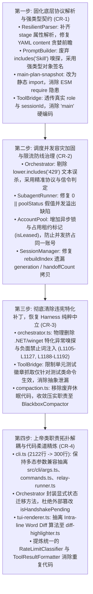

# 工作区深度审查综合决议报告与落地蓝图 (FINAL-AUDIT-REPORT)

- **目标工程**: `E:\copilot-web proxy\CPH-PI` (Copilot M365 x Pi Autonomous Coding Terminal)
- **审查模式**: Full Mode 全量深度审查 (覆盖全部 26 个核心源码模块，9,760 行，72 个测试套件，508 项单测)
- **审核轮次**: 4 维度初审矩阵 (Agent A1~A4) + 4 维度独立对抗复核矩阵 (Agent B1~B4)，共 8 组子代理完成闭环对抗审计
- **基线测试防护网**: **508 passed / 0 failed / 72 test files / 2235 assertions (100% 绿灯全通)**
- **综合裁决统计概览**:
  - 确认确凿真实缺陷与坏味道 `[CONFIRMED]`: **16 项** (高危致命级 5 项，架构与契约级 7 项，代码坏味道 4 项)
  - 判定违背项目治理宪章 `[VIOLATES-GOVERNANCE-RULE]`: **2 项** (orchestrator.ts 硬编码 .NET/winget 特化补丁；Harness 层拦截改写 Shell 建议)
  - 纠偏/核准既定设计 `[INTENDED-DESIGN]`: **5 项** (CopilotAction 非受信边界 DTO、Lineage 正则恢复兜底、Interrupt 繁忙保护、多代接力预算重置、多态 CLI 解析)
  - 识别设计与实现脱节 `[DRIFT-DESYNC]`: **4 项** (Stage 屏障漏采、命令 30s 硬编码超时、Compaction 废弃代码、CphPiCli 双重接力割裂)
  - 证伪初审误报与陈旧复读 `[FALSE-POSITIVE]`: **6 项** (成功反驳已修复的稀疏数组、空响应死循环、附件 0 阈值、负面词残留、Lineage 正则断言失真、DTO 联合类型)
- **绝对只读门禁声明**: 本次审计全周期遵循【绝对只读门禁】，未修改任何生产代码与测试代码。必须呈报用户批准后方可切入实施。

---

## 一、 系统级核心矛盾（跨维度交汇的高危缺陷）

```mermaid
flowchart TD
    subgraph Core1["核心矛盾 1: Stage 屏障属性解析丢失，多阶段任务并发抢跑 (P0 致命)"]
        Bug1["ResilientParser.parseSubagentsBlock: 完全遗漏 stage 属性解析提取"]
        Bug2["SubagentRunner: Math.max(1, t.stage ?? 1) 永远降级为 Stage 1"]
        Bug3["模型规划的串行 Stage 1 -> Stage 2 依赖被拉平，全部任务并发抢跑崩溃"]
        Bug1 --> Bug2 --> Bug3
    end

    subgraph Core2["核心矛盾 2: 429 文本粗暴匹配误杀与全限流假值并发溢出 (P0 致命)"]
        L1["Orchestrator.isRateLimitResponseText: 粗暴匹配 lower.includes('429')"]
        L2["模型探讨 'HTTP 429' 或输出包含 'Line 429' 时被 Harness 误杀自杀，误冻健康账号 3 分钟"]
        L3["SubagentRunner: 0 || poolStatus.length 假值求值错误，全池限流时反以满额并发冲击"]
        L4["AccountPool: await getAccessToken 异步间隙无锁，多个并发 worker 瞬间挤占同一账号"]
        L1 --> L2
        L3 --> L4
    end

    subgraph Core3["核心矛盾 3: Harness 治理宪章违背与特化补丁污染通用抽象 (P1 违宪)"]
        G1["orchestrator.ts#L1105-L1127: 硬编码特化 .NET/winget/0x80070005 异常嗅探"]
        G2["向交接快照中强行注入 '切勿盲目重复调用 winget' 负面禁止词"]
        G3["严重践踏准则 1 (Harness 中立)、准则 3 (正向引导) 与准则 6 (黑盒契约)，非 .NET 项目产生幻觉"]
        G1 --> G2 --> G3
    end

    subgraph Core4["核心矛盾 4: 字符串启发式嗅探颠倒事实与 ESM 动态 require 物理账本失联 (P1 契约)"]
        P1["PromptBuilder.buildTurn2TaskPrompt: 依赖 arg.includes('Skill') 模糊猜测重载位置"]
        P2["当工具输出包含 'Skill' (如读取技能代码或报错) 时，客观事实与技能文档发生灾难性反转"]
        P3["main-plan-snapshot.ts: ESM 模块动态调用 CommonJS require 在纯 Node 环境抛异常静默丢失账本挂载头"]
        P4["ToolBridge.recordToLedger: 硬编码 role: 'main' 抹杀多子代理与继任者审计证据链 (违背准则 7)"]
        P1 --> P2
        P3 --> P4
    end

    subgraph Core5["核心矛盾 5: 单体上帝类失控与状态机越界撕裂 (P2 架构)"]
        C1["cli.ts (2,122 行) 上帝单体承担 6 大职责，外部暴力篡改 orchestrator.isHandshakePending"]
        C2["orchestrator.ts (1,702 行) 核心 run() 方法 584 行，子任务就地重置 turn = 0 控制流异味"]
        C3["SessionManager 贫血模型导致 rebuildIndex 自愈重建时遗漏 generation 与 handoffCount 字段"]
        C1 --> C2 --> C3
    end
```

---

## 二、 修复依赖拓扑次序图 (Topological Execution Flow)

严格按照自底向上原则：**先修复协议解析与数据契约 ➔ 再固化调度并发与容灾防线 ➔ 继而清除违宪特化补丁 ➔ 最后完成上帝类模块解耦**：

---

## 三、 确凿问题分类明细与物理证据链

### 1. 协议解析与契约漏洞 (Doubt & Contract Breakage)

#### [Issue D-1] `ResilientParser.parseSubagentsBlock` 物理丢弃 `stage` 属性导致 Stage Barrier 屏障全盘失效
- **物理源码**: `src/protocol/resilient-parser.ts#L309-L347`
- **缺陷核查**: JSON 与 YAML 两个解析分支均未提取 `stage` 字段。下游 `subagent-runner.ts#L105` 的 `Math.max(1, Math.floor(t.stage ?? 1))` 永远得到 `undefined`，导致模型规划的串行多阶段任务（例如 Stage 1 调研 ➔ Stage 2 编码）在实战中全部被拉平为同一批并发抢跑。
- **单测盲区**: `tests/agent/subagent-stage-barrier.test.ts` 直接在内存中硬编码了 `tasks: SubagentTaskSpec[]`，绕过了解析器；而解析器单测未包含 `stage` 断言。

#### [Issue D-2] `PromptBuilder.buildTurn2TaskPrompt` 字符串嗅探倒置客观事实与技能文档
- **物理源码**: `src/protocol/prompt-builder.ts#L140-L164`
- **缺陷核查**: 代码使用 `arg2.includes("Skill") || arg2.includes("技能")` 暴力猜测参数顺序。当工具输出（如查看文件、代码搜索、单测报错日志）中包含单词 `"Skill"` 或 `"技能"` 时，`toolResult` 与 `skillsSection` 发生反向颠倒，导致模型在 Turn 2 收到的提示词严重错乱。

#### [Issue D-3] `ResilientParser` YAML 动作块 `content:` 贪婪正则吞噬元数据
- **物理源码**: `src/protocol/resilient-parser.ts#L208, L248-L265`
- **缺陷核查**: 正则 `([\s\S]*)$` 贪婪匹配到末尾。若 Copilot 模型在 `content:` 之后输出 `path:` 或其他元数据，后续同级键值全部被吞入文件正文，导致写入文件的代码受到物理污染。

#### [Issue D-4] `main-plan-snapshot.ts` ESM 模块动态调用 CommonJS `require` 导致物理账本挂载头静默丢失
- **物理源码**: `src/session/main-plan-snapshot.ts#L102-L108`
- **缺陷核查**: 在 `"type": "module"` 的工程中，直接调用 CommonJS `require` 在标准 Node.js 环境下抛出 `ReferenceError`，外层空 `catch {}` 静默吞没，导致后继主控会话丢失物理账本挂载指纹，直接违背《AGENTS.md》准则 7。

#### [Issue D-5] `ToolBridge.recordToLedger` 硬编码静态身份 `role: "main"`
- **物理源码**: `src/protocol/tool-bridge.ts#L485-L488`
- **缺陷核查**: 写入 ExecutionLedger 时硬编码 `role: "main", sessionId: "main"`。多子代理 (Coder / Researcher) 与多代继任者执行工具时真实调用方身份被抹除，破坏客观溯源证据链。

---

### 2. 调度并发、容灾与限流防线缺陷 (Concurrency & Resilience)

#### [Issue R-1] `Orchestrator.isRateLimitResponseText` 粗暴文本匹配导致正常技术推演被误杀
- **物理源码**: `src/agent/orchestrator.ts#L1397-L1411`
- **缺陷核查**: 仅豁免 `action` 与 `FINAL_ANSWER`，任何包含 `429`、`throttled` 或 `"Line 429"` 的普通技术分析文本均被误判为云端限流，强行中断会话并将健康账号关入 3 分钟禁闭，严重破坏 Harness 中立性。

#### [Issue R-2] `SubagentRunner` 账号容量计算中 `0 || poolStatus.length` 的假值并发溢出
- **物理源码**: `src/agent/subagent-runner.ts#L88`
- **缺陷核查**: 当所有账号均处于限流冷却期时（`activeAllowedAccounts.length === 0`），JavaScript 中 `0 || poolStatus.length` 错误回退为总池账号数，导致限流风暴期反以最大并发冲撞。

#### [Issue R-3] `AccountPool.getNextAvailableToken` 异步间隙无锁导致并发 worker 挤占同账号
- **物理源码**: `src/auth/account-pool.ts#L339-L346`
- **缺陷核查**: 在 `await this.manager.getAccessToken` 异步 I/O 挂起期间，第二个并发 worker 进入循环，此时 `this.currentIndex` 尚未更新且无租约占用标记，多个并发子任务必然获取完全相同的账号，冲击单账号连接上限。

#### [Issue R-4] `SessionManager.rebuildIndex` 自愈重建遗漏代际元数据
- **物理源码**: `src/session/session-manager.ts#L185-L199`
- **缺陷核查**: 扁平 DTO 缺乏封装，`saveSession` 保存了 `generation` 与 `handoffCount`，但在 `rebuildIndex` 索引重建中遗漏了这两个字段的拷贝，导致索引重建后会话代数丢失归零。

---

### 3. 治理宪章违背与特化补丁异味 (Charter Governance & Cleanliness)

#### [Issue G-1] `orchestrator.ts` 硬编码特化 .NET/winget 异常诊断与系统卡点建议
- **物理源码**: `src/agent/orchestrator.ts#L1105-L1127, L1188-L1192`
- **裁决**: **`[VIOLATES-GOVERNANCE-RULE]` (严重违宪)**
- **违宪事实**: 硬编码针对 `.NET SDK`、`winget`、`0x80070005` 的特化异常诊断，并在交接文档中强行注入“切勿盲目重复调用 winget”等负面禁止词。直接违反《AGENTS.md》准则 1（Harness 纯粹与中立原则）、准则 3（正向引导铁律，摒弃负面词）与准则 6（黑盒契约与操作者视角），在非 .NET 项目中诱发严重模型幻觉。必须无条件彻底物理删除。

#### [Issue G-2] `tool-bridge.ts` 通用工具桥接层无差别抓取测试状态徽章
- **物理源码**: `src/protocol/tool-bridge.ts#L479-L484`
- **缺陷核查**: 正则在底层通用 bash 工具层对所有命令输出无差别生效，任意含 `password`、`failover`、`compass` 的输出均会被误抓为测试徽章。应仅限测试命令生效。

#### [Issue G-3] `compaction.ts` 废弃滑动微压实属于休眠死代码
- **物理源码**: `src/agent/compaction.ts#L24-L134, orchestrator.ts#L815-L826`
- **缺陷核查**: 物理账本与事故黑匣子架构落地后，会话内破坏性滑动压实被默认禁用。两套压缩概念并存造成认知冗余，应清理收敛至 Blackbox。

---

### 4. 上帝类、代码坏味道与架构深度 (Refactoring & Architecture)

#### [Issue S-1] `src/cli.ts` (2,122 行) 上帝单体膨胀与外部篡改状态机
- **物理源码**: `src/cli.ts#L75-L2122`
- **缺陷核查**: 单体类持有 27 个实例字段，承担参数解析、Readline 输入、Slash 路由、配置落盘、状态卡渲染、多代接力编排等 6 大领域职责；且在 L446、L457 等处直接外部暴力赋值 `this.orchestrator.isHandshakePending = false`，破坏状态机封装。

#### [Issue S-2] `src/agent/orchestrator.ts` (1,702 行) 核心循环超载与子任务内部就地重置 `turn = 0`
- **物理源码**: `src/agent/orchestrator.ts#L425-L898`
- **缺陷核查**: 核心 `run()` 单体长达 584 行，嵌套了多代接力、网络流式、握手、压实等多层分支；深层子任务内部就地突变外层 `while` 的 `turn = 0`，隐式副作用增加心智负担。

#### [Issue S-3] `orchestrator.ts` 与 `subagent-runner.ts` 强双向循环依赖
- **物理源码**: `src/agent/orchestrator.ts#L24 vs src/agent/subagent-runner.ts#L4`
- **缺陷核查**: 两者相互静态导入并直接 `new` 对方具体类，构成强循环耦合，违背依赖倒置原则。

#### [Issue S-4] `tui-renderer.ts` 视图类混合 138 行 Intra-line Word Diff 算法
- **物理源码**: `src/ui/tui-renderer.ts#L157-L295`
- **缺陷核查**: 纯展示层内嵌复杂的词级 Diff 比较与高亮算法，内聚度失调，应剥离为独立模块。

#### [Issue S-5] 重复代码：ToolBridge 6 分支结果构造样板与 3 处散落的 429 正则
- **物理源码**: `src/protocol/tool-bridge.ts#L644-L826`, `src/auth/account-pool.ts`, `src/agent/orchestrator.ts`
- **缺陷核查**: ToolBridge 6 处分支复制相同样板；429 限流正则三处分散且各不相同，缺乏统一源头真理。

---

## 四、 预填 CHANGE-REQUEST 草案 (对接 change-protocol)

### CR-1: 固化底层协议解析、强类型契约与账本保真度
- **类型**: 🛠️ 契约与稳定性重构
- **目标**: 补齐 `ResilientParser` 的 `stage` 解析；重构 `PromptBuilder` 为强类型参数；消除 ESM 动态 `require`；`ToolBridge` 透传真实身份。
- **7 类制品双向冲击面评估**:
  | 制品类型 | ⬆️ 上游（生产方） | ⬇️ 下游（消费方） | 风险 | 缓解措施 |
  |---|---|---|---|---|
  | **函数/接口** | `ResilientParser.parseSubagentsBlock`, `PromptBuilder.buildTurn2TaskPrompt` | `SubagentRunner`, `Orchestrator` | 🟡 中 | 保持参数对象字段自适应，保留单测兼容签名 |
  | **数据/存储** | `SubagentTaskSpec.stage` | `StageBarrier` 阶段分组 | 🟢 低 | `stage` 缺省安全归为 1 |
  | **配置** | 无变更 | 无变更 | 🟢 低 | 无 |
  | **资源** | `main-plan-snapshot.ts` 静态加载 | 磁盘账本读取 | 🟢 低 | 消除动态 require 运行时隐患 |
  | **全局状态** | 无变更 | 无变更 | 🟢 低 | 无 |
  | **常量** | YAML 正则同级前瞻 | 动作块解析 | 🟢 低 | 增加同级关键字前瞻断言 |
  | **依赖** | `import { ExecutionLedger }` | 依赖图谱 | 🟢 低 | 静态 ESM 导入 |

### CR-2: 调度并发容灾加固、限流误杀拦截与无锁竞态防护
- **类型**: 🛡️ 容灾与并发健壮性加固
- **目标**: 消除 429 文本误杀；修复 0 假值并发溢出；为 AccountPool 增加租约锁；修复 SessionManager 索引重建。
- **7 类制品双向冲击面评估**:
  | 制品类型 | ⬆️ 上游（生产方） | ⬇️ 下游（消费方） | 风险 | 缓解措施 |
  |---|---|---|---|---|
  | **函数/接口** | `Orchestrator.isRateLimitResponseText`, `AccountPool.getNextAvailableToken` | `Orchestrator` 调度循环, `SubagentRunner` | 🟡 中 | 429 文本判断限定仅在纯异常状态码与固定信令触发 |
  | **全局状态** | `AccountPool.isLeased` 账号租约状态 | 所有获取 Token 的 worker | 🟡 中 | 保证在 `finally` 块中 100% 释放租约 |
  | **数据/存储** | `SessionManager.rebuildIndex` | `index.json` 索引文件 | 🟢 低 | 补齐 `generation` 与 `handoffCount` 拷贝 |

### CR-3: 彻底清除违宪特化补丁，恢复 Harness 纯粹中立
- **类型**: 🧹 治理宪章归正与死代码清理
- **目标**: 物理删除 `orchestrator.ts` 中的 .NET/winget 特化异常诊断；收敛死代码压实服务。
- **7 类制品双向冲击面评估**:
  | 制品类型 | ⬆️ 上游（生产方） | ⬇️ 下游（消费方） | 风险 | 缓解措施 |
  |---|---|---|---|---|
  | **函数/接口** | `Orchestrator.generateHandoffMarkdown` | 继任者会话 Prompt | 🟢 低 | 移除特化环境卡点生成，保持通用错误呈现 |
  | **常量/提示词**| 交接文档建议部分 | 下一代 Agent 认知 | 🟢 低 | 消除负面词，遵守《AGENTS.md》准则 1 与 3 |
  | **依赖** | 废弃 `src/agent/compaction.ts` | `orchestrator.ts` | 🟢 低 | 统一使用 `BlackboxCompactor` |

### CR-4: 上帝类职责拓扑解耦与代码柔道精炼
- **类型**: 🏗️ 架构拓扑重构
- **目标**: 解耦 `cli.ts` (2122行) 与 `orchestrator.ts` (1702行)；保持多态参数零破坏；抽离独立子模块。
- **7 类制品双向冲击面评估**:
  | 制品类型 | ⬆️ 上游（生产方） | ⬇️ 下游（消费方） | 风险 | 缓解措施 |
  |---|---|---|---|---|
  | **函数/接口** | `src/cli/args.ts`, `src/cli/commands.ts`, `src/cli/relay-runner.ts` | `cph-pi.bat/ps1`, 外部命令行调用 | 🟡 中 | 编写形式化参数单测，锁定 `-t` 多态语义 |
  | **全局状态** | `Orchestrator` 自治状态迁移方法 | `CphPiCli` | 🟢 低 | 消除外部暴力赋值，提供受控 API |

---

## 五、 已排除的误报与治理保护项 (Audit Trail)

为避免未来重复质疑与误判，以下项目已被复审矩阵 B 证伪并予以永久归档保护：

1. **`[FALSE-POSITIVE]` 稀疏数组并发崩溃 (A3 Issue 1)**：已在 2026-10-14 CR-1 彻底修复，具备密集初始化与非空守卫，单测锁死。
2. **`[FALSE-POSITIVE]` 空响应死循环 (A3 Issue 9)**：已在 2026-10-14 CR-2 修复为 `empty_response` 分流与指数退避，单测锁死。
3. **`[FALSE-POSITIVE]` 云端附件 0 阈值 (A3 Issue 10)**：已在 2026-10-14 CR-3 默认调优为 12,000 字符与 200 行并嵌入指纹，单测锁死。
4. **`[FALSE-POSITIVE]` 提示词负面词 (A3 Issue 12)**：已在 2026-10-14 CR-4 全量清洗完毕，单测 `prompt-builder-governance.test.ts` 绿灯通过。
5. **`[FALSE-POSITIVE]` LineageTracker 正则反解代数 (A4 Issue 7)**：A4 反例断言错误，源码正则含尾部 `$` 锚点，且作为跨进程恢复兜底属于合理防守设计。
6. **`[FALSE-POSITIVE]` CopilotAction 30+ 属性 (A1 Issue 13)**：初审误解了系统非受信边界 DTO 与内部领域模型的划分，边界必须宽容。
7. **`[VIOLATES-GOVERNANCE-RULE]` Harness 改写 Shell 命令 (A3 Issue 11)**：严禁在 Harness 替模型擦屁股，已在系统提示词正向认知塑形中闭环。
8. **`[INTENDED-DESIGN]` 否决使用 `util.parseArgs` (A4 Issue 1)**：原生库不支持 `-t` 多态与可选值参数，草率套用必破坏 CLI 兼容性。

---

## 六、 用户裁决入口 (Decision Gate)

根据【绝对只读门禁】，本次审计未修改任何生产代码。请人类用户审查上述拓扑执行流与 CR 草案并做出决策：

- [ ] **方案 A (推荐 - 全面治理与重构)**: 严格按拓扑次序图分阶段执行 **CR-1 ➔ CR-2 ➔ CR-3 ➔ CR-4**，彻底拔除 P0 缺陷与违宪特化补丁，完成千行巨石解耦。
- [ ] **方案 B (保守 - 核心缺陷止血)**: 仅执行 **CR-1** (协议契约) + **CR-2** (429/并发容灾) + **CR-3** (违宪补丁删除)，暂缓 CR-4 上帝类架构大重构。
- [ ] **方案 C (仅治理违宪补丁)**: 仅执行 **CR-3** 物理删除 `orchestrator.ts` 中违宪的 .NET/winget 异常诊断代码。

*(请在对话中输入您的选择，获得明确批准后方可切入实施)*
