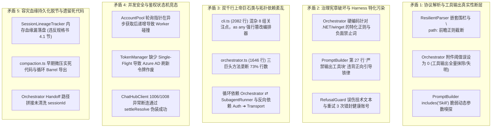
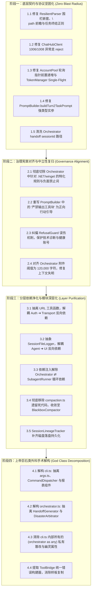

# 工作区深度审查综合决议报告与落地蓝图 (FINAL-AUDIT-REPORT)

- **审查对象**: `E:\copilot-web proxy\CPH-PI` (Copilot M365 x Pi Autonomous Coding Terminal)
- **审查轮次**: 4 维度初审 (Tasks 1~4) + 4 维度独立对抗复核 (Tasks 5~8)，共 8 组子代理矩阵闭环审计
- **基线测试状态**: 476 passed / 0 failed / 63 test files (100% 绿色通行)
- **结论概览**: 
  - 累计排查初始指控 43 项
  - 确认确凿真实缺陷 `[CONFIRMED]`: **27 项**
  - 纠偏/确认既定设计 `[INTENDED-DESIGN]`: **6 项**
  - 查实违反项目宪章 `[VIOLATES-GOVERNANCE-RULE]`: **2 项**
  - 查实设计与实现脱节 `[DRIFT-DESYNC]`: **5 项**
  - 证伪误报与事实幻觉 `[FALSE-POSITIVE]`: **3 项**
  - 提炼系统级核心矛盾: **5 大跨维度交汇高危瓶颈**

---

## 一、 系统级核心矛盾（跨维度交汇的高危缺陷）



### 1. 协议解析与工具上下文真实性断层 (Dim-2 ⇄ Dim-3 ⇄ Dim-4)
- **表现**: 
  - `ResilientParser` 采用非贪婪匹配 ````(?:action|json)?\s*([\s\S]*?)````，在生成含 Markdown 嵌套围栏的代码时提前闭合，导致写入静默丢失；局部编辑正则前瞻 `(?=\n(?:...|path)\s*:)` 遇到目标代码含有 `\npath:` 即提前截断，引发 Patch 必败；`trimmed.includes("ALL_TASKS_COMPLETED")` 模糊匹配导致技术性陈述被误解析为任务终结；
  - `Orchestrator` 附件阈值 `attachmentThreshold` 硬编码为 `0`，而设计规格书中明确规定为 `120,000` 字符。当前行为导致只要工具返回 >0 字符，真实内容就被全量转入 OneDrive 且在 Prompt 中被彻底清空，导致后续轮次模型严重“失明”；
  - `PromptBuilder.buildTurn2TaskPrompt` 依靠 `arg.includes("Skill")` 模糊推断参数角色，代码若含 "Skill" 字符会发生形参反向错位。

### 2. 治理宪章破坏与 Harness 特化污染 (Dim-3 ⇄ Dim-4)
- **表现**: 
  - `src/agent/orchestrator.ts#L1050-L1071` 与 `L1132-L1136` 硬编码针对 `.NET SDK`、`dotnet`、`winget`、`[System.IO.Path]` 的专用正则匹配与“切勿盲目重复调用 winget”等负面禁止词，严重违背 `AGENTS.md` 准则 1（Harness 纯粹中立，严禁替模型擦屁股）与准则 3（正向引导铁律，摒弃负面禁止词）；
  - `PromptBuilder.PROTOCOL_REMINDER` 第 27 行包含“严禁输出工具块”，正面触碰准则 3 红线；
  - `RefusalGuard` 采用粗暴正则匹配拒答，极易误伤技术分析与代码审计输出，且在 3 次重试失败后错误调用 `accountPool.markThrottled`，导致正常账号被永久错封。

### 3. 双千行上帝巨石类与分层依赖拓扑紊乱 (Dim-1 ⇄ Dim-3 ⇄ Dim-4)
- **表现**: 
  - `src/cli.ts` (2082 行) 严重超载，手写解析器、15 个命令巨大 if 链、多行 Readline、报表渲染、多代接力调度全部耦合；且存在 7 处通过 `(this.orchestrator as any)...` 强行篡改编排器私有状态和注入无效幽灵属性（`timeoutMs`）；
  - `src/agent/orchestrator.ts` (1646 行) 三巨头方法（`run` 558行、`generateHandoffSnapshot` 362行、`executeDisasterRecoveryArbitration` 285行）垄断 73% 代码，在循环内部篡改 `turn = 0` 破坏轮次单调性；
  - 依赖拓扑存在 2 处闭环与 2 处反向依赖：`Orchestrator` ⇄ `SubagentRunner` 双向实例化闭环；`AccountPool` ➔ `ChatHubClient`（认证层反向依赖传输层）；`SubagentRunner` ➔ `TerminalLogger`（核心调度反向依赖 UI 渲染层）。

### 4. 并发安全与鉴权状态机竞态 (Dim-2)
- **表现**: 
  - `AccountPool.getAvailableAccount` 轮询指针在异步获取 AccessToken 成功后才推进，并发 Worker 启动时必抢占同一账号发生冲突；
  - `TokenManager` 缺少 In-flight Promise 去重，并发刷新同一账号必然触发 Azure AD Refresh Token Rotation 作废机制，致第二路遭遇 `invalid_grant`；
  - `ChatHubClient` 在异常断连（WebSocket 1006 / 1008）时，若已发送 Chat 帧，依然调用 `settleResolve({ text: "" })`，向上游伪装成成功交付空文本，导致容灾管道完全失效，误诊为 `invalid_chatter`。

### 5. 容灾血缘持久化脱节与遗留死代码 (Dim-2 ⇄ Dim-3 ⇄ Dim-4)
- **表现**: 
  - `SessionLineageTracker` 完全基于内存 Map 记录三代理血缘，未实现设计规格书（`2026-10-12-tri-agent-handoff-and-lineage-architecture-design.md` 4.1节）明确要求的磁盘持久化，进程中断即血缘断绝；
  - `compaction.ts` (140行) 早期会话内滑动微压实在确立容灾黑匣子后已被硬编码禁用，成为死代码与循环导出污染源；
  - `Orchestrator` 生成 Handoff 文件名时未清洗外部 `sessionId`，存在跨目录写文件的路径逃逸隐患。

---

## 二、 修复依赖拓扑次序图 (Topological Execution Flow)

为确保重构不引发级联崩溃并持续保持 476 个自动化测试绿灯通行，必须严格遵循以下单向拓扑顺序推进：



---

## 三、 预填 CHANGE-REQUEST 草案 (对接 change-protocol)

### CR-01: 坚固化 ResilientParser 与协议上下文真实性
- **变更类型**: 🛠️ 契约与解析层缺陷修复
- **关联缺陷**: 矛盾 1 (Items A2-1, A2-2, A2-4, A2-8, A1-5, A4-5)
- **修改文件**: 
  - `src/protocol/resilient-parser.ts`
  - `src/protocol/prompt-builder.ts`
  - `src/agent/orchestrator.ts`
- **原始逻辑**:
  1. 正则 ````(?:action|json)?\s*([\s\S]*?)```` 遇嵌套代码块提前闭合；
  2. 编辑操作前瞻断言 `(?=\n(?:...|path)\s*:)` 遇 `\npath:` 提前截断；
  3. `buildTurn2TaskPrompt` 靠 `includes("Skill")` 动态反推参数；
  4. `attachmentThreshold` 硬编码为 `0`。
- **重构逻辑**:
  1. 改用基于平衡标记计数或贪婪围栏匹配，并校验代码围栏配对闭合；
  2. 编辑工具精准锚定到 YAML 顶层字段边界，消除局部属性误切；
  3. `buildTurn2TaskPrompt` 升级为显式对象入参 `{ taskPrompt: string; skillName?: string }`；
  4. `attachmentThreshold` 恢复为规范规定的 `120000` 字符阈值。
- **7 类制品双向冲击面评估**:
  | 制品类型 | ⬆️ 上游（生产方） | ⬇️ 下游（消费方） | 风险等级 |
  |---|---|---|---|
  | 函数/接口 | `PromptBuilder.buildTurn2TaskPrompt` 改用配置对象 | `cli.ts` 与 `subagent-runner.ts` 调用点同步改用命名参数 | 🟢 低 (TypeScript 编译保障) |
  | 配置/常量 | `attachmentThreshold` 设为 120,000 | 大文本输出不再全量上云，直接流入 Prompt 上下文 | 🟢 低 (与 Sydney 模型窗口匹配) |
  | 数据/存储 | 提取的代码与 Patch 参数 | 目标文件内容无损写入，杜绝截断丢代码 | 🟢 低 |

---

### CR-02: 落实 AGENTS.md 宪章治理：切除 Harness 特化与负面词
- **变更类型**: ⚖️ 架构中立性与治理宪章对齐
- **关联缺陷**: 矛盾 2 (Items A4-1, B4-1, A3-8, B3-8, A2-9, B2-9)
- **修改文件**:
  - `src/agent/orchestrator.ts`
  - `src/protocol/prompt-builder.ts`
  - `src/agent/refusal-guard.ts`
- **原始逻辑**:
  1. `orchestrator.ts` 硬编码针对 `.NET SDK/dotnet/winget` 的特化正则及“切勿盲目重复调用 winget”等负面禁止词；
  2. `PromptBuilder.PROTOCOL_REMINDER` 包含“严禁输出工具块”；
  3. `RefusalGuard` 强行拦截技术分析并错封账号。
- **重构逻辑**:
  1. 彻底删除 `orchestrator.ts` 中针对特定命令/环境的硬编码 if 判断与报错拼接，让 Harness 保持纯粹与调度中立；
  2. 将系统提示词中所有“严禁……”、“切勿……”全面重写为建设性的正向行动指引（例如将“严禁输出工具块”改写为“请直接给出总结说明与后续方案，工具调用由系统自动解析”）；
  3. 优化 `RefusalGuard` 判定逻辑，避免代码审计与安全分析报告触发限流错封。
- **7 类制品双向冲击面评估**:
  | 制品类型 | ⬆️ 上游（生产方） | ⬇️ 下游（消费方） | 风险等级 |
  |---|---|---|---|
  | 共享常量 | 系统提示词协议常量变更 | Copilot 大模型注意力更集中，消除粉色大象效应 | 🟢 低 (正向改进) |
  | 全局状态 | `AccountPool.markThrottled` | 不再被误调，避免健康账号被误冻结 | 🟢 低 |

---

### CR-03: 认证池并发安全与传输网络异常透传
- **变更类型**: 🔒 并发竞态与传输健壮性修复
- **关联缺陷**: 矛盾 4 (Items A2-3, A2-5, A2-6)
- **修改文件**:
  - `src/auth/account-pool.ts`
  - `src/auth/token-manager.ts`
  - `src/transport/chathub-client.ts`
- **原始逻辑**:
  1. `AccountPool` 轮询指针在获取 Token 成功后才递增；
  2. `TokenManager` 刷新 Token 无并发合并；
  3. `ChatHubClient` 在 1006/1008 异常关闭时通过 `settleResolve({ text: "" })` 吞掉错误。
- **重构逻辑**:
  1. `AccountPool` 在进入异步 Token 获取前原子递增指针；
  2. `TokenManager` 引入 `refreshPromises: Map<string, Promise<string>>` 实现 Single-Flight 并发去重；
  3. `ChatHubClient` 在异常关闭且未正常结束流时，直接调用 `settleReject(new Error(...))`，让编排层正常触发故障转移与账号轮换。
- **7 类制品双向冲击面评估**:
  | 制品类型 | ⬆️ 上游（生产方） | ⬇️ 下游（消费方） | 风险等级 |
  |---|---|---|---|
  | 函数/接口 | `TokenManager.getAccessToken` 保持签名 | 并发调用共享同一 Promise，保护 Refresh Token 轮转安全 | 🟢 低 |
  | 全局状态 | 账号轮换指针与活跃 Promise 集合 | 并发子代理平滑调度，无同账号碰撞 | 🟢 低 |
  | 依赖/库 | SignalR WebSocket 断开处理 | 编排器能准确捕获 1006 异常并触发容灾接力 | 🟡 中 (需保持单测全绿) |

---

### CR-04: 分层净化、解除循环依赖与补齐血缘持久化
- **变更类型**: 🏛️ 分层架构治理
- **关联缺陷**: 矛盾 3 & 5 (Items A3-1, A3-3, A3-4, A3-6, A3-7, A4-4, B3-3)
- **修改文件**:
  - `src/auth/account-pool.ts`
  - `src/transport/chathub-client.ts`
  - `src/agent/subagent-runner.ts`
  - `src/agent/orchestrator.ts`
  - `src/agent/compaction.ts` (删除)
  - `src/agent/blackbox-compactor.ts`
  - `src/session/lineage-tracker.ts`
  - `src/session/session-manager.ts`
- **重构逻辑**:
  1. 将 `normalizeAgentId` 移入独立的 `src/utils/url-utils.ts`，断开 `auth` ➔ `transport` 反向依赖；
  2. 将会话日志输出下沉至 Session 领域层，断开 `agent` ➔ `ui` 反向依赖；
  3. 通过接口抽象与构造注入，解除 `Orchestrator` 与 `SubagentRunner` 循环依赖；
  4. 清理 `compaction.ts`，将 `TurnRecord` 统合至 `blackbox-compactor.ts`，消除循环 Barrel；
  5. 在 `SessionManager` 中为 `SessionRecord` 增加 `lineage` 字段，实现树状血缘断电持久化。
- **7 类制品双向冲击面评估**:
  | 制品类型 | ⬆️ 上游（生产方） | ⬇️ 下游（消费方） | 风险等级 |
  |---|---|---|---|
  | 数据/存储 | `SessionManager.saveSession` | `index.json` 包含血缘数据，重启后可持续追踪 | 🟢 低 (向上兼容) |
  | 模块依赖 | 依赖关系单向流动 | 彻底消除 ESM 运行时循环引用隐患 | 🟢 低 |

---

### CR-05: 外科手术式解构双千行上帝巨石类
- **变更类型**: ✂️ 深度代码重构 (Code Judo)
- **关联缺陷**: 矛盾 3 (Items A1-1, A1-2, A1-4, A4-2, A4-3, A4-8, B1-1, B1-2, B4-2, B4-3)
- **修改文件**:
  - `src/cli.ts` (从 2082 行瘦身至 400 行以内)
  - `src/agent/orchestrator.ts` (从 1646 行瘦身至 600 行以内)
  - 新增/抽离模块：
    - `src/cli/args.ts` (声明式 CLI 参数解析)
    - `src/cli/commands/` (Slash 命令注册表与分发器)
    - `src/agent/handoff-generator.ts` (独立快照生成器)
    - `src/agent/disaster-arbitrator.ts` (独立容灾仲裁器)
- **重构逻辑**:
  1. 将 `cli.ts` 中的 15 组命令 if 链拆解为标准 Command 模式；
  2. 将 `orchestrator.ts` 中的三巨头方法抽离为独立服务，消灭对私有状态的 `as any` 篡改；
  3. 修复 `turn = 0` 破坏时序单调性问题，轮次保持全局单调递增。
- **7 类制品双向冲击面评估**:
  | 制品类型 | ⬆️ 上游（生产方） | ⬇️ 下游（消费方） | 风险等级 |
  |---|---|---|---|
  | 函数/接口 | `CphPiCli` 与 `CopilotOrchestrator` 保持公开 API | 外部 `cph-pi.ts` 启动脚本零改动 | 🟢 低 |
  | 全局状态 | 单调轮次计数器 | 压实摘要不再出现 `Turns 4 ~ 2` 倒置 | 🟢 低 |

---

## 四、 已排除的误报与既定设计保护项 (Audit Trail)

为避免未来重复审计产生误判，以下项目经对抗辩护已被证实为合理设计或误报，严禁进行破坏性修改：

| 编号 | 审查项 | 初审定性 | 终审裁决 | 对抗辩护核心依据与保护结论 |
|---|---|---|---|---|
| 1 | `IOrchestratorChatClient` Seam | 伪 Seam / 抽象泄漏 | `[INTENDED-DESIGN]` | **离线测试生命线**。全库 30+ 自动化单测依赖该接口进行 mock。若删除此 Seam，单测必须连真实微软接口，测试基建直接崩溃。予以坚决保护保留。 |
| 2 | 主控与子代理接力循环 | 逻辑克隆 / 霰弹修改 | `[INTENDED-DESIGN]` | **初审存在事实幻觉**（`cli.ts` 中根本没有 `lineageTracker`）。前台交互 REPL 宿主与后台批量代理工作流属于正交领域模型，强行抽取抽象违背高内聚原则。 |
| 3 | `TurnRecord` 与 `SessionTurnRecord` 双轨制 | 数据泥团 / 契约重复 | `[INTENDED-DESIGN]` | 内存紧凑运算模型与磁盘 JSON 存储模型的分层解耦完全合理，只需在 `SessionManager` 内部封装转换胶水即可。 |
| 4 | `InterruptController` 繁忙期双击退出 | 竞态条件 / 信号丢失 | `[INTENDED-DESIGN]` | **实测与既定设计完全吻合**。繁忙时连按仅取消当前操作，空闲时双击才退出进程，系防用户误杀当前长会话的防御性设计。 |
| 5 | `SessionManager` 并发落盘非原子写 | 数据破坏风险 | `[FALSE-POSITIVE]` | **单线程事实证伪**。`saveSession` 全程纯同步（无 await），在 Node/Bun 单线程机制下不可能发生交错竞态；476 项测试全绿，且已有 `rebuildIndex` 磁盘兜底。 |
| 6 | `invoke_subagent` 未下沉 ToolBridge | 架构分层混杂 | `[INTENDED-DESIGN]` | `invoke_subagent` 属于包含主会话虚拟化快照与重定向的元控制流跃迁，由编排器直管属于合理的既定设计。 |
| 7 | A3 声称编排器持有网络违反 Rule 6 | 违背项目宪章 | `[FALSE-POSITIVE]` | **准则误读纠偏**。`AGENTS.md` 准则 6 严格限定在“Agent 系统提示词与 Skill 中严禁向模型解释底层机制”，属于面向大模型防污染的提示词契约，不可用于批判 Harness 内部 TypeScript 源码。 |

---

## 五、 用户裁决入口 (Hard Read-Only Gate)

> [!CAUTION]
> **绝对只读门禁约束中**：当前所有审查产物均已落盘，**生产代码未做任何修改**。
> 请用户检阅并选择执行方案。只有在用户明确给出指令后，方可切入实施代码变更。

- [ ] **方案 A (全量工业级重构，强烈推荐)**：严格按照拓扑次序执行 `CR-01` ➔ `CR-02` ➔ `CR-03` ➔ `CR-04` ➔ `CR-05`，一次性根治协议截断、治理违规、并发碰撞与千行大文件异味，重构后全量跑通 476+ 自动化测试。
- [ ] **方案 B (最小破坏性修复)**：仅执行 `CR-01` (协议与解析截断修复)、`CR-02` (治理宪章违规切除) 与 `CR-03` (并发与网络健壮性)，暂缓 `CR-04` 和 `CR-05` 的千行大文件架构解构。
- [ ] **方案 C (仅治理合规修复)**：仅执行 `CR-02`，切除 `Orchestrator` 与提示词中的违规负面禁止词和业务特化规则，其余逻辑保持现状。
- [ ] **方案 D (保持现状)**：不修改任何代码，仅将本审计报告归档备查。

