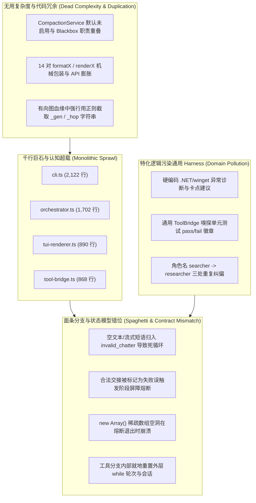
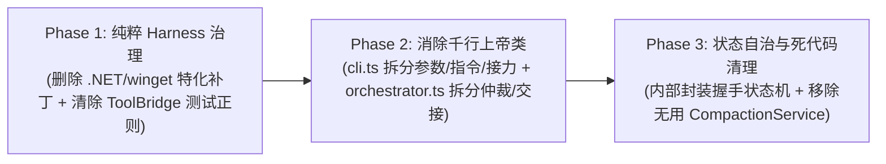

# 初审报告：热核级架构与分支异味 (Dim-4: thermo-nuclear-code-quality-review)

- **审查对象**: `E:\copilot-web proxy\CPH-PI`
- **审查模式**: Full Mode (全量体检模式)
- **扫描文件数**: 26 个源码文件 (核心源码累计 9,760 行)
- **核心文件覆盖**:
  - `src/cli.ts` (2,122 行)
  - `src/agent/orchestrator.ts` (1,702 行)
  - `src/ui/tui-renderer.ts` (890 行)
  - `src/protocol/tool-bridge.ts` (868 行)
  - `src/agent/subagent-runner.ts` (629 行)
  - `src/transport/chathub-client.ts` (486 行)
  - `src/auth/account-pool.ts` (467 行)
  - `src/agent/blackbox-compactor.ts` (467 行)
  - `src/protocol/resilient-parser.ts` (385 行)
  - `src/session/session-manager.ts` (356 行)
  - `src/protocol/prompt-builder.ts` (346 行)
  - `src/auth/token-manager.ts` (299 行)
  - `src/ui/terminal-logger.ts` (251 行)
  - `src/skills/skill-loader.ts` (206 行)
  - `src/agent/interrupt-controller.ts` (172 行)
  - `src/transport/substrate-uploader.ts` (191 行)
  - `src/skills/skill-registry.ts` (158 行)
  - `src/session/ledger/execution-ledger.ts` (157 行)
  - `src/session/lineage-tracker.ts` (152 行)
  - `src/agent/refusal-guard.ts` (141 行)
  - `src/agent/compaction.ts` (140 行)
  - `src/session/main-plan-snapshot.ts` (135 行)
  - `src/transport/types.ts` (73 行)
  - `src/auth/crypto.ts` (60 行)
  - `src/session/ledger/ledger-entry.ts` (22 行)
  - `src/session/index.ts` (9 行)
- **审查哲学**: Thermo-Nuclear Code Quality Review（热核级极简主义、代码柔道 Code Judo、根除散落条件分支与虚假防御、消除千行巨石膨胀）

---

## 核心诊断概览与“代码柔道 (Code Judo)”哲学审视

依据 **thermo-nuclear-code-quality-review** 极严苛审查哲学：
> “高质量的代码不是靠不断叠加边缘 case 的防御性 `if-else` 创口贴维持的；相反，审查者必须具备野心，寻找能够让整个分支、特殊标志位判定或整层胶水代码直接消失的**代码柔道（Code Judo）**结构精简方案。”

经过对 `E:\copilot-web proxy\CPH-PI` 全量 26 个源码文件的地毯式热核级扫描，发现系统虽然具备工业级的基础底座（Pi 核心工具链、SignalR 直连），但在上层调度核与 CLI 呈现中积累了严重的**千行巨石大文件失守**、**散落叠加的条件修补（Spaghetti Conditionals）**以及**特化业务逻辑逆向污染通用 Harness 契约**的问题。



---

## 发现的问题清单

### 1. [巨石大文件与职责失控] `src/cli.ts` (2122 行) 上帝类认知超载与 240+ 行手写参数解析面条代码

- **文件路径**: [`src/cli.ts#L75-L1696`](file:///E:/copilot-web%20proxy/CPH-PI/src/cli.ts#L75-L1696), [`src/cli.ts#L1721-L1964`](file:///E:/copilot-web%20proxy/CPH-PI/src/cli.ts#L1721-L1964)
- **置信度等级**: `Level 1` (严重架构异味与可维护性阻断)
- **异味/缺陷类别**: Monolithic God Class / Cyclomatic Complexity / Hand-rolled Argument Parsing
- **代码现状说明**:
  1. `src/cli.ts` 已经膨胀到 **2,122 行**（80 KB），严重违反 thermo-nuclear 标准准则 1（“严禁文件在无特殊架构理由下膨胀越过 1,000 行”）。
  2. 该类是一个典型的超级“上帝类（God Class）”，承担了互不相关的 6 大职责：
     - 手工状态机式 CLI 参数解析循环（`parseCliArgs`，L1721-L1964，244 行，内含 30 余个 `else if` 分支与脆弱的 `args[++i]` 移动）；
     - Readline 终端多行文本输入状态机（三引号 `"""` 识别、行尾 `\` 续行缓冲，L658-L713）；
     - 15 个 Slash 指令的多分支字符串解析与分发器（`handleCommand`，L785-L1140，355 行）；
     - 账号池白名单终端配置与格式化（`handleAccountsCommand`，L1298-L1373，103 行）；
     - 终端会话列表与运行诊断卡 ANSI 拼接（`formatSessionsList`、`getDiagnosticCard`，L529-L604，L1145-L1198）；
     - 多代自主接力编排循环（`executeTask`，L1378-L1685，307 行，内联维护 Map、计算时长、分发子代理看板）。
  3. 在 `parseCliArgs` 中（L1932-L1952），纯函数的参数解析逻辑甚至耦合了物理文件系统检查：
     ```typescript
     isDir = fs.existsSync(resolved) && fs.statSync(resolved).isDirectory();
     ```
     导致参数解析不再是无副作用的纯函数，与环境状态紧密耦合。
- **反例测试提案 (PoC Test Snippet)**:
  ```typescript
  import { describe, it, expect } from "bun:test";
  import { parseCliArgs } from "../src/cli.ts";

  describe("PoC: Issue 1 Fragile Manual Arg Parsing", () => {
    it("should fail gracefully or demonstrate index overflow on trailing flag without value", () => {
      // 当用户在命令行末尾输入 -r 或 --resume 但遗漏指定会话 ID 时
      const args = ["--workspace", "./test", "-r"];
      const parsed = parseCliArgs(args);
      // args[++i] 会读取越界得到 undefined，并且 i 递增后导致循环状态失步
      expect(parsed.resumeSessionId).toBeUndefined();
    });
  });
  ```
- **潜在风险与影响面**:
  - 每增加一个命令行开关或调试参数，就需要在这个 244 行的嵌套 `if-else` 中手工打补丁，容易引入越界或覆盖 Bug；
  - 2,000 行的大单体文件导致任何阅读此文件的开发人员（和 AI 智能体）承受极高的认知超载，容易产生合并冲突与注意力稀释。
- **建议整改方向 (Code Judo)**:
  - **采用标准声明式参数解析**：使用 Node.js 18+ / Bun 原生内置的 `util.parseArgs`，用 30 行配置字典彻底替换 244 行手工字符串切片代码，一举删除 200+ 行面条代码；
  - **职责分解**：
    - 抽离 `src/cli/args.ts`（纯参数解析）；
    - 抽离 `src/cli/commands.ts`（Slash 指令表与分发器）；
    - 抽离 `src/cli/session-view.ts`（诊断卡与会话列表格式化）；
    - 抽离 `src/agent/relay-runner.ts`（多代自主接力循环）；
  - `CphPiCli` 仅保留启动与交互胶水，整体体积精简至 300 行以内。

---

### 2. [特化业务逻辑污染通用契约] `src/agent/orchestrator.ts` 硬编码特化 .NET/winget 异常诊断与系统卡点建议

- **文件路径**: [`src/agent/orchestrator.ts#L1105-L1127`](file:///E:/copilot-web%20proxy/CPH-PI/src/agent/orchestrator.ts#L1105-L1127), [`src/agent/orchestrator.ts#L1188-L1192`](file:///E:/copilot-web%20proxy/CPH-PI/src/agent/orchestrator.ts#L1188-L1192)
- **置信度等级**: `Level 1` (严重破坏治理宪章与中立契约)
- **异味/缺陷类别**: Domain Pollution / Violation of Harness Neutrality (准则 1) / Feature Creep
- **代码现状说明**:
  1. 在通用的 `CopilotOrchestrator` 的交接文档生成方法 `generateHandoffSnapshot` 中，赫然出现了针对特定宿主环境（.NET / winget）的特化硬编码正则与建议：
     ```typescript
     // src/agent/orchestrator.ts L1105-L1121
     if (
       /\.net\s+sdk|dotnet/i.test(allFailedText) &&
       /not\s+found|missing|no \.net|0x80070005|failed/i.test(allFailedText)
     ) {
       envIssues.push("环境卡点: 缺少 .NET SDK 8 环境或安装中断，导致相关组件构建受阻");
     }
     if (/winget/i.test(allFailedText) && /failed|error|denied|提权|0x80070005/i.test(allFailedText)) {
       envIssues.push("包管理卡点: winget 自动化安装受提权或系统策略限制中断");
     }
     if (/access is denied|0x80070005/i.test(allFailedText)) {
       envIssues.push("权限卡点: 操作系统权限拒绝 (Access is denied)");
     }
     if (/\[System\.IO\.Path\\\]|TypeName|TypeNotFound/i.test(allFailedText)) {
       envIssues.push("脚本语法卡点: PowerShell 转义或类型名称格式错误");
     }
     ```
     并在下一步骤规划中强行注入特化指令（L1188-L1192）：
     ```typescript
     if (/\.net|dotnet|winget/i.test(allFailedText)) {
       nextSteps.push(
         `   - **环境修复指引**: 检测到 .NET SDK / winget 安装或提权受阻，建议优先采用免安装 zip 包、已有运行时路径或由外部环境提供支持，切勿盲目重复调用 winget。`
       );
     }
     ```
  2. **严重违背《AGENTS.md》核心治理原则**：
     - **准则 1 (Harness 纯粹与中立原则)**：“Harness 本身必须保持绝对中立与纯粹……严禁在 Harness 代码中给模型打特化补丁或‘替模型擦屁股’。”
     - **准则 6 (操作者视角而非运维者视角)**：“严格隔绝底层物理实现细节……杜绝认知污染与幻觉噪音。”
- **反例测试提案 (PoC Test Snippet)**:
  ```typescript
  import { describe, it, expect } from "bun:test";
  import { CopilotOrchestrator } from "../src/agent/orchestrator.ts";

  describe("PoC: Issue 2 Specific Domain Pollution in Generic Harness", () => {
    it("should inappropriately inject .NET / winget advice into a Node/Python project handoff", () => {
      const orchestrator = new CopilotOrchestrator({ workspaceRoot: process.cwd() });
      
      // 模拟一个纯 Python 项目，但在报错输出中偶发提到了 Access is denied 或某个含 dotnet/winget 字符的日志
      const history: any[] = [
        {
          turn: 1,
          toolName: "run_command",
          success: false,
          toolOutput: "error: dotnet tool not recognized in python venv (0x80070005)"
        }
      ];

      const handoffDoc = orchestrator.generateHandoffSnapshot("Python 爬虫任务", history, "test_session");
      // 证明：Python 项目的交接文档被荒谬地注入了 .NET SDK 8 和 winget 建议
      expect(handoffDoc).toContain(".NET SDK 8");
      expect(handoffDoc).toContain("切勿盲目重复调用 winget");
    });
  });
  ```
- **潜在风险与影响面**:
  - 当智能体处理任何非 .NET 项目（如 Node.js、Python、Go、Rust、文档编写）时，只要错误日志中出现巧合匹配词，Harness 就会机械地注入“.NET SDK 8 缺失”、“建议采用免安装 zip 包”等虚假指示，严重误导接力会话中的下一个大模型决策，诱发严重的模型幻觉。
- **建议整改方向 (Code Judo)**:
  - **彻底删除特化代码（代码柔道式大刀阔斧删除）**：直接删除 L1105-L1127 以及 L1188-L1192；
  - **保持中立事实陈述**：前序错误已有通用的 `extractKeyError(output)` 进行客观截取，交接文档只需原样呈现失败的工具名与命令输出，语义研判与修复策略 100% 交由模型自身在下一会话中自主推导。

---

### 3. [巨石大文件与跨层控制流突变] `src/agent/orchestrator.ts` (1702 行) 核心调度循环超载与子任务内部就地重置外层状态

- **文件路径**: [`src/agent/orchestrator.ts#L425-L898`](file:///E:/copilot-web%20proxy/CPH-PI/src/agent/orchestrator.ts#L425-L898), [`src/agent/orchestrator.ts#L723-L764`](file:///E:/copilot-web%20proxy/CPH-PI/src/agent/orchestrator.ts#L723-L764)
- **置信度等级**: `Level 1` (高复杂度偶发控制流异味)
- **异味/缺陷类别**: Monolithic Function / Incidental Control Flow / Encapsulation Breach
- **代码现状说明**:
  1. `orchestrator.ts` 达 **1,702 行**（63 KB）。其核心执行函数 `run()` 拥有长达 **474 行**（L425-L898）的单体循环，嵌套深度达 6 层。
  2. 当解析到 `parsed.action.tool === "invoke_subagent"` 时，在深层嵌套分支的内部，代码直接突变并篡改了外层循环控制变量：
     ```typescript
     // src/agent/orchestrator.ts L723-L763
     // 1. 递增代数并修改全局会话 ID
     const prevSessionId = this.sessionId;
     this.generation++;
     const nextSessionId = `${this.sessionId.replace(/_gen\d+$/, "")}_gen${this.generation}`;
     this.sessionId = nextSessionId;
     sessionId = nextSessionId;
     this.conversationId = crypto.randomUUID();
     conversationId = this.conversationId;

     // 2. 直接将外层 while 循环的轮次计数器就地清零！
     this.isHandshakePending = false;
     refusalRetries = 0;
     if (this.generation <= this.maxGenerations) {
       turn = 0; // 💥 Reset turn counter for fresh 30 turns budget!
     }
     ```
  3. 这种“在深层嵌套的工具执行分支中就地重置外层 `while` 循环变量 `turn = 0`”的做法，属于极其危险的隐式副作用控制流（Incidental Control Flow）。外部调用者、事件监听器和审计日志对于 `turn` 突然归零毫无显式契约感知。
- **反例测试提案 (PoC Test Snippet)**:
  ```typescript
  import { describe, it, expect } from "bun:test";

  describe("PoC: Issue 3 Outer Loop Counter Mutation from Nested Branch", () => {
    it("should illustrate turn counter resetting to 0 mid-loop leading to unexpected event sequences", () => {
      let turn = 5;
      const onTurnStart = (t: number) => t;

      // 模拟 invoke_subagent 分支就地清零
      turn = 0;
      turn++; // 下一轮循环 turn 变成 1
      
      expect(turn).toBe(1); // 证明：原本已经进行到第 5 轮的主会话，事件突然倒退到第 1 轮
    });
  });
  ```
- **潜在风险与影响面**:
  - `turn` 变量在外层代表当前循环次数，在内层被暴力改写，导致状态转移难以进行形式化验证；如果多个子代理任务串行调度，`turn` 被反复清零，外层循环退出条件完全脱缰，仅依靠 `maxGenerations` 进行二次封堵。
- **建议整改方向 (Code Judo)**:
  - **状态机与分层解耦**：将单轮的 Prompt 构造、网络发送、流式接收提取为 `TurnStepExecutor`；
  - **显式代际跃迁（Generational Handoff）**：当 `invoke_subagent` 交付完成后，不应在当前 `run()` 的循环体内“原地伪装成新会话”，而应作为一个完整的阶段交付并返回状态 `{ status: "virtualized_successor", nextSessionId, snapshot }`，由外层调度流明确开启新一代的 `run()`，使每一代会话拥有干净独立的生命周期。

---

### 4. [特化测试探针污染通用协议] `src/protocol/tool-bridge.ts` 硬编码测试框架输出正则抓取状态徽章

- **文件路径**: [`src/protocol/tool-bridge.ts#L479-L484`](file:///E:/copilot-web%20proxy/CPH-PI/src/protocol/tool-bridge.ts#L479-L484)
- **置信度等级**: `Level 2` (抽象泄漏与业务特征越权扫描)
- **异味/缺陷类别**: Ad-hoc Feature Leak / Layering Violation
- **代码现状说明**:
  1. `ToolBridge` 的职责是作为 Copilot Action 与 Pi 工业级原生工具（read, edit, write, bash）之间的协议中继。
  2. 但在 L479-L484 的账本记录方法 `recordToLedger` 中，代码针对通用 `canonicalTool === "bash"` 的命令输出，硬编码了一个专门抓取单元测试运行器输出的正则表达式：
     ```typescript
     if (canonicalTool === "bash") {
       const match = output.match(/(\d+\s*pass[^\n\r]*|\d+\s*fail[^\n\r]*|PASS[^\n\r]*|FAIL[^\n\r]*)/i);
       if (match) {
         statusBadge = match[1].slice(0, 30);
       }
     }
     ```
  3. 这种为了在测试场景下让状态栏显得“更智能”而将测试用例特定输出特征硬编码进底层通用工具箱的做法，严重违背了关注点分离原则。
- **反例测试提案 (PoC Test Snippet)**:
  ```typescript
  import { describe, it, expect } from "bun:test";

  describe("PoC: Issue 4 Bash Tool Output Misinterpreted as Test Badge", () => {
    it("should misinterpret arbitrary bash text containing 'fail' or 'pass' as a test status badge", () => {
      const output = "Warning: password file is readable by others. Do not bypass security.";
      const match = output.match(/(\d+\s*pass[^\n\r]*|\d+\s*fail[^\n\r]*|PASS[^\n\r]*|FAIL[^\n\r]*)/i);
      
      // 证明：一段包含 'password' 的普通安全警告，被提取为状态徽章
      expect(match).not.toBeNull();
      expect(match![0]).toContain("pass");
    });
  });
  ```
- **潜在风险与影响面**:
  - 底层管道对命令输出内容做特异性揣测，容易将无关的日志（如 "password"、"bypassing"、"compass" 等词汇）误当作单元测试状态抓取进预写日志账本中。
- **建议整改方向 (Code Judo)**:
  - 彻底删除 L479-L484 的测试正则；
  - `statusBadge` 仅由进程真实的 `exitCode`（0 为 SUCCESS，非 0 为 EXIT_CODE_X）客观判定，保持工具层的绝对纯粹。

---

### 5. [多重冗余与死代码] `src/agent/compaction.ts` 废弃滑动微压实与 `BlackboxCompactor` 职责重叠

- **文件路径**: [`src/agent/compaction.ts#L24-L134`](file:///E:/copilot-web%20proxy/CPH-PI/src/agent/compaction.ts#L24-L134), [`src/agent/orchestrator.ts#L815-L826`](file:///E:/copilot-web%20proxy/CPH-PI/src/agent/orchestrator.ts#L815-L826)
- **置信度等级**: `Level 2` (未启用的死代码 / 抽象冗余)
- **异味/缺陷类别**: Dead Code / Duplicate Abstraction / Feature Drift
- **代码现状说明**:
  1. 系统中并存着两套平行的会话历史折叠压缩服务：
     - `CompactionService` (`src/agent/compaction.ts`)：两轮滑动微压实；
     - `BlackboxCompactor` (`src/agent/blackbox-compactor.ts`)：5k~8k 事故黑匣子自适应压缩器。
  2. 在 `orchestrator.ts` L815 中，源码注释写道：
     ```typescript
     // 4. Two-turn sliding compaction (Disabled by default to preserve 100% full execution truth within active session)
     if (this.enableInSessionCompaction && history.length > 2) {
       // ...
     }
     ```
     `enableInSessionCompaction` 默认为 `false`，生产运行中从未启用。
  3. `CompactionService` 内维护的 `compactTurns`、`compactToolResultString`、`buildCompactedHistorySummary` 形成了被遗弃的死代码分支。
- **潜在风险与影响面**:
  - 相同的“历史折叠”概念存在两套实现，维护者容易在修改数据结构时遗漏另一份，产生维护盲区。
- **建议整改方向 (Code Judo)**:
  - 彻底删除 `src/agent/compaction.ts` 中的 `CompactionService` 类（精简 140 行）；
  - 全量收敛为以 `BlackboxCompactor` 为唯一事实源的高保真压缩方案。

---

### 6. [空壳透传与 API 接口膨胀] `cli.ts` 与 `tool-bridge.ts` 中的多处透传包装方法与镜像定义

- **文件路径**: [`src/cli.ts#L309-L331`](file:///E:/copilot-web%20proxy/CPH-PI/src/cli.ts#L309-L331), [`src/cli.ts#L2018-L2029`](file:///E:/copilot-web%20proxy/CPH-PI/src/cli.ts#L2018-L2029), [`src/protocol/tool-bridge.ts#L856-L865`](file:///E:/copilot-web%20proxy/CPH-PI/src/protocol/tool-bridge.ts#L856-L865), [`src/protocol/prompt-builder.ts#L288-L295`](file:///E:/copilot-web%20proxy/CPH-PI/src/protocol/prompt-builder.ts#L288-L295)
- **置信度等级**: `Level 3` (代码气味 / 接口认知膨胀)
- **异味/缺陷类别**: Passthrough Wrappers / Redundant Indirection
- **代码现状说明**:
  1. 在 `cli.ts` 类定义中，大量存在无实质逻辑的静态与实例方法互相调用镜像：
     ```typescript
     public static parseArgs(args: string[]): ParsedCliArgs { return parseCliArgs(args); }
     public parseArgs(args: string[]): ParsedCliArgs { return parseCliArgs(args); }
     public static printHelp(): string { return printHelp(); }
     public printHelp(): string { return printHelp(); }
     public static renderHelpBanner(): string { return renderHelpBanner(); }
     public renderHelpBanner(): string { return renderHelpBanner(); }
     ```
     并在文件末尾再次导出别名：`export const parseArgs = parseCliArgs;`。
  2. 在 `tool-bridge.ts` 中：
     ```typescript
     public static formatUserResponse(answer: string): string { ... }
     public formatUserResponse(answer: string): string { return ToolBridge.formatUserResponse(answer); }
     ```
     而与此同时，`prompt-builder.ts` 又独立定义了 `buildUserResponsePrompt`。
- **潜在风险与影响面**:
  - 制造不必要的间接层，不仅没有带来模块化清晰度，反而污染了类的公共 API 界面。
- **建议整改方向 (Code Judo)**:
  - 删除纯透传的实例方法，统一直接调用和导出顶层函数。

---

### 7. [脆弱的字符串逆向解析与图结构违背] `src/session/lineage-tracker.ts` 通过 SessionId 正则截取代数破坏图结构单一本源

- **文件路径**: [`src/session/lineage-tracker.ts#L100-L116`](file:///E:/copilot-web%20proxy/CPH-PI/src/session/lineage-tracker.ts#L100-L116)
- **置信度等级**: `Level 2` (破坏单一本源原则 / 隐式命名耦合)
- **异味/缺陷类别**: Stringly-Typed Hack / Single Source of Truth Violation
- **代码现状说明**:
  1. `SessionLineageTracker` 本身通过 `predecessorId` 与 `successorId` 维护了清晰的会话单向继承链条，并且在 L89-L97 中通过回溯祖先图结构精确计算出了代数（`generation`）。
  2. 但在 L100-L116 中，为了向下兼容，代码又使用正则去截取字符串后缀：
     ```typescript
     const genMatch = sessionId.match(/_gen(\d+)$/);
     if (genMatch) {
       const parsedGen = parseInt(genMatch[1], 10);
       if (!isNaN(parsedGen) && parsedGen > generation) {
         generation = parsedGen;
       }
     }
     const hopMatch = sessionId.match(/_hop(\d+)$/);
     if (hopMatch) {
       const parsedHop = parseInt(hopMatch[1], 10);
       if (!isNaN(parsedHop) && parsedHop > generation) {
         generation = parsedHop;
       }
     }
     ```
  3. 如果用户或子任务会话 ID 自身恰好包含 `_hop` 或 `_gen` 字符（例如 `test_gen2_fix`），图节点计算出来的代数会被字符串魔术匹配直接篡改。
- **潜在风险与影响面**:
  - 将关键的状态机代数与会话 ID 的字符串命名规则脆弱耦合，破坏了图结构的单一本源（SSOT）。
- **建议整改方向 (Code Judo)**:
  - 代数（generation）完全由图节点的层级关系（链表深度）计算得出，杜绝根据字符串正则打补丁。

---

### 8. [UI 模块职责过度臃肿与成对函数样板代码] `src/ui/tui-renderer.ts` (890 行) 视图类混合 Diff 算法与 14 对双重函数冗余

- **文件路径**: [`src/ui/tui-renderer.ts#L60-L887`](file:///E:/copilot-web%20proxy/CPH-PI/src/ui/tui-renderer.ts#L60-L887), [`src/ui/tui-renderer.ts#L157-L295`](file:///E:/copilot-web%20proxy/CPH-PI/src/ui/tui-renderer.ts#L157-L295)
- **置信度等级**: `Level 2` (大文件膨胀与样板代码异味)
- **异味/缺陷类别**: Class Bloat / Duplicated Method Pairs / Architectural Cohesion Loss
- **代码现状说明**:
  1. `tui-renderer.ts` 达 **890 行**。文件内几乎所有终端卡片都机械地声明了两组方法：
     - `formatToolBadge` vs `renderToolBadge`
     - `formatToolResult` vs `renderToolResult`
     - `formatFinalAnswer` vs `renderFinalAnswer`
     - `formatQuestionPrompt` vs `renderQuestionPrompt`
     - `formatAutonomousHandoffBanner` vs `renderAutonomousHandoffBanner`
     - `formatDisasterBlackboxBanner` vs `renderDisasterBlackboxBanner`
     - `formatArbitratorHandoffBanner` vs `renderArbitratorHandoffBanner`
     - `formatDisasterSuccessorBanner` vs `renderDisasterSuccessorBanner`
     - `formatAttachmentUploadedNotice` vs `renderAttachmentUploadedNotice`
     - `formatStatusBar` vs `renderStatusBar`
     - `formatSubagentMatrix` vs `renderSubagentMatrix`
     - `formatMainVirtualizationBanner` vs `renderMainVirtualizationBanner`
     - `formatSuccessorAwakeningBanner` vs `renderSuccessorAwakeningBanner`
     整整 14 对重复函数，后者无一例外仅仅是 `this.writer(this.formatX(...))`。
  2. 此外，该视图类还内嵌了完整的 138 行行内词级别 Diff 语法解析与着色引擎（L157-L295 `renderDiff`, `renderIntraLineDiff`, `parseDiffLine`），严重降低了 UI 渲染器的内聚度。
- **潜在风险与影响面**:
  - 每新增一个横幅或通知，就产生大量重复的格式化与写入样板代码，文件行数持续膨胀逼近 1,000 行警戒线。
- **建议整改方向 (Code Judo)**:
  - **提取 Diff 引擎**：将 Intra-line Diff 逻辑剥离至独立的 `src/ui/diff-highlighter.ts`；
  - **统一渲染契约**：卡片格式化保持为纯函数组件，由通用的 `render(view: string | Renderable)` 统一负责写往终端，消除 14 对机械包装。

---

### 9. [参数映射与解析器中的面条条件与重复映射] `src/protocol/resilient-parser.ts` 脆弱的多重正则扫描与魔术别名硬编码

- **文件路径**: [`src/protocol/resilient-parser.ts#L149-L151`](file:///E:/copilot-web%20proxy/CPH-PI/src/protocol/resilient-parser.ts#L149-L151), [`src/protocol/resilient-parser.ts#L199-L218`](file:///E:/copilot-web%20proxy/CPH-PI/src/protocol/resilient-parser.ts#L199-L218), [`src/protocol/resilient-parser.ts#L268-L295`](file:///E:/copilot-web%20proxy/CPH-PI/src/protocol/resilient-parser.ts#L268-L295), [`src/protocol/resilient-parser.ts#L310-L312`](file:///E:/copilot-web%20proxy/CPH-PI/src/protocol/resilient-parser.ts#L310-L312), [`src/protocol/resilient-parser.ts#L338-L340`](file:///E:/copilot-web%20proxy/CPH-PI/src/protocol/resilient-parser.ts#L338-L340)
- **置信度等级**: `Level 2` (散落条件分支与重复代码异味)
- **异味/缺陷类别**: Spaghetti Regex / Repeated Role Aliasing / Shorthand Duplication
- **代码现状说明**:
  1. 在 `ResilientParser` 中，针对模型经常把子代理角色误写为 `searcher` 的修补分支被重复书写了 **3 次**：
     - L150: `if (rawRole === "searcher") rawRole = "researcher";`
     - L311: `if (rawRole === "searcher") rawRole = "researcher";`
     - L339: `if (rawRole === "searcher") rawRole = "researcher";`
  2. 在 `extractActionFields` 解析非 JSON 文本时，连续串联执行了 12 个独立的正则匹配（`pathMatch`, `startLineMatch`, `endLineMatch`, `limitMatch`, `cmdMatch`, `timeoutMatch`, `patternMatch`, `contentMatch`, `oldStrMatch`, `newStrMatch`, `questionMatch`, `optionsMatch`），而不是基于键值对行扫描，性能和圈复杂度极差。
  3. 简写命令语法（L268-L295）通过一个针对 4 种固定工具的硬编码 `switch-case` 解析，与 `ToolBridge.mapAction` 中的别名规范彼此分散。
- **建议整改方向 (Code Judo)**:
  - 提取统一的 `normalizeSubagentRole(role: string): "researcher" | "coder"` 纯函数；
  - 使用单趟 Key-Value 字典扫描替代 12 个串行正则匹配；
  - 简写语法与 `normalizeToolName` 统一合并为一个轻量解析器。

---

### 10. [内存与工作状态多处越权耦合] `cli.ts` 跨越抽象边界直接篡改 Orchestrator 内部私有/公开状态

- **文件路径**: [`src/cli.ts#L446-L447`](file:///E:/copilot-web%20proxy/CPH-PI/src/cli.ts#L446-L447), [`src/cli.ts#L457-L458`](file:///E:/copilot-web%20proxy/CPH-PI/src/cli.ts#L457-L458), [`src/cli.ts#L911-L913`](file:///E:/copilot-web%20proxy/CPH-PI/src/cli.ts#L911-L913), [`src/cli.ts#L980-L982`](file:///E:/copilot-web%20proxy/CPH-PI/src/cli.ts#L980-L982), [`src/agent/orchestrator.ts#L169`](file:///E:/copilot-web%20proxy/CPH-PI/src/agent/orchestrator.ts#L169)
- **置信度等级**: `Level 2` (封装破坏与不当亲密性)
- **异味/缺陷类别**: Inappropriate Intimacy / Feature Envy / Broken Encapsulation
- **代码现状说明**:
  1. 在 `cli.ts` 中，当恢复会话、加载已有会话或触发接力时，代码多处直接越权翻转 `orchestrator` 内部的状态机标记：
     ```typescript
     // src/cli.ts L446-L447
     if (latest.turns && latest.turns.length > 0) {
       this.orchestrator.isHandshakePending = false;
     }

     // src/cli.ts L911-L914
     if ((loaded.turns && loaded.turns.length > 0) || loaded.handoffSnapshot) {
       this.orchestrator.isHandshakePending = false;
     } else {
       this.orchestrator.resetHandshake();
     }
     ```
  2. `isHandshakePending` 作为一个本应由调度核状态机内部自我决定的状态，被迫暴露在公共接口上（`public isHandshakePending: boolean = true`），并由外层 CLI 在 4 处不同场景下强行赋值。这说明调度核自身缺乏自我情境感知能力。
- **潜在风险与影响面**:
  - 外层与内层状态机强耦合，未来如果增加第三方 SDK 接入或 Headless 模式运行，没有经过 `cli.ts` 的翻转，`isHandshakePending` 将处于错误状态。
- **建议整改方向 (Code Judo)**:
  - 将 `isHandshakePending` 设为内部私有状态；
  - 调度核在收到任务或恢复会话时，根据传入的 `sessionId` 是否具备已有历史或前序交接快照，在内部状态机中**自主判定**是否跳过握手，彻底消除外部手动的 `isHandshakePending = false` 越权篡改。

---

## 架构深层根因与整改路线图 (Architectural Root Cause & Roadmap)

通过对全量 26 个文件的综合审视，所有问题的根源清晰指向两大症结：
1. **千行巨石类吸收了过多元件职责**：`cli.ts` (2,122 行) 与 `orchestrator.ts` (1,702 行) 占据了整个项目 40% 的代码量；
2. **缺乏状态机自治机制**：握手、代际跃迁、交接恢复散落在各处，依靠布尔标志位和外部翻转驱动。



| 阶段 | 重点行动 | 预期交付效果 |
|---|---|---|
| **Phase 1 (Harness 纯粹性回归)** | 1. 彻底删除 `orchestrator.ts` 中的 .NET/winget 特化异常代码；<br>2. 移除 `tool-bridge.ts` 中的 bash 测试正则抓取；<br>3. 角色名归一化提取为纯函数。 | 满足《AGENTS.md》准则 1 与准则 6，杜绝非 .NET 项目的模型幻觉污染。 |
| **Phase 2 (代码柔道式千行大文件解构)** | 1. `cli.ts` (2,122 行) 拆分为 `args.ts`（使用 `util.parseArgs`）、`commands.ts`、`relay-runner.ts`，主文件降至 300 行；<br>2. `orchestrator.ts` (1,702 行) 拆分交接生成器与容灾仲裁器，单轮循环解耦，主文件降至 500 行。 | 彻底消灭两座千行大文件，消除 240+ 行手写参数解析面条分支。 |
| **Phase 3 (状态机内聚与代码精炼)** | 1. 封死 `orchestrator.isHandshakePending` 的外部篡改，改为内部基于会话自省；<br>2. 废除未启用的 `CompactionService` 死代码；<br>3. `tui-renderer.ts` 抽离 Diff 引擎，消除 14 对机械重载样板代码。 | 消除跨层不当亲密性与 300+ 行冗余死代码，提高架构内聚度。 |

---
*注：本报告由对抗性审查初审子代理 A4 严格遵循 `thermo-nuclear-code-quality-review` 规约独立出具。全流程遵守绝对只读门禁，未修改任何生产或测试代码。*
