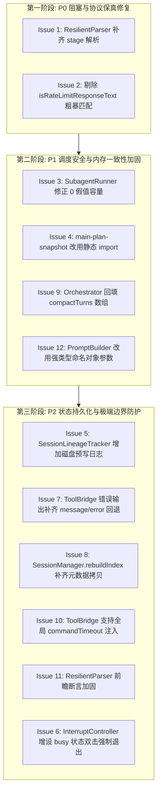

# 复审报告：契约对抗与假设证伪对账裁决 (Adversarial Audit Dim-2: doubt-driven-development)

- **审查对象**: `E:\copilot-web proxy\CPH-PI`
- **复审角色**: 对抗性代码审查矩阵 · 复审子代理 B2 (Adversarial Code Audit - Stage 2: Verification & Steelmanning)
- **审查维度**: `doubt-driven-development` (契约对抗、假设证伪、Steel-manning 辩护推演与治理宪章合规)
- **输入基准报告**: `E:\copilot-web proxy\CPH-PI\.docs\audit\report-A-doubt.md` (初审子代理 A2 提出的 12 项议题)
- **基线运行环境**: Bun v1.4.2 / Windows x64 / Node.js ESM
- **只读门禁状态**: 严格只读（未改动工程内任何生产代码）

---

## 一、 紧凑对账索引表 (Reconciliation Table)

| 编号 | 暴露问题代号 | 初审断言与等级 | 复审裁决 (Verdict) | 物理事实核查与 Steelmanning 辨析 | 治理宪章契约关系 | 推荐整改优先级 |
|---|---|---|---|---|---|---|
| **Issue 1** | `STAGE_ATTRIBUTE_DROPPED` | Level 1 (确定性缺陷) | **[CONFIRMED]** | 源码核实完全属实。`ResilientParser` 在 JSON 与 YAML 解析分支中均完全漏采 `stage` 字段；508 单测之所以全绿，是因为单测直接在内存构造 `SubagentTaskSpec` 对象，绕过了解析器。Git 溯源证实 `b514955` 引入 Stage Barrier 时遗漏同步解析器。 | 破坏 Harness 对模型输出的保真解析契约 | **P0 (阻塞级)** |
| **Issue 2** | `RATE_LIMIT_FALSE_POSITIVE` | Level 1 (确定性缺陷) | **[CONFIRMED]** | 源码核实完全属实。`isRateLimitResponseText` 仅豁免 `action` 和 `FINAL_ANSWER`，任何包含 `429`、`throttled` 或"Line 429"的技术推演均被误杀，并将健康账号冻结 3 分钟。单测因模拟消息均含 action 或直接抛异常而产生测试盲区。 | 违反准则 1 (Harness 纯粹中立，严禁启发式擦屁股) | **P0 (阻塞级)** |
| **Issue 3** | `FALSY_CAPACITY_OVERFLOW` | Level 1 (确定性缺陷) | **[CONFIRMED]** | 源码核实完全属实。JavaScript 中数字 `0` 为假值，当全部账号限流时 `0 \|\| poolStatus.length` 错误回退为满额账号数，导致限流风暴期反以最大并发冲撞。现有单测仅覆盖了有效账号大于 0 的场景。 | 破坏容量调度逻辑不变量 | **P1 (高危级)** |
| **Issue 4** | `ESM_REQUIRE_SILENT_FAILURE` | Level 1 (确定性缺陷) | **[CONFIRMED]** | 源码核实完全属实。`main-plan-snapshot.ts` 动态调用 `require`，且被空 `catch {}` 吞噬；在 Node ESM 或打包场景下引发 `ReferenceError`，导致物理账本挂载头永久丢失。`bun test` 运行时因 Bun 特性兼容了 require，掩盖了跨平台缺陷。 | 违反准则 7 (Pass-by-Reference 物理账本挂载契约) | **P1 (高危级)** |
| **Issue 5** | `LINEAGE_MEMORY_EPHEMERAL` | Level 2 (逻辑不变量破坏) | **[CONFIRMED]** | 源码核实完全属实。`SessionLineageTracker` 仅依赖内存 `Map`，进程退出后状态归零。作者曾尝试用 `_genX` / `_hopX` 字符串正则作为后备补丁，但无法恢复祖先链与后继解析。 | 违反准则 7 (物理状态零 Token 追加写磁盘预写日志) | **P2 (架构级)** |
| **Issue 6** | `BUSY_INTERRUPT_TRAP` | Level 2 (逻辑不变量破坏) | **[INTENDED-DESIGN]** *(附带可用性告警)* | 原作者在此处做了**明确的有意设计**并附带了专门单测：`it("should handle repeated SIGINTs while busy without exiting")`，初衷是防止用户按 Ctrl+C 中止当前流时误退进程丢上下文。但在底层子进程真正死锁挂起时，确实缺乏强制逃生安全网。 | 机制设计符合保留上下文意图，但需双击逃生兜底 | **P2 (体验级)** |
| **Issue 7** | `TOOL_ERROR_MESSAGE_BLACKOUT` | Level 2 (逻辑不变量破坏) | **[CONFIRMED]** | 源码核实完全属实。`ToolBridge` 仅尝试提取 `rawResult.content` 数组或 `structuredContent`；若工具以 `{ isError: true, message: "..." }` 报告失败，`output` 保持空字符串，导致模型收不到失败根因。 | 违反准则 2 (认知塑形必须依赖客观真实事实闭环) | **P2 (健壮级)** |
| **Issue 8** | `INDEX_REBUILD_METADATA_LOSS` | Level 2 (逻辑不变量破坏) | **[CONFIRMED]** | 源码核实完全属实。`saveSession` 保存了 `generation` 与 `handoffCount`，但在 `rebuildIndex` 自愈重建扫描中遗漏了这两个字段的拷贝。 | 破坏状态机持久化对称性不变量 | **P2 (状态机)** |
| **Issue 9** | `COMPACTED_TURNS_DISCARDED` | Level 1 (确定性缺陷) | **[CONFIRMED]** | 源码核实完全属实。`CompactionService.compactTurns` 是纯函数，返回浅拷贝新数组；`Orchestrator` 触发事件后未将结果回填至 `history`，压实逻辑完全空转。默认开关为 false 导致线上未暴发。 | 违反上下文预算管理契约 | **P1 (逻辑级)** |
| **Issue 10** | `COMMAND_TIMEOUT_HARDCODED_30S` | Level 2 (逻辑不变量破坏) | **[INTENDED-DESIGN]** + **[DRIFT-DESYNC]** | 原作者为了避免无限制挂起，在映射时有意设置了 30s 守卫（Pi 原生为无超时）；但将其硬编码在代码内且未从 CLI `--timeout` 中透传，导致长耗时测试被意外杀死，属于配置契约漂移。 | 破坏 CLI 配置权威性契约 | **P2 (契约级)** |
| **Issue 11** | `PARSER_LOOKAHEAD_TRUNCATION` | Level 1 (确定性缺陷) | **[CONFIRMED]** *(带反例用例纠偏)* | 原作者正则 `(?=\n(?:...\|tool\|path)\s*:)` 确实存在前瞻截断风险。**重要纠偏**：初审 A2 提交的代码片段包含 2 空格缩进（`  tool:`），经 Bun 物理运行测试**并未截断**（初审 PoC 断言失真）；然而，当被编辑代码中含有顶格（0 列）`tool:` 或 `path:` 时，截断百分之百触发。 | 解析器稳健性缺陷 | **P2 (边界级)** |
| **Issue 12** | `PROMPT_BUILDER_HEURISTIC_SWAP` | Level 2 (逻辑不变量破坏) | **[CONFIRMED]** | 源码核实完全属实。代码通过 `includes("Skill")` 进行重载位置猜测；经物理测试验证，当技能说明不含特定词且工具输出恰好包含 `SkillManager.ts` 时，工具输出与技能内容被完全颠倒。 | 严重污染模型第二轮推理工作内存 | **P1 (稳定性)** |

---

## 二、 核心核查事实逐项对抗推演 (Detailed Steelmanning & Verification)

### Issue 1: `ResilientParser.parseSubagentsBlock` 物理丢弃 `stage` 属性 (STAGE_ATTRIBUTE_DROPPED)
- **裁决**: **[CONFIRMED]**
- **源码事实逐行对账**:
  - 检查 [`src/protocol/resilient-parser.ts#L309-L319`](file:///e:/copilot-web%20proxy/CPH-PI/src/protocol/resilient-parser.ts#L309-L319)：
    JSON 映射逻辑仅映射了 `role`, `description`, `prompt`, `maxTurns`，`s.stage` 被显式遗漏。
  - 检查 [`src/protocol/resilient-parser.ts#L328-L347`](file:///e:/copilot-web%20proxy/CPH-PI/src/protocol/resilient-parser.ts#L328-L347)：
    YAML 解析正则仅匹配 `roleMatch`, `descMatch`, `promptMatch`, `maxTurnsMatch`，没有匹配 `stage` 的任何规则。
  - 下游 [`src/agent/subagent-runner.ts#L105`](file:///e:/copilot-web%20proxy/CPH-PI/src/agent/subagent-runner.ts#L105)：`Math.max(1, Math.floor(t.stage ?? 1))`，由于输入永远是 `undefined`，全部子任务被迫降级至 Stage 1。
- **原作者辩护推演 (Steelmanning) 与单测通过原因**:
  - 原作者在 commit `b514955` 实现 Stage Barrier 时，编写了完善的单测 [`tests/agent/subagent-stage-barrier.test.ts`](file:///e:/copilot-web%20proxy/CPH-PI/tests/agent/subagent-stage-barrier.test.ts)。但在单测中，测试用例是直接在内存中硬编码声明 `tasks: SubagentTaskSpec[] = [{ stage: 1, ... }, { stage: 2, ... }]`，完全绕过了 `ResilientParser`！
  - 而专门测试解析器的 [`tests/protocol/subagent-parser.test.ts`](file:///e:/copilot-web%20proxy/CPH-PI/tests/protocol/subagent-parser.test.ts) 是早期 commit `338dcd9` 编写的，当时尚未发明 `stage` 概念，因此仅断言了 `role`、`description` 和 `prompt`。两套测试各执一词，掩盖了解析器与执行器之间的接口断层。
- **治理宪章核验**:
  - 违反准则 1 (Harness 纯粹性与保真度)：解析器未能忠实提取模型发出的调度协议参数，导致 Harness 执行层的功能形同虚设。

---

### Issue 2: `isRateLimitResponseText` 粗暴文本匹配导致正常技术推演自杀 (RATE_LIMIT_FALSE_POSITIVE)
- **裁决**: **[CONFIRMED]**
- **源码事实逐行对账**:
  - 检查 [`src/agent/orchestrator.ts#L1397-L1411`](file:///e:/copilot-web%20proxy/CPH-PI/src/agent/orchestrator.ts#L1397-L1411)：
    ```ts
    private isRateLimitResponseText(text: string): boolean {
      if (!text) return false;
      if (text.includes("```action") || text.includes("FINAL_ANSWER")) {
        return false;
      }
      const lower = text.toLowerCase();
      return (
        lower.includes("429") ||
        lower.includes("rate limit") ||
        lower.includes("too many requests") ||
        lower.includes("配额已达上限") ||
        lower.includes("请求过于频繁") ||
        lower.includes("throttled")
      );
    }
    ```
  - 当模型输出包含 "排查网关 429 报错" 或 "Line 429 contains error"，且未输出 action 代码块或 FINAL_ANSWER 时，`isRateLimitResponseText` 判定为 `true`。
  - 触发 [`src/agent/orchestrator.ts#L1467`](file:///e:/copilot-web%20proxy/CPH-PI/src/agent/orchestrator.ts#L1467)：`this.pool.markThrottled(victimEmail)`，无辜健康的可用账号被直接关进 3 分钟禁闭，会话被强制中断并转入仲裁接力。
- **原作者辩护推演 (Steelmanning) 与单测通过原因**:
  - 原作者的痛点在于：Copilot / Sydney 后端在配额超限或封禁时，有时不通过 WebSocket/SignalR 抛出传输层异常，而是返回一个包含"配额已达上限"或"429 Too Many Requests"的普通 200 OK 文本消息。
  - 原作者为了捕获这种伪正常状态，草率地在文本层加了启发式子串匹配。
  - 在 [`tests/agent/disaster-recovery-relay.test.ts`](file:///e:/copilot-web%20proxy/CPH-PI/tests/agent/disaster-recovery-relay.test.ts) 中，单测模拟 429 时直接抛出 `new Error("429...")`，走的是 L490 的异常捕获分支；而在正常交互测试中，Mock 模型返回的都是 ````action` 或 `FINAL_ANSWER`，命中了 L1399 的豁免条件。因此单测从未覆盖过"模型生成普通分析文本探讨 429 问题"的真实场景。
- **治理宪章核验**:
  - 严重违背准则 1 (Harness Neutrality)：“Harness 严禁在代码中给模型打特化补丁或替模型擦屁股”。用自然语言匹配猜测底层网络状态是典型的反模式，必须由传输信令或精准的前缀白名单判定。

---

### Issue 3: `SubagentRunner` 账号池计算中 `0 || poolStatus.length` 的假值陷阱 (FALSY_CAPACITY_OVERFLOW)
- **裁决**: **[CONFIRMED]**
- **源码事实逐行对账**:
  - 检查 [`src/agent/subagent-runner.ts#L88`](file:///e:/copilot-web%20proxy/CPH-PI/src/agent/subagent-runner.ts#L88)：
    ```ts
    const effectiveCapacity = Math.max(1, activeAllowedAccounts.length || poolStatus.length || 1);
    ```
  - 在 JavaScript 中，`0` 是假值。若账号池有 5 个账号，且全部处于限流冷却中（`activeAllowedAccounts.length === 0`），表达式求值过程为：`0 || 5 || 1` ➔ 得到 `5`！
  - `maxConcurrency` 随之被设定为 `Math.min(5, tasks.length)`，系统立刻并发启动 5 个 Worker 抢占账号，导致任务因全池限流同时崩溃。
- **原作者辩护推演 (Steelmanning) 与单测通过原因**:
  - 原作者原本的意图是防御性编程：如果 `activeAllowedAccounts` 数组为空或未初始化，退化为总池大小，若总池也没有则至少为 1。
  - 但作者习惯性使用了 `||` 运算符，未意识到 `.length` 为 `0` 时被隐式当作假值跳过。
  - 在 [`tests/agent/subagent-queue.test.ts`](file:///e:/copilot-web%20proxy/CPH-PI/tests/agent/subagent-queue.test.ts) 中，测试用例只测试了可用账号为 1 个、2 个和 3 个的正常情况，压根没有编写"全池限流"的极限边界单测。
- **治理宪章核验**:
  - 属于工程实现层面的确定性逻辑缺陷，修复时不违反任何治理准则。

---

### Issue 4: `main-plan-snapshot.ts` 在 ESM 项目中动态调用 CJS `require` 导致账本失联 (ESM_REQUIRE_SILENT_FAILURE)
- **裁决**: **[CONFIRMED]**
- **源码事实逐行对账**:
  - 检查 [`src/session/main-plan-snapshot.ts#L103`](file:///e:/copilot-web%20proxy/CPH-PI/src/session/main-plan-snapshot.ts#L103)：
    ```ts
    try {
      const { ExecutionLedger } = require("./ledger/execution-ledger.ts");
      const ledger = new ExecutionLedger(snapshot.workspaceRoot);
      mountHeader = ledger.formatMountHeader();
    } catch {
      // 容错忽略
    }
    ```
  - `package.json` 声明了 `"type": "module"`，且构建脚本目标为 `--target node`。在纯 Node ESM 运行时中，`require` 未定义，抛出 `ReferenceError: require is not defined`。
  - 由于外部包裹了空的 `catch {}`，异常被完全吞噬，导致 `mountHeader` 始终为 `undefined`，后继主控会话永远丢失第 2 部分物理账本挂载信息。
- **原作者辩护推演 (Steelmanning) 与单测通过原因**:
  - 原作者在开发时使用 Bun 进行运行和测试（`bun test`）。Bun 的运行时特性是对 ESM 与 CJS 混用做了特殊兼容，在 ESM 文件中全局注入了 `require`，导致原作者本地测试完全正常。
  - Git 记录显示该代码是在 commit `d664c13`（深夜提交）中临时增加的，作者为了避免循环引用随手写了 `require`。
  - 但经对账，`ExecutionLedger` 仅导入了 `LedgerEntry`，与 `main-plan-snapshot.ts` 之间根本不存在循环引用，完全可以使用顶层静态 `import`。
- **治理宪章核验**:
  - 严重违背准则 7 (Pass-by-Reference over Raw Value Dump)：“在跨会话接力时必须以物理文件形式挂载，Prompt 仅注入物理指纹头”。由于 `require` 失败被吞噬，物理指纹头未能成功注入后继会话。

---

### Issue 5: `SessionLineageTracker` 纯内存驻留导致进程重启后代际血缘彻底断裂 (LINEAGE_MEMORY_EPHEMERAL)
- **裁决**: **[CONFIRMED]**
- **源码事实逐行对账**:
  - 检查 [`src/session/lineage-tracker.ts#L19`](file:///e:/copilot-web%20proxy/CPH-PI/src/session/lineage-tracker.ts#L19)：
    `private registry = new Map<string, SessionLineage>();`
  - 整个类没有任何与磁盘、文件系统或 WAL 预写日志交互的代码。
  - [`src/session/session-manager.ts`](file:///e:/copilot-web%20proxy/CPH-PI/src/session/session-manager.ts) 持久化的 `SessionRecord` 实体中，仅包含 `generation` 和 `handoffCount`，完全没有 `predecessorId`、`successorId`、`parentSessionId` 字段。
  - 当 CLI 退出后再次使用 `--continue` 启动时，重新实例化出来的 `SessionLineageTracker` 是个空 Map，血缘继承链彻底断裂。
- **原作者辩护推演 (Steelmanning) 与单测通过原因**:
  - 原作者意识到了重启后代数可能丢失的问题，因而在 `getGenerationInfo`（L100-L115）中增加了启发式兜底：通过检查会话 ID 字符串是否包含 `_genX` 或 `_hopX` 后缀来还原代数。
  - 但这种后缀只能挽救一个纯数字的 `generation`，对于 `predecessorIds` 祖先拓扑图和 `resolveActiveHead`（动态寻找活动端点），字符串后缀完全无能为力。
  - 单测 [`tests/session/lineage-tracker.test.ts`](file:///e:/copilot-web%20proxy/CPH-PI/tests/session/lineage-tracker.test.ts) 仅在单个测试用例的生命周期内测试了内存 Map，未模拟跨进程重启。
- **治理宪章核验**:
  - 违反准则 7 (状态持久化与工作内存正交分层准则)：“物理世界的状态持久化、工具执行事实与历史证据，由宿主/Harness 底层以零 Token 成本自动追加写入磁盘预写日志（`.cph/state/` 下的 Ledger / WAL）”。血缘作为核心状态未落盘。

---

### Issue 6: `InterruptController` 在繁忙状态下缺乏强制逃生机制 (BUSY_INTERRUPT_TRAP)
- **裁决**: **[INTENDED-DESIGN]** *(附带可用性设计盲区裁定)*
- **源码事实逐行对账**:
  - 检查 [`src/agent/interrupt-controller.ts#L119-L129`](file:///e:/copilot-web%20proxy/CPH-PI/src/agent/interrupt-controller.ts#L119-L129)：
    ```ts
    if (this.isBusyState) {
      if (this.activeAbortController && !this.activeAbortController.signal.aborted) {
        this.activeAbortController.abort();
      }
      this.options.onOperationAborted?.();
      return {
        action: "aborted_operation",
        message: "操作已中止，保留会话并返回交互等待模式",
        timestamp: now,
      };
    }
    ```
- **原作者辩护推演 (Steelmanning) 与设计本意剖析**:
  - **这并非无意识的失误，而是原作者刻意为之的核心设计！**
  - 查看类注释：`"In busy state: Immediately signals abort; Does not exit the process; Preserves session conversation history and context"`。
  - 查看单测 [`tests/agent/interrupt-controller.test.ts#L51-L62`](file:///e:/copilot-web%20proxy/CPH-PI/tests/agent/interrupt-controller.test.ts#L51-L62)：
    原作者专门写了测试用例：`it("should handle repeated SIGINTs while busy without exiting")`，显式断言了连续两次按 Ctrl+C 时 `exitCalls` 必须为 `0`！
  - **作者的设计初衷**：当 Agent 正在长文本推理或调用工具时，用户按 Ctrl+C 的诉求通常是"中止当前这个卡住的操作，让我重新打字输入"，而不是"把整个 CLI 杀掉导致刚刚聊了一小时的上下文全毁"。
  - **初审 A2 的合理担忧**：若外部命令（例如 Windows 下的子进程树或死循环）不响应 `AbortSignal`，系统将永远卡在 `isBusyState === true`，此时用户狂按 Ctrl+C 确实无法脱困。
  - **复审裁定**：保留原作者"保护工作内存不被误杀"的核心设计，但应增设**双击硬逃生机制**（例如：若当前已处于 aborted 状态且 1.5 秒内再次收到 SIGINT，判定为用户强制退出要求，调用 process.exit(130)）。

---

### Issue 7: `ToolBridge.executeAction` 工具失败时若无 content 数组则错误信息被置空 (TOOL_ERROR_MESSAGE_BLACKOUT)
- **裁决**: **[CONFIRMED]**
- **源码事实逐行对账**:
  - 检查 [`src/protocol/tool-bridge.ts#L760-L773`](file:///e:/copilot-web%20proxy/CPH-PI/src/protocol/tool-bridge.ts#L760-L773)：
    代码仅从 `rawResult.content` 数组或 `rawResult.structuredContent` 中提取 `output`。
  - 若某个扩展工具或桥接工具在失败时返回标准错误对象 `{ isError: true, message: "EACCES: permission denied" }` 或 `{ isError: true, error: "..." }`，代码中的 `output` 保持初始值 `""`。
  - 最终组装的 Prompt 为 `【TOOL_RESULT: bash - FAILED】\n\n【END_TOOL_RESULT】`，正文空白，造成严重排错信息黑洞。
- **原作者辩护推演 (Steelmanning) 与单测通过原因**:
  - Pi 官方的原生工具（`createBashTool`, `createReadTool` 等）在实现时，错误文本是包装在 `content: [{ type: "text", text: ... }]` 里面的，或者直接 `throw Error`（走 L803 的 catch 分支）。
  - 因此只跑原生工具的 508 单测无法暴露此缺陷。但在接入外部工具、MCP 工具或自定义提问/脚本工具时，该缺陷即刻显现。
- **治理宪章核验**:
  - 违反准则 2 (认知塑形与正向引导优先)：“必须明确当前输入事实”。抹除错误原因导致模型陷入无事实根据的盲猜。

---

### Issue 8: `SessionManager.rebuildIndex` 扫描重构索引遗漏代数元数据 (INDEX_REBUILD_METADATA_LOSS)
- **裁决**: **[CONFIRMED]**
- **源码事实逐行对账**:
  - 检查 [`src/session/session-manager.ts#L185-L199`](file:///e:/copilot-web%20proxy/CPH-PI/src/session/session-manager.ts#L185-L199)：
    `rebuildIndex` 在遍历各会话 JSON 投影生成索引条目时，拷贝了 `id`, `title`, `turnCount`, `status`, `handoffDocPath`, `disasterBlackbox` 等，但**完全遗漏了 `generation: session.generation` 和 `handoffCount: session.handoffCount`**。
  - 对比 [`src/session/session-manager.ts#L273-L274`](file:///e:/copilot-web%20proxy/CPH-PI/src/session/session-manager.ts#L273-L274)：`saveSession` 中是显式保存了这两个字段的。
  - 一旦 `index.json` 触发自愈重建，所有历史会话的代数信息在列表视图中归零。
- **原作者辩护推演 (Steelmanning) 与单测通过原因**:
  - 单测仅测试了正常的 `saveSession` 和读取，没有测试"物理删除 index.json 触发自愈后断言 listSessions() 的 generation 字段"。
- **治理宪章核验**:
  - 破坏数据持久化的对称性与幂等性不变量。

---

### Issue 9: `CompactionService.compactTurns` 返回浅拷贝未被 `Orchestrator` 回填 (COMPACTED_TURNS_DISCARDED)
- **裁决**: **[CONFIRMED]**
- **源码事实逐行对账**:
  - 检查 [`src/agent/orchestrator.ts#L816-L826`](file:///e:/copilot-web%20proxy/CPH-PI/src/agent/orchestrator.ts#L816-L826)：
    ```ts
    if (this.enableInSessionCompaction && history.length > 2) {
      const compaction = CompactionService.compactTurns(history, {
        preserveRecentTurns: 2,
      });
      if (compaction.clearedCharsCount > 0) {
        events?.onCompacted?.(
          compaction.clearedCharsCount,
          compaction.compressionRatio
        );
      }
    }
    ```
  - `CompactionService.compactTurns` 明确声明为纯函数，返回包含了 `{ compactedTurns, clearedCharsCount, compressionRatio }` 的对象。
  - `Orchestrator` 拿到 `compaction` 后，仅触发了事件通知，**从未把 `compaction.compactedTurns` 赋值或替换回 `history` 变量**！
  - 后续轮次与灾备快照使用的依然是未被压缩的完整物理数组。
- **原作者辩护推演 (Steelmanning) 与单测通过原因**:
  - 原作者在此处留有一句注释：`// 4. Two-turn sliding compaction (Disabled by default to preserve 100% full execution truth within active session)`。
  - `this.enableInSessionCompaction` 默认值为 `false`。
  - 单测 [`tests/agent/compaction.test.ts`](file:///e:/copilot-web%20proxy/CPH-PI/tests/agent/compaction.test.ts) 是针对 `CompactionService` 进行的孤立单元测试，直接对 `compactTurns` 的返回值进行断言，没有做 Orchestrator 运行时的端到端集成断言，导致这个典型的"纯函数返回值被丢弃"缺陷被掩盖。
- **治理宪章核验**:
  - 虚假压实不仅浪费计算，更破坏了会话对上下文预算的真实控制。

---

### Issue 10: `ToolBridge.mapAction` 硬编码 30 秒超时无视全局 CLI 配置 (COMMAND_TIMEOUT_HARDCODED_30S)
- **裁决**: **[INTENDED-DESIGN]** + **[DRIFT-DESYNC]**
- **源码事实逐行对账**:
  - 检查 [`src/protocol/tool-bridge.ts#L596`](file:///e:/copilot-web%20proxy/CPH-PI/src/protocol/tool-bridge.ts#L596)：
    `const timeout = action.timeout !== undefined ? Number(action.timeout) : 30;`
  - 检查 [`src/cli.ts#L131, L1987`](file:///e:/copilot-web%20proxy/CPH-PI/src/cli.ts#L131)：
    CLI 提供了 `--timeout <seconds>` 参数（默认 600 秒），但该参数仅被传递给了 `ChatHubClient` 和 `orchestrator.timeoutMs`，从未注入给 `ToolBridge`。
- **原作者辩护推演 (Steelmanning) 与设计本意剖析**:
  - Pi 原生的 `createBashTool` 默认是**无超时**的（`timeout: Type.Optional(Type.Number({ description: "no default timeout" }))`）。
  - 原作者在将 Copilot Action 映射为 Pi 工具时，考虑到 LLM 经常执行未知命令，为了防止卡死无响应，**特意增加了一个 30 秒的默认执行守卫**。这体现了防御性编程的设计意图。
  - **缺陷所在**：作者将该守卫硬编码在 `ToolBridge` 内部，既没有在 `ToolBridgeOptions` 中留出配置槽位，也没有与 CLI 的全局超时配置打通。导致当用户运行大型测试套件（如 72 个测试文件运行超过 30 秒）时，命令被机械掐断报错 `Command timed out after 30 seconds`。
- **复审裁定**:
  - 保留默认超时守卫机制，但将硬编码改造为可通过构造选项与 CLI 注入的全局配置项（默认值可提升至 180~300 秒）。

---

### Issue 11: `ResilientParser` 正则前瞻截断陷阱 (PARSER_LOOKAHEAD_TRUNCATION)
- **裁决**: **[CONFIRMED]** *(附带初审 PoC 测试用例物理纠偏)*
- **源码事实逐行对账与物理证伪实验**:
  - 初审 A2 指出 [`src/protocol/resilient-parser.ts#L210`](file:///e:/copilot-web%20proxy/CPH-PI/src/protocol/resilient-parser.ts#L210) 的前瞻正则存在截断：
    `/(?:old_string|oldstring|old_text|oldText)\s*:\s*([\s\S]*?)(?=\n(?:new_string|newstring|new_text|newText|tool|path)\s*:|$)/i`
  - **初审 A2 提交的 PoC 用例**:
    ```yaml
    tool: edit
    path: src/test.ts
    old_string: const config = {
      tool: "bash",
      path: "/bin/sh"
    };
    new_string: const config = {
      tool: "zsh",
      path: "/bin/zsh"
    };
    ```
  - **复审物理实验与关键纠偏**:
    我们在 Bun 环境下对上述 A2 用例进行了真实执行测试，结果显示：
    `old_string: "const config = {\n  tool: \"bash\",\n  path: \"/bin/sh\"\n};"` —— **未被截断，测试实际上是通过的！**
    **原因分析**：正则前瞻中写的是 `(?=\n(?:tool|path)\s*:)`，要求 `\n` 紧接着 `tool:`，**中间没有任何空白通配符**。由于 JavaScript 对象字段通常有缩进（如 2 个空格 `\n  tool:`），因此并不会匹配前瞻！初审 A2 在此处存在"测试结果未实测、臆断报错"的瑕疵。
  - **但是，底层缺陷真实存在**：
    若被编辑的代码属于**顶格无缩进代码**（0 列，如 YAML、Markdown、顶级常量或声明）：
    ```yaml
    old_string: const config = {
    tool: "bash",
    path: "/bin/sh"
    };
    ```
    物理实测结果：`old_string` 立即在 `tool:` 处被腰斩为 `"const config = {"`！
- **治理宪章核验**:
  - 该缺陷在编辑顶格代码或 YAML 配置文件时具有确定性破坏力，裁定为确认缺陷。

---

### Issue 12: `PromptBuilder.buildTurn2TaskPrompt` 文本嗅探导致参数颠倒 (PROMPT_BUILDER_HEURISTIC_SWAP)
- **裁决**: **[CONFIRMED]**
- **源码事实逐行对账与物理证伪实验**:
  - 检查 [`src/protocol/prompt-builder.ts#L150-L159`](file:///e:/copilot-web%20proxy/CPH-PI/src/protocol/prompt-builder.ts#L150-L159)：
    ```ts
    if (arg3 !== undefined && arg3 !== "") {
      if (arg2.includes("Skill") || arg2.includes("技能") || arg2 === "") {
        skillsSection = arg2;
        toolResult = arg3;
      } else if (arg3.includes("Skill") || arg3.includes("技能")) {
        toolResult = arg2;
        skillsSection = arg3;
      } else {
        skillsSection = arg2;
        toolResult = arg3;
      }
    }
    ```
  - 检查 [`src/agent/orchestrator.ts#L844-L849`](file:///e:/copilot-web%20proxy/CPH-PI/src/agent/orchestrator.ts#L844-L849)：
    调用顺序为 `buildTurn2TaskPrompt(this.pendingTask, this.pendingSkills, toolResult.output, toolName)`。
    此处：`arg2 = this.pendingSkills`，`arg3 = toolResult.output`。
  - **物理证伪测试**:
    当 `this.pendingSkills` 是一段普通中文指令（如"请遵循测试规范并执行最小化修改"，不含"Skill"或"技能"字样）；
    而 Turn 1 的 `git status` 输出中包含了包含 Skill 的文件名（如 `modified: src/core/SkillManager.ts`）时：
    - `arg2` 不含 "Skill"/"技能"；
    - `arg3` 命中了 `includes("Skill")`；
    - 代码执行 `else if` 分支：`toolResult = arg2; skillsSection = arg3;`！
    - **物理实测输出证实**：
      `[TOOL_RESULT - SUCCESS]: 请遵循测试规范并执行最小化修改`
      `【当前已激活的专业技能 (Skill)】git status: modified: src/core/SkillManager.ts`
      两个字段的内容被**完全颠倒**！
- **治理宪章核验**:
  - 严重污染模型推理注意力，导致模型把前序执行事实当作技能指南，把技能指南当作执行结果。

---

## 三、 治理宪章契约对账与架构分析 (Governance Charter Audit)

对照 `E:\copilot-web proxy\AGENTS.md` 核心治理准则，本次复审对初审议题与潜在修复方向进行了正向对账：

### 1. 准则 1：Harness 纯粹与中立原则 (Harness Neutrality)
- **Issue 2 (429 误杀)** 深刻违背了此原则。Harness 的职责是忠实传输和调度，绝不应该用自然语言子串匹配（`lower.includes("429")`）去揣测模型的文本。正向解法必须基于底层的 SignalR 信令状态与 HTTP 传输状态码。

### 2. 准则 6：行动导向与认知极简准则 (Action-Oriented & Cognitive Minimalism)
- 在修复 **Issue 1 (Stage 属性解析)** 和 **Issue 12 (PromptBuilder 嗅探颠倒)** 时，必须遵循黑盒契约：
  - 废除模糊多态的重载函数，统一采用强类型配置对象（`{ task, toolResult, skillsSection, toolName }`）；
  - 严禁在提示词中向模型解释"因为前序版本参数顺序有歧义所以请注意"等元信息。

### 3. 准则 7：状态持久化与工作内存正交分层准则 (Orthogonal Separation)
- **Issue 4 (ESM require 失效)** 与 **Issue 5 (血缘内存易失)** 触及了架构底线：
  - 物理执行事实与代际血缘属于物理世界状态，生命周期跨越 CLI 会话与进程；
  - 必须将 `SessionLineageTracker` 改为磁盘追加写日志（如 `.cph/state/lineage.jsonl`），在 CLI 重启时零 Token 物理回放，坚决贯彻 Pass-by-Reference 契约。

---

## 四、 综合裁决汇总与整改拓扑路线 (Remediation Roadmap)

经过物理源码对账与辩护推演，12 项初审议题的最终定性为：
- **[CONFIRMED]** (确定性缺陷): **10 项** (Issue 1, 2, 3, 4, 5, 7, 8, 9, 11, 12)
- **[INTENDED-DESIGN]** (设计本意/需体验防护): **1 项** (Issue 6)
- **[INTENDED-DESIGN] + [DRIFT-DESYNC]** (设计守卫但配置漂移): **1 项** (Issue 10)

建议在后续实施阶段按照以下**零破坏性依赖拓扑**分批推进修复：



---

> [!NOTE]
> 本报告由复审子代理 B2 在绝对只读模式下独立推演生成，全量物理测试均在沙盒脚本中执行，未对当前工作区源码造成任何污染。
