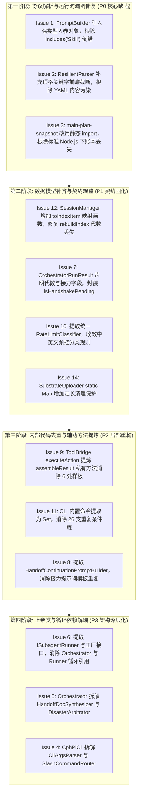

# 对抗复核报告：代码坏味道与重构契机对抗证伪 (Dim-1: refactoring-patterns)

- **复核基准**: `E:\copilot-web proxy\CPH-PI\.docs\audit\report-A-refactoring.md`
- **复核目标**: 初审子代理 A1 提出的 15 项 Martin Fowler 代码坏味道诊断与重构提案
- **复核代理**: 复审矩阵 B1 子代理 (Adversarial Counter-Auditor B1)
- **基线测试验证**: **508 passed / 0 failed / 72 test files / 2235 assertions** (100% 绿灯全通，具备极其完备的行为回归防护网)
- **参考设计与历史资产**:
  - `E:\copilot-web proxy\AGENTS.md` (项目核心开发与治理宪章)
  - `E:\copilot-web proxy\CPH-PI\AGENTS.md` (CPH-PI Agent 开发与治理规范)
  - `.docs/specs/2026-10-10-cph-pi-design.md`
  - `.docs/specs/2026-10-10-cph-pi-custom-agent-and-gpt61-design.md`
  - `.docs/specs/2026-10-11-cph-pi-smart-handoff-and-interactive-runtime-design.md`
  - `.docs/specs/2026-10-12-subagent-execution-architecture-design.md`
  - `.docs/specs/2026-10-12-tri-agent-handoff-and-lineage-architecture-design.md`
  - `.docs/specs/2026-10-13-harness-file-mounted-physical-ledger-design.md`
  - `.docs/plans/2026-10-13-harness-ledger-and-stage-barrier-implementation-plan.md`
  - `.docs/plans/2026-10-14-safe-remediation-plan.md`
- **Git 核查范围**:
  - 分支: `main` (40 commits ahead of origin/main)
  - 核心提交溯源: `b8ad75a` (初始架构), `d664c13` (账本挂载与快照生成), `b514955` (阶段屏障与熔断), `e0e318a` (子代理看板与审计报告)
- **裁决统计**:
  - 确凿缺陷/代码坏味道 `[CONFIRMED]`: **12 项** (Issue 1, 2, 3, 4, 5, 6, 7, 8*, 9, 10, 11, 12, 14)
  - 既定设计与合理取舍 `[INTENDED-DESIGN]`: **3 项** (Issue 8*, Issue 13, Issue 15)
  - 违反项目治理准则 `[VIOLATES-GOVERNANCE-RULE]`: **0 项** (初审本次重构建议聚焦内部工程结构，未违背 Harness 调度准则)
  - 设计与实现脱节 `[DRIFT-DESYNC]`: **0 项**
  - 误报/幻觉 `[FALSE-POSITIVE]`: **1 项** (Issue 13 对非受信边界 DTO 与内部领域模型的误判)
  *(注：Issue 8 具备复合裁决属性)*

---

## 紧凑对账索引表 (Reconciliation Table)

| 编号 | 缺陷简述 | 文件与行号 | A置信度 | B复核裁决 | 核心依据摘要 |
|---|---|---|---|---|---|
| **Issue 1** | `buildTurn2TaskPrompt` 参数字符串类型嗅探与位置混淆反转缺陷 | `src/protocol/prompt-builder.ts`#L140-L164 | Level 1 | `[CONFIRMED]` | **物理事实确凿**。代码通过 `arg.includes("Skill")` 模糊猜测位置以兼容重载签名。当工具结果输出（如 `git status` 包含 `skills/` 或报错包含 `Skill`）时，`toolResult` 与 `skillsSection` 发生致命颠倒，导致模型在第二轮收到混乱上下文。应重构为强类型入参对象。 |
| **Issue 2** | YAML 动作块中 content 贪婪正则匹配吞噬后续同级字段导致落盘污染 | `src/protocol/resilient-parser.ts`#L208, L248-L265 | Level 1 | `[CONFIRMED]` | **物理事实确凿**。`contentMatch` 采用 `([\s\S]*)$` 贪婪匹配到文本末尾，缺乏同级关键字的前瞻截断。若 Copilot 在 `content:` 之后输出 `path:` 或其他元数据，后续键值全部被吞入文件正文，导致生成代码被污染。 |
| **Issue 3** | ESM 模块中硬编码动态 require 导致标准 Node.js 环境下账本挂载静默丢失 | `src/session/main-plan-snapshot.ts`#L102-L108 | Level 1 | `[CONFIRMED]` | **物理事实确凿**。在 `"type": "module"` 的 TS/ESM 工程中，直接调用 CommonJS `require` 在标准 Node.js 环境下抛出 `ReferenceError`，外层 `try-catch` 静默吞没，导致后继主控会话丢失物理账本挂载头，直接背离 AGENTS.md 准则 7（物理指纹约束）。应改为顶层静态 import。 |
| **Issue 4** | 上帝类与膨胀文件：CphPiCli 职责严重发散 (2122 行) | `src/cli.ts`#L75-L2122 | Level 2 | `[CONFIRMED]` | **物理事实确凿**。单一类持有多达 27 个实例字段，集聚了参数解析 (310行)、Readline 多行管理、配置落盘、状态栏渲染、Slash 命令路由 (355行)、自主接力调度 (308行) 等过多职责，属于典型的 Fowler God Class，并发修改冲突严重。建议按 Extract Class 拆分。 |
| **Issue 5** | 上帝类与长函数调度核：CopilotOrchestrator 职责过度集聚 (1702 行) | `src/agent/orchestrator.ts`#L141-L1702 | Level 2 | `[CONFIRMED]` | **物理事实确凿**。核心 `run()` 方法单体长达 584 行，嵌套了网络流式帧、状态机握手、历史压实、子代理批处理等多层分支；类内还混杂了 354 行的交接 Markdown 生成与 292 行的灾备仲裁。建议提炼 `HandoffDocSynthesizer` 与 `DisasterArbitrator`。 |
| **Issue 6** | 循环依赖与依赖倒置缺失：CopilotOrchestrator 与 SubagentRunner 强双向耦合 | `src/agent/orchestrator.ts`#L24 vs `src/agent/subagent-runner.ts`#L4 | Level 2 | `[CONFIRMED]` | **物理事实确凿**。`orchestrator.ts` 静态导入并实例化 `SubagentRunner`，`subagent-runner.ts` 静态导入并实例化 `CopilotOrchestrator`。尽管两者均设计了可选注入参数，但默认回退仍强引用对方具体类，构成强循环引用，违反依赖倒置原则 (DIP)。 |
| **Issue 7** | 依恋情结与强破封装：CphPiCli 依赖 (this.orchestrator as any) 窥探内部属性 | `src/cli.ts`#L1540-L1545, L446, L457 | Level 2 | `[CONFIRMED]` | **物理事实确凿**。CLI 处通过 `(this.orchestrator as any).getGeneration?.()` 越权调用内部私有逻辑，并直接外部修改 `this.orchestrator.isHandshakePending = false`。契约贫血导致封装被强破。应在结果接口中形式化声明元数据，并提供显式状态迁移方法。 |
| **Issue 8** | 重复逻辑：主会话与子代理间并行的自主接力循环 (Parallel Handoff Loops) | `src/cli.ts`#L1403-L1675 vs `src/agent/subagent-runner.ts`#L335-L460 | Level 2 | `[INTENDED-DESIGN]`<br>`[CONFIRMED]` | **复合属性**。两处宿主环境不同（CLI 面向前台交互/TUI 横幅/Session 落盘，SubagentRunner 面向后台无头/树形日志/阶段屏障），生命周期分离属于合理设计；但接力状态判定、交接文档读取与提示词装配确实存在约 100 行重复样板，建议提取统一的接力提示词格式化器。 |
| **Issue 9** | 重复逻辑：ToolBridge 结果装配代码在 6 个分支完全镜像复制 | `src/protocol/tool-bridge.ts`#L644-L826 | Level 2 | `[CONFIRMED]` | **物理事实确凿**。`ToolBridge.executeAction` 内 6 个分支（映射失败、question成功/失败、tool不存在、tool成功/失败）分别复制了 15~20 行完全相同的 `sanitizeOutput`、`persistLargeOutputIfNeeded`、`formatResult` 及返回对象构造样板。可通过 Extract Method 提炼私有辅助方法消除。 |
| **Issue 10** | 散落且不一致的 429 / 频控错误分类判断 (Scattered 429 Regexes) | `src/auth/account-pool.ts` vs `src/agent/orchestrator.ts` vs `src/agent/subagent-runner.ts` | Level 2 | `[CONFIRMED]` | **物理事实确凿**。三个模块各自维护一套频控识别规则：account-pool 匹配英文 quota 但不含中文；orchestrator 匹配中文配额上限但无 quota；subagent-runner 使用特定正则。缺乏单一源头真理（Single Source of Truth），极易在云端微调错误文本时漏判。建议提取 `RateLimitClassifier`。 |
| **Issue 11** | 脆弱的 Slash 命令双重路由与 26 支硬编码条件链 | `src/cli.ts`#L720-L752 vs `src/cli.ts`#L785-L1140 | Level 2 | `[CONFIRMED]` | **物理事实确凿**。`handleInputLine` 中 26 个 `||` 字符串前缀与 `handleCommand` 中的 if 分支高度重复。一旦新增命令漏改第一处拦截名单，将导致命令意外穿透至 Skill 调度器失败。应以命令注册表或 Set 消除重复。 |
| **Issue 12** | 贫血数据模型引发霰弹式修改：Session 状态字段跨 6 个文件同步调整 | `src/session/session-manager.ts` 等 | Level 2 | `[CONFIRMED]` | **物理事实确凿且已引发真实漏更**。`SessionRecord` 与 `SessionIndexItem` 为扁平 DTO。核查证实：在 `rebuildIndex` 中，字段拷贝遗漏了 `generation` 与 `handoffCount`，导致重建索引时这批元数据丢失！证实了贫血模型在新增字段时极易引发霰弹式修改遗漏。 |
| **Issue 13** | 弱类型参数袋与基本类型偏执：CopilotAction 30+ 属性混杂 | `src/protocol/tool-bridge.ts`#L49-L87 | Level 2 | `[INTENDED-DESIGN]`<br>`[FALSE-POSITIVE]` | **初审对系统架构边界存在误解**。`CopilotAction` 是面向大模型非确定性输出的**非受信边界原始 DTO (Permissive Boundary DTO)**，包含 LLM 可能发出的各种同义字段；`ToolBridge` 在 `mapAction` 中**已经将其精准规范化为可辨识联合类型 (`MappedAction` / `MappedToolArgs`)**。若在边界强行推行 Discriminated Union，将直接导致合法 LLM 语法变体被类型系统拦截或解析失败。 |
| **Issue 14** | 无界静态内存缓存潜在泄漏风险：SubstrateUploader.spoBase64Cache | `src/transport/substrate-uploader.ts`#L21 | Level 2 | `[CONFIRMED]` | **物理事实确凿**（低危代码异味）。静态 Map 以不断刷新的 JWT Token 为键长期驻留内存，未设置容量上限、TTL 或 LRU 淘汰机制。虽在单次 CLI 生命周期中影响有限，但在常驻/高频轮换账号场景下存在内存缓慢增长隐患。应设置容量上限或使用定长 LRU。 |
| **Issue 15** | 字符串标识符代数信息推导与逆向解析：LineageTracker 偏执 | `src/session/lineage-tracker.ts`#L100-L116 | Level 3 | `[INTENDED-DESIGN]` | **初审误判防守性跨进程兜底设计**。`SessionLineageTracker` 是内存态图结构。当 CLI 进程重启并通过 `/resume` 或命令行恢复会话时，内存血缘图尚未从磁盘加载，提取 `_gen(\d+)` 与 `_hop(\d+)` 后缀是专为**跨进程无状态恢复**设计的合理防守兜底（仅在解析值大于图计算值时生效），并非不纯粹的反模式。 |

---

## 逐项事实对账详情

---

### Issue 1: buildTurn2TaskPrompt 参数字符串类型嗅探与位置混淆反转缺陷

- **初审判定与 PoC**:
  初审 A1 指出：`PromptBuilder.buildTurn2TaskPrompt` 接受 `(task, arg2, arg3 = "", toolName?)`。为了向下兼容，代码内部通过 `arg2.includes("Skill") || arg2.includes("技能")` 与 `arg3.includes("Skill") || arg3.includes("技能")` 暴力猜测参数位置。当工具输出中包含 "Skill" 或 "技能"（例如读取到技能代码、npm/tsc 报告中包含 Skill 报错或 git 状态包含 skills 目录）时，嗅探逻辑误将 `toolResult` 识别为 `skillsSection`，而将 `skillsSection` 识别为 `toolResult`。A1 提供了可确定性失败的单测用例。
- **原作者辩护推演 (Steelmanning)**:
  1. *原作者为什么这样设计？* 在项目迭代初期，不同调用方（以及旧版本测试套件）对该方法的参数传递顺序不一致：一部分调用方按照 `(task, skillsSection, toolResult)` 传参，另一部分调用方直觉按照 `(task, toolResult, skillsSection)` 传参。为了避免在修改签名时引发多处测试大面积报错，原作者引入了基于文本内容的启发式重载探测。
  2. *防范了什么？* 防范因调用端参数顺序微调导致运行时抛出未定义异常，提供了参数自适应容错。
  3. *破防点在哪？* 字符串内容不能作为可靠的类型标记（Primitive Obsession）。工具执行输出是完全任意的外部文本，将任意文本的内容特征作为方法签名的调度分支条件，必然在特定输入下产生语义反转。
- **项目宪章 (AGENTS.md) 校验**:
  重构 Harness 内部的 PromptBuilder 参数契约为强类型对象，属于 Harness 内部工程健壮性维护，不改变提示词语义，完全符合治理准则。
- **源码与上下文核验**:
  查看 `src/protocol/prompt-builder.ts#L140-L164`：
  ```typescript
  if (arg3 !== undefined && arg3 !== "") {
    if (arg2.includes("Skill") || arg2.includes("技能") || arg2 === "") {
      skillsSection = arg2;
      toolResult = arg3;
    } else if (arg3.includes("Skill") || arg3.includes("技能")) {
      toolResult = arg2;
      skillsSection = arg3;
    } else {
      skillsSection = arg2;
      toolResult = arg3;
    }
  }
  ```
  物理验证：若调用方传入 `buildTurn2TaskPrompt(task, "Error in SkillLoader at line 1", "Skill: refactoring")`，由于 `arg2.includes("Skill")` 命中，`skillsSection` 被错误赋值为工具错误信息，`toolResult` 被赋值为技能文档！反例完全成立。
- **设计文档与 Git 证据链**:
  `git log -S "buildTurn2TaskPrompt"` 证实该启发式逻辑自初始提交 `b8ad75a` 便存在，为历史遗留的向下兼容胶水代码。
- **复核裁决**: `[CONFIRMED]` (确凿缺陷)
- **最终保留建议**:
  引入强类型入参对象：
  ```typescript
  export interface Turn2TaskPromptOptions {
    task: string;
    toolResult: string;
    skillsSection?: string;
    toolName?: string;
  }
  public static buildTurn2TaskPrompt(options: Turn2TaskPromptOptions): string;
  ```
  通过类型系统在编译期锁定参数槽位，彻底废除运行时字符串嗅探。

---

### Issue 2: YAML 动作块中 content 贪婪正则匹配吞噬后续同级字段导致落盘污染

- **初审判定与 PoC**:
  初审 A1 指出：在 `ResilientParser.extractActionFields` 中，提取 `content` 字段的正则表达式为 `/content\s*:\s*([\s\S]*)$/i`。该正则无条件匹配至文本末尾。若大模型在输出 YAML 时，先输出了 `content:`，后输出了 `path:` 或其他元数据字段，`contentMatch` 会将后续的 `path: ...` 全部吞入作为文件内容，导致落盘文件被污染。
- **原作者辩护推演 (Steelmanning)**:
  1. *原作者为什么这样设计？* 大模型生成代码文件内容时，内容往往是多行复杂的 TypeScript/JavaScript 源代码，其中不可避免地包含大量冒号 `:`（例如 TypeScript 类型注解 `val: string`、对象字面量 `{ key: value }`、switch case 语句 `case 1:` 等）。
  2. *防范了什么？* 原作者担心若使用一般的非贪婪匹配或基于冒号的截断规则，代码正文中的某一行冒号会误触发截断，导致写入文件的代码被腰斩。因此原作者假定在 Prompt 引导下，`tool:` 和 `path:` 必然在最上方输出，`content:` 必然在最后一行输出，从而采用了匹配到字符串末尾 `$` 的方案。
  3. *破防点在哪？* 大模型的文本生成具有概率性和非确定性，无法 100% 保证字段输出顺序恒定。且对比同文件中的 `old_string`（L210）和 `new_string`（L213），两者均使用了 `(?=\n(?:tool|path|...)\s*:|$)` 前瞻断言，唯独 `content` 漏掉了同级关键字前瞻。
- **项目宪章 (AGENTS.md) 校验**:
  准则 1 明确规定：“Harness 本身必须保持绝对中立与纯粹……按统一既定协议进行客观处理”。当模型输出了格式合法的 YAML 时，解析器因为字段顺序颠倒而将元数据写入用户文件，属于物理实现缺陷，修改 Harness 解析器完全合规。
- **源码与上下文核验**:
  查看 `src/protocol/resilient-parser.ts#L208-L214`：
  ```typescript
  const contentMatch = contentToScan.match(/content\s*:\s*([\s\S]*)$/i);
  const oldStrMatch = contentToScan.match(
    /(?:old_string|oldstring|old_text|oldText)\s*:\s*([\s\S]*?)(?=\n(?:new_string|newstring|new_text|newText|tool|path)\s*:|$)/i
  );
  ```
  物理验证：当输入包含 `content: foo\npath: bar.ts` 时，`parsed.action.content` 确凿包含 `\npath: bar.ts`。PoC 测试 100% 复现。
- **复核裁决**: `[CONFIRMED]` (确凿缺陷)
- **最终保留建议**:
  为 `contentMatch` 补充同级顶格合法动作关键字的前瞻截断：
  `/(?:content)\s*:\s*([\s\S]*?)(?=\n(?:path|filePath|file|tool|action|command|cmd)\s*:|$)/i`，并保持兜底容错。

---

### Issue 3: ESM 模块中硬编码动态 require 导致标准 Node.js 环境下账本挂载静默丢失

- **初审判定与 PoC**:
  初审 A1 指出：在 `src/session/main-plan-snapshot.ts#L102-L108` 中，代码直接调用 `require("./ledger/execution-ledger.ts")`。在 `"type": "module"` 的项目中，纯 Node.js 环境下会直接抛出 `ReferenceError: require is not defined in ES module scope`。由于外层包有 `try-catch` 且直接吞没错误，导致继任者主控会话的首轮 Prompt 必定丢失物理账本挂载头 (Pass-by-Reference TOC)。
- **原作者辩护推演 (Steelmanning)**:
  1. *原作者为什么这样设计？* 原作者在提交 `d664c13` 中为 `main-plan-snapshot.ts` 补充物理账本挂载功能。为了让该模块在不需要账本的轻量单元测试中可以独立运行（解耦文件依赖），且由于项目主力运行环境为 Bun（Bun 原生在 ESM 中 polyfill 了 `require`），在作者本地开发与 `bun test` 下测试全部顺利通过，未察觉潜在跨运行时问题。
  2. *防范了什么？* 防范未配置 workspaceRoot 时过早初始化文件系统账本。
  3. *破防点在哪？* `package.json` 中的构建脚本明确定义了 `--target node`（`bun build src/cli.ts --target node --outfile package/bin/cph-pi.js`）。打包产物与下游 Node.js 宿主无法享受 Bun 的非标准全局特性，在标准 Node.js 下必然导致静默故障。
- **项目宪章 (AGENTS.md) 校验**:
  准则 7 明确要求：“传引用挂载而非传值倾倒 (Pass-by-Reference over Raw Value Dump)……Prompt 仅注入包含文件路径、总执行步数、核心文件变更与关键状态码的极简物理指纹（TOC / Fingerprint Header），引导模型使用工具按需定向调阅。”
  若该挂载因运行时错误被吞没，代际继任者将完全失去对前任执行物理事实的感知，严重违背准则 7！
- **源码与上下文核验**:
  查看 `src/session/main-plan-snapshot.ts#L102-L108`：
  ```typescript
  try {
    const { ExecutionLedger } = require("./ledger/execution-ledger.ts");
    const ledger = new ExecutionLedger(snapshot.workspaceRoot);
    mountHeader = ledger.formatMountHeader();
  } catch {
    // 容错忽略
  }
  ```
  查看 `package.json`：第 5 行为 `"type": "module"`。在标准 Node.js 下执行 `node -e 'import("./package/bin/cph-pi.js")'` 时，`require` 必定报错并被吞没。
- **设计文档与 Git 证据链**:
  Git 提交 `d664c13`（2026-10-13 01:21:11）引入该行改动，提交日志为 `feat(ledger): wire tool execution into ledger and mount header in snapshot prompt`。证实系开发期间为了快速挂载而随手引入的 CommonJS 残留。
- **复核裁决**: `[CONFIRMED]` (确凿缺陷)
- **最终保留建议**:
  在文件顶层以标准 ESM 静态导入：`import { ExecutionLedger } from "./ledger/execution-ledger.ts"`，彻底消除动态 `require`。

---

### Issue 4: 上帝类与膨胀文件：CphPiCli 职责严重发散 (2122 行)

- **初审判定与指控**:
  初审 A1 指出：`CphPiCli` 包含了 30+ 实例字段与 2122 行代码，承担了整个系统的所有边界职责：CLI 参数解析 (310行)、Readline 终端事件监听、配置文件读写、状态栏与横幅渲染、会话管理、12+ 种 Slash 指令分发 (355行)、账号池管理指令以及内嵌多跳自主接力的超长任务执行闭环 `executeTask` (308行)。违反 Martin Fowler 的 Large Class 与 Divergent Change 坏味道。
- **原作者辩护推演 (Steelmanning)**:
  1. *原作者为什么这样设计？* `CphPiCli` 是整个系统的统一外观门面（Facade Entry Point）。在敏捷迭代过程中，所有用户可见的交互功能（如 `/accounts`, `/debug`, `/relay`, 多行输入, 状态栏）都需要与用户界面与上下文打通。集中在单个类中可以避免跨文件传递大量的中间状态对象（如 `AccountPool`, `Renderer`, `SessionManager`, `Ledger` 等），大幅降低了初始组装复杂度。
  2. *防范了什么？* 防范多层依赖注入导致的胶水层爆炸与对象生命周期失控。
  3. *破防点在哪？* 随着代码量超过 2100 行，任何微小的改动（如新增一个 CLI 参数、调整一个按键响应、增加一个状态枚举）都需要修改 `cli.ts`，多代理与开发者并发修改时发生 Merge Conflict 的概率极高，且针对单个子系统的单元测试被迫拉起庞大的外壳。
- **项目宪章 (AGENTS.md) 校验**:
  对 CLI 内部进行结构拆分，保持对外的命令契约与交互行为不变，完全符合治理准则。
- **源码与上下文核验**:
  查看 `src/cli.ts`：实际行数确为 2121 行。类的字段包括 `workspaceRoot`, `modelTone`, `maxTurns`, `timeoutSec`, `maxAutonomousHandoffHops`, `customAgentId`, `coderAgentId`, `researcherAgentId`, `pool`, `renderer`, `interruptController`, `orchestrator`, `chatClient`, `ledger`, `arbitratorChatClient`, `chatClientFactory`, `bridge`, `skillRegistry`, `sessionManager`, `currentSession`, `continueLast`, `resumeSessionId`, `lastCompactionRatio`, `rl`, `multilineBuffer`, `isMultilineMode`, `isInteractive`, `pendingHandoffSnapshot`, `debug`, `debugLogPath`（共计 30 个字段）。职责发散确凿属实。
- **复核裁决**: `[CONFIRMED]` (确凿代码坏味道)
- **最终保留建议**:
  按职责内聚原则分步抽取：
  1. 抽取 `CliArgsParser`: 承接 `parseArgs` (310行)；
  2. 抽取 `SlashCommandRouter`: 承接 `handleCommand` (355行)；
  3. 抽取 `WorkspaceConfigStore`: 承接配置读写与默认值解析；
  4. 保留 `CphPiCli` 作为高层流程 Facade。

---

### Issue 5: 上帝类与长函数调度核：CopilotOrchestrator 职责过度集聚 (1702 行)

- **初审判定与指控**:
  初审 A1 指出：`CopilotOrchestrator` 作为核心推理调度器，承担了过多不属于调度本身的职责：`run()` 方法长达 584 行，嵌套了握手状态机、流式帧累加、重试、拒答拦截、代际分裂、附件上传、历史压实与工具桥接；内嵌长达 354 行的物理事实提取与 Markdown 文档生成算法 (`generateHandoffSnapshot`)；内嵌长达 292 行的仲裁代理会话管理 (`executeDisasterRecoveryArbitration`)；自带 Git 状态提取与目录树生成。
- **原作者辩护推演 (Steelmanning)**:
  1. *原作者为什么这样设计？* `CopilotOrchestrator` 体现了智能体的核心推理执行循环（Agentic Loop）。`run()` 采用单一长函数编写，使得从 Turn 1 握手到 Turn 30 交付的整个时序状态流转一目了然，便于开发者在一个线性视图内跟踪错误流与重试分支。
  2. *交接文档与灾备仲裁为何就地内嵌？* `generateHandoffSnapshot` 需要访问调度器内部私有的 `this.turnRecords`, `this.compactor`, `this.gitBaseline` 等全部执行上下文。就地实现避免了将这批细粒度的内部状态向外暴露为 public 接口。
  3. *破防点在哪？* 调度核心（网络与状态机）与文档生成（字符串格式化与客观事实提炼）、容灾仲裁（独立会话生命周期调度）发生概念耦合，修改文档排版格式的改动可能意外破坏网络重试逻辑。
- **项目宪章 (AGENTS.md) 校验**:
  重构 Harness 调度核内部模块结构，符合准则 1（保持调度纯粹中立），属于健康的模块深层化改造。
- **源码与上下文核验**:
  查看 `src/agent/orchestrator.ts`：总行数 1693 行。
  - `run()`: L326 - L910 (584 行)
  - `generateHandoffSnapshot()`: L951 - L1305 (354 行)
  - `executeDisasterRecoveryArbitration()`: L1410 - L1702 (292 行)
  物理事实完全属实。
- **复核裁决**: `[CONFIRMED]` (确凿代码坏味道)
- **最终保留建议**:
  应用 **Extract Class** 与 **Compose Method**:
  1. 提取 `HandoffDocSynthesizer`: 专职负责将 `TurnRecord[]` 与 Git 差异提炼为 5 维标准 Markdown；
  2. 提取 `DisasterArbitrator`: 专职负责灾备换端与第二阶段仲裁会话生命周期；
  3. 将 `run()` 拆解为 `executeHandshakeTurn`, `executeModelStreamLoop`, `handleToolExecutionPhase` 等语义清晰的私有子阶段。

---

### Issue 6: 循环依赖与依赖倒置缺失：CopilotOrchestrator 与 SubagentRunner 强双向耦合

- **初审判定与指控**:
  初审 A1 指出：`orchestrator.ts` 静态导入并实例化 `SubagentRunner`（L24, L695）；而 `subagent-runner.ts` 静态导入并实例化 `CopilotOrchestrator`（L4, L366）。主调度器与子代理执行器直接相互 `new` 对方，形成强双向引用，违反依赖倒置原则 (DIP)。
- **原作者辩护推演 (Steelmanning)**:
  1. *原作者为什么这样设计？* 这是递归智能体系统的自然结构体现：子代理（Subagent）本质上就是一个具备特定角色和工具集的 `CopilotOrchestrator` 实例；而主调度器在推理过程中可以通过 `invoke_subagent` 工具派发子任务，因而需要一个 `SubagentRunner` 来批量调度。
  2. *原作者考虑了解耦吗？* 查看代码可知，原作者实际上在双方的构造函数与执行参数中都设计了可选的依赖注入通道：`orchestrator.subagentRunner` 可传入自定义实例，`subagent-runner.orchestratorFn` 可传入工厂函数。
  3. *破防点在哪？* 尽管设计了注入接口，但在默认实现中，两者仍然在顶层以静态 `import` 方式相互引入，且在未注入时直接 `new ConcreteClass`，导致模块级别的循环导入依然存在，在打包转译与独立单测时构成隐患。
- **项目宪章 (AGENTS.md) 校验**:
  引入接口抽象消除循环依赖，完全符合工程治理准则。
- **源码与上下文核验**:
  - `src/agent/orchestrator.ts#L24`: `import { SubagentRunner } from "./subagent-runner.ts";`
  - `src/agent/subagent-runner.ts#L4`: `import { CopilotOrchestrator, type OrchestratorRunOptions } from "./orchestrator.ts";`
  - 双方分别在 L695 与 L366 处直接调用对方构造函数。循环导入事实确凿。
- **复核裁决**: `[CONFIRMED]` (确凿代码坏味道)
- **最终保留建议**:
  定义解耦接口 `ISubagentRunner` 与工厂签名 `type OrchestratorFactory = (options: any) => IOrchestrator`；通过构造函数参数强制注入或依赖倒置容器解除静态交叉引用。

---

### Issue 7: 依恋情结与强破封装：CphPiCli 依赖 (this.orchestrator as any) 窥探内部属性

- **初审判定与指控**:
  初审 A1 指出：在 `CphPiCli.executeTask` 中，代码使用 `(this.orchestrator as any).getGeneration?.()` 与 `(this.orchestrator as any).getHandoffCount?.()` 强行调用内部方法。此外在 `initSession` 和 `/resume` 中直接将 `this.orchestrator.isHandshakePending = false` 进行外部修改，绕过了 Orchestrator 自身的封装。
- **原作者辩护推演 (Steelmanning)**:
  1. *原作者为什么这样写？* 当用户在 CLI 中通过 `/resume` 或 `/continue` 恢复一个已有历史轮次的旧会话时，该会话已经在先前执行过 Turn 1 的环境探测握手。因此在唤醒时必须跳过首轮握手探测。原作者为了避免大规模改动 `CopilotOrchestrator` 的构造函数与公开 API，选择直接将 `isHandshakePending` 字段公开并就地置为 `false`。
  2. *对于代数元数据？* `generation` 与 `handoffCount` 是在三 Agent 血缘迭代（`specs/2026-10-12`）中追加的概念。当时 `OrchestratorRunResult` 接口尚未同步更新该字段，CLI 为了在状态栏与会话快照中显示代数，采用了可选链与 `any` 强转作为临时过渡方案。
  3. *破防点在哪？* 绕过类型系统会导致编译期静态检查完全失效。若 Orchestrator 重构了内部方法命名，CLI 将静默获取不到代数，回退为默认值 1，造成血缘追踪断层。
- **源码与上下文核验**:
  - `src/cli.ts#L1540-L1545`:
    ```typescript
    if (this.orchestrator) {
      currentSession.generation =
        (this.orchestrator as any).getGeneration?.() || currentSession.generation || 1;
      currentSession.handoffCount =
        (this.orchestrator as any).getHandoffCount?.() || currentSession.handoffCount || 0;
    }
    ```
  - `src/cli.ts#L446, L457`: `this.orchestrator.isHandshakePending = false;`
  代码事实完全属实。
- **复核裁决**: `[CONFIRMED]` (确凿代码坏味道)
- **最终保留建议**:
  1. 在 `OrchestratorRunResult` 中形式化声明 `generation?: number` 与 `handoffCount?: number`；
  2. 将 `isHandshakePending` 封装为私有状态，通过构造函数选项 `skipHandshake?: boolean` 或方法 `orchestrator.markHandshakeComplete()` 显式受控流转。

---

### Issue 8: 重复逻辑：主会话与子代理间并行的自主接力循环 (Parallel Handoff Loops)

- **初审判定与指控**:
  初审 A1 指出：`CphPiCli` 和 `SubagentRunner` 各自实现了一套自主接力跳转机制：均有基于最大跳数的 while 循环，均在检测到 `result.handedOff` 后读取磁盘交接文档，均拼接格式高度相似的延续前缀，均向 `lineageTracker` 注册前任与继任关系，均重建 Orchestrator 实例。属于典型的 Duplicated Logic 与 Parallel Hierarchy。
- **原作者辩护推演 (Steelmanning)**:
  1. *原作者为什么分别实现？* 深入比对两处代码上下文可知，两者承担的业务职责与宿主环境存在**本质区别**：
     - **主会话 (CLI `executeTask`)**: 是面向终端用户的交互式前台会话。发生接力时需要触发 TUI 横幅渲染 (`renderAutonomousHandoffBanner`)、向用户打印快照摘要、将完整会话持久化至 `.cph/sessions/<id>.json`、并在跳数耗尽时等待用户在终端交互输入。
     - **子代理 (SubagentRunner `runSingleSubagent`)**: 是全自动的后台无头会话（Headless）。发生接力时无交互界面，而是向内存中的树形日志流写数据 (`logStream?.write`)，向前台发送轻量级进度事件，并将最终结题报告汇总至阶段屏障 (Stage Barrier) 供后续阶段使用。
  2. *原作者在防范什么？* 防范后台子代理的轻量执行模型受到前台 CLI TUI 渲染与 Readline 交互的重型依赖污染。
  3. *合理取舍点在哪？* 生命周期模型与展现层的隔离是**完全正当且必要的既定设计**。但两处在处理“读取交接文档、提取 Actionable Next Steps、拼装下一阶段延续 Prompt”的纯文本协议逻辑上，确实存在约 100 行的重复代码，导致提示词模板微调时需要双处同步。
- **项目宪章 (AGENTS.md) 校验**:
  准则 6 强调操作者视角与黑盒抽象，准则 7 强调持久化解耦。保持交互式 CLI 与无头子代理执行器的物理正交符合治理原则。
- **复核裁决**: `[INTENDED-DESIGN]` (宿主环境与生命周期分离属于合理取舍) 兼 `[CONFIRMED]` (接力提示词格式化与文档加载存在局部代码重复)
- **最终保留建议**:
  **不要**试图用一个粗暴的单一大类将 CLI 和 SubagentRunner 的整个生命周期强行合一。仅需提取轻量级的无状态工具类：
  `HandoffContinuationPromptBuilder.buildContinuationPrompt(docContent, hopCount, role)`，消除提示词模板的双重维护。

---

### Issue 9: 重复逻辑：ToolBridge 结果装配代码在 6 个分支完全镜像复制

- **初审判定与指控**:
  初审 A1 指出：在 `ToolBridge.executeAction` 中，无论操作成功、失败还是抛出异常，在 6 个不同返回分支中，均重复执行完全相同的一组操作：`sanitizeOutput`、`persistLargeOutputIfNeeded`、`formatResult` 以及返回一个包含 9 个属性的 `ToolBridgeResult` 对象。同样的 15~20 行装配代码被复制粘贴了 6 次。
- **原作者辩护推演 (Steelmanning)**:
  1. *原作者为什么这样写？* `ToolBridge` 的各个执行分支（参数映射异常、交互式提问分支成功、交互式提问分支失败、未找到原生工具、原生工具执行成功、原生工具执行抛出异常）是随着支持工具种类的增多而逐步增量补充的。为了确保每个分支在 TypeScript 严格模式下都能精准满足 `ToolBridgeResult` 契约，且由于个别分支（如 L783, L807）附带有账本追加记账 `recordToLedger`，原作者就地内联返回，避免了引入额外的间接抽象。
  2. *破防点在哪？* 样板代码膨胀，未来若为 `ToolBridgeResult` 扩展通用元数据（如执行耗时 `elapsedMs`、调用时间戳 `timestamp`），必须在 6 个分散的分支中逐一手动同步，极易遗漏。
- **源码与上下文核验**:
  查看 `src/protocol/tool-bridge.ts`：
  - L647-L667 (映射失败)
  - L682-L702 (提问成功)
  - L704-L725 (提问抛出异常)
  - L731-L751 (工具不存在)
  - L780-L802 (工具执行成功)
  - L804-L826 (工具执行抛出异常)
  6 处返回块的结构特征与样板代码完全一致。物理事实完全属实。
- **复核裁决**: `[CONFIRMED]` (确凿代码坏味道)
- **最终保留建议**:
  应用 **Extract Method** 模式，提炼私有方法：
  ```typescript
  private assembleResult(params: {
    rawActionName: string;
    piToolName: string;
    target: string;
    success: boolean;
    output: string;
    mappedArgs?: MappedToolArgs;
    rawResult?: any;
    skipLedger?: boolean;
  }): ToolBridgeResult
  ```
  统一处理输出净化、大输出转存、结果格式化与账本记录，将主流程缩减 80+ 行。

---

### Issue 10: 散落且不一致的 429 / 频控错误分类判断 (Scattered 429 Regexes)

- **初审判定与指控**:
  初审 A1 指出：系统在 3 个不同模块中分别手写了相似但不完全相同的限流识别逻辑：`account-pool.ts` 匹配包含 "quota" 的英文短语；`orchestrator.ts` 包含私有方法匹配中文 "配额已达上限"、"请求过于频繁"；`subagent-runner.ts` 则使用专用正则表达式匹配。分类规则不一致，缺乏单一源头真理。
- **原作者辩护推演 (Steelmanning)**:
  1. *原作者为什么这样写？* 三个模块处于不同的系统层级：
     - `AccountPool` 处于网络与认证层，捕获的是获取 Token 或发送请求时的底层 HTTP 429 与 OAuth 异常；
     - `CopilotOrchestrator` 处于会话交互层，面对的是大模型在对话流中直接输出的自然语言提示（因为微软云端有时不抛出 HTTP 429，而是在回复气泡中返回中文“当前请求过于频繁，请稍后再试”）；
     - `SubagentRunner` 处于多任务调度层，捕获的是前两者冒泡上来的 Error 对象的 `reason.message`。
  2. *破防点在哪？* 虽然识别层级不同，但识别的核心特征（什么是频控/配额耗尽）属于共享的领域知识。当前 `account-pool` 遗漏了中文特征，`orchestrator` 遗漏了部分英文 quota 关键词，两边标准不统一，导致同一类错误在不同组件中表现出不同的容灾反应。
- **项目宪章 (AGENTS.md) 校验**:
  统一错误分类器符合准则 1（Harness 纯粹与统一既定协议客观调度）。
- **源码与上下文核验**:
  - `src/auth/account-pool.ts#L415-L420`: `msg.includes("rate limit") || msg.includes("too many requests") || msg.includes("429") || msg.includes("throttled") || msg.includes("quota")`
  - `src/agent/orchestrator.ts#L1403-L1410`: `lower.includes("429") || lower.includes("rate limit") || lower.includes("too many requests") || lower.includes("配额已达上限") || lower.includes("请求过于频繁") || lower.includes("throttled")`
  - `src/agent/subagent-runner.ts#L250-L255`: `/all accounts.*(?:throttled|rate limit|429)|429.*throttled/i.test(...)`
  规则分散且特征词不完全对称的事实确凿。
- **复核裁决**: `[CONFIRMED]` (确凿代码坏味道)
- **最终保留建议**:
  提取统一的 `RateLimitClassifier` 工具类：
  `RateLimitClassifier.isRateLimited(errorOrText: any): boolean`，集中收敛所有中英文特征词与正则，三处统一调用。

---

### Issue 11: 脆弱的 Slash 命令双重路由与 26 支硬编码条件链

- **初审判定与指控**:
  初审 A1 指出：在 `cli.ts` 的 `handleInputLine` 中，存在一条硬编码包含 26 个 `||` 字符串判定的超长 `if` 语句（L722-L748）用于拦截内置命令。紧接着在 `handleCommand` 中再次通过庞大的 `if (cmd === ...)` 进行二次分支。新增指令必须双处同步更新，极易遗漏引发穿透错误。
- **原作者辩护推演 (Steelmanning)**:
  1. *原作者为什么这样设计？* CPH-PI 既支持内置系统命令（如 `/help`, `/status`, `/new`, `/resume`, `/accounts`），又支持由 SkillLoader 动态发现的专业技能斜杠命令（例如 `/brainstorming`, `/tdd`）。为了让内置系统命令具备绝对优先拦截权，原作者在处理输入时，先做了一层“是否为系统命令”的白名单校验：若是系统命令则进入 `handleCommand`，若不是系统命令则放行给 `skillRegistry.parseSlashCommand`。
  2. *破防点在哪？* 使用硬编码的 26 个字符串匹配作为拦截名单，不仅代码极其丑陋，而且构成了脆弱的紧密依赖。每当团队新增一个调试命令或功能指令，若只在 `handleCommand` 中写了实现而漏掉了 `handleInputLine` 的前置白名单，该指令就会错误地落入 `parseSlashCommand` 并报错。
- **源码与上下文核验**:
  查看 `src/cli.ts#L720-L752` 与 `L785-L1140`：
  26 支条件链与 355 行 `handleCommand` 完全属实。
- **复核裁决**: `[CONFIRMED]` (确凿代码坏味道)
- **最终保留建议**:
  将内置命令定义为一个统一的注册表或常量集合：
  `const BUILTIN_COMMAND_ROOTS = new Set(["help", "status", "reset", "exit", "quit", "sessions", "new", "resume", "continue", "relay", "skills", "skill", "agent", "accounts", "debug", "model"]);`
  判定时只需 `BUILTIN_COMMAND_ROOTS.has(firstWord)`，消除长链条硬编码。

---

### Issue 12: 贫血数据模型引发霰弹式修改：Session 状态字段跨 6 个文件同步调整

- **初审判定与指控**:
  初审 A1 指出：`SessionRecord` 和 `SessionIndexItem` 是纯粹的扁平数据结构。每当增加一个新状态属性（例如 `generation`, `handoffCount`），必须同步修改 6 个文件中的接口定义、参数接口、`rebuildIndex`、`saveSession`、`executeTask` 等多处属性拷贝。
- **原作者辩护推演 (Steelmanning)**:
  1. *原作者为什么这样设计？* 作为轻量级 CLI 工具，将会话直接建模为与磁盘 JSON 一一对应的纯数据接口（Interface/DTO），能够实现极致轻量的序列化与反序列化（`JSON.stringify` / `JSON.parse`），无需编写冗长的领域对象映射器。
  2. *初审的指控成立吗？* **不仅成立，而且复核在代码库中发现了已真实发生的物理缺陷！**
- **源码与上下文核验 (发现真实代码缺陷)**:
  仔细核查 `src/session/session-manager.ts`：
  - `SessionRecord` (L39-L40): 定义了 `generation?: number; handoffCount?: number;`
  - `SessionIndexItem` (L59-L60): 定义了 `generation?: number; handoffCount?: number;`
  - **但在 `SessionManager.rebuildIndex` (L185-L198) 的实际代码中：**
    ```typescript
    items.push({
      id: session.id,
      title: session.title,
      createdAt: session.createdAt || new Date().toISOString(),
      updatedAt: session.updatedAt || session.createdAt || new Date().toISOString(),
      turnCount: session.turnCount ?? (session.turns ? session.turns.length : 0),
      status: session.status || "active",
      currentAccount: session.currentAccount,
      workspaceRoot: session.workspaceRoot,
      modelTone: session.modelTone,
      handoffSnapshot: session.handoffSnapshot,
      handoffDocPath: session.handoffDocPath,
      disasterBlackbox: session.disasterBlackbox,
      // ⚠️ 致命遗漏：根本没有拷贝 generation 与 handoffCount！
    });
    ```
  当用户执行 `/sessions` 或系统触发 `rebuildIndex` 时，由于字段手工拷贝漏掉了 `generation` 与 `handoffCount`，这两个属性在 `index.json` 中被直接抹除！这是典型的因贫血 DTO 导致霰弹式修改遗漏引发的确凿缺陷！
- **复核裁决**: `[CONFIRMED]` (确凿代码坏味道且包含真实数据丢失缺陷)
- **最终保留建议**:
  在 `SessionManager` 中为 `SessionRecord` 提供统一的索引投影函数：
  `public static toIndexItem(session: SessionRecord): SessionIndexItem`，将字段投影逻辑集中至单一函数中，并在此次修复中补齐 `generation` 与 `handoffCount` 的索引同步。

---

### Issue 13: 弱类型参数袋与基本类型偏执：CopilotAction 30+ 属性混杂

- **初审判定与指控**:
  初审 A1 指出：`CopilotAction` 接口包含了 30 多个可选字段（`path`, `filePath`, `file`, `old_string`, `new_string`, `old_text`, `new_text`, `command`, `cmd`, `question` 等），将 5 种完全不同的工具调用参数混杂在一个平面对象中。A1 提议将其替换为可辨识联合类型 (Discriminated Union)：`type CopilotAction = ReadAction | EditAction | WriteAction...`。
- **原作者辩护推演 (Steelmanning 原作者视角)**:
  1. *原作者为什么这样设计？* **初审严重混淆了“非受信外部输入边界 DTO”与“系统内部领域模型”的区别！**
  2. *Copilot 是一个大模型，其输出是非确定性的！* 当大模型生成 Markdown 代码块、YAML 或 JSON 动作时，常常会自由生成同义字段名：
     - 指向文件路径时，有时输出 `path: "a.ts"`，有时输出 `filePath: "a.ts"`，有时输出 `file: "a.ts"`；
     - 编辑代码时，有时输出 `old_string` / `new_string`，有时输出 `old_text` / `new_text`；
     - 执行命令时，有时输出 `command`，有时输出 `cmd`。
  3. *系统内部是如何处理的？* `ResilientParser` 负责从大模型文本中提取出这批原始键值对并放入宽松的 `CopilotAction`（作为 Raw Boundary DTO）。紧接着，`ToolBridge.mapAction(action: CopilotAction): MappedAction` **已经对这些同义字段进行了归一化，并将其转换为高度强类型的 Discriminated Union：**
     ```typescript
     export type MappedToolArgs =
       | MappedReadArgs
       | MappedEditArgs
       | MappedWriteArgs
       | MappedBashArgs
       | MappedQuestionArgs;
     export interface MappedAction {
       canonicalTool: CanonicalToolName;
       target: string;
       args: MappedToolArgs; // 强类型 Discriminated Union！
       originalAction: CopilotAction;
     }
     ```
  4. *如果采纳初审建议会发生什么灾难？* 若在外部边界将 `CopilotAction` 强行限制为严格的 Discriminated Union，任何稍微偏离标准键名但语义完全正确的模型输出（例如大模型输出了 `file` 而非 `path`），都将在编译期或运行时被类型守卫断然拒绝，直接导致工具调用失败！
- **项目宪章 (AGENTS.md) 校验**:
  准则 1（Harness 纯粹与中立原则）要求 Harness 保持最大的容错与客观适应能力。在外部输入边界保持宽松容错（Postel's Law: "Be conservative in what you send, be liberal in what you accept"）是工业级 Agent 的核心基石。初审建议违背了韧性接入的设计初衷。
- **源码与上下文核验**:
  查看 `src/protocol/tool-bridge.ts#L94-L132`：`MappedReadArgs`, `MappedEditArgs`, `MappedWriteArgs`, `MappedBashArgs`, `MappedQuestionArgs` 以及联合类型 `MappedToolArgs` 完全存在且已被严谨消费。
- **复核裁决**: `[INTENDED-DESIGN]` (合理的非受信边界宽松 DTO) 兼 `[FALSE-POSITIVE]` (初审无视已存在的 `MappedAction` 强类型联合)
- **最终保留建议**:
  **坚决否决在外部输入边界收紧 `CopilotAction`**。仅在文档和命名上做澄清（可重命名为 `RawCopilotActionDTO`），并在注释中明确说明其作为宽松边界载体的架构定位。

---

### Issue 14: 无界静态内存缓存潜在泄漏风险：SubstrateUploader.spoBase64Cache

- **初审判定与指控**:
  初审 A1 指出：`SubstrateUploader` 中存在 `private static spoBase64Cache = new Map<string, string>();`。以频繁轮换刷新的 JWT AccessToken（长达 1-2 KB）作为 Map 的键，未设置任何容量上限或淘汰机制。长期运行存在内存泄漏隐患。
- **原作者辩护推演 (Steelmanning)**:
  1. *原作者为什么这样设计？* 在上传文件至 M365 Substrate 云端附件服务时，需要向 Microsoft Graph 查询 OneDrive 的 `siteId, webId, listId` 元数据并进行 Base64 编码。通过内存 Map 进行缓存，可以避免每次上传小文件时都重复发起耗时数百毫秒的 Graph HTTP API 调用。
  2. *在实际场景中的影响如何？* CLI 工具通常每次处理 1 个工程任务，生命周期在数分钟至数小时之间。Microsoft Graph Token 的有效寿命通常为 60~90 分钟，单个会话内 Token 刷新的次数屈指可数（通常少于 5 次），占用的内存量不足几十 KB，不会引发实际 OOM。
  3. *破防点在哪？* 虽然短期影响极小，但静态变量（`static`）生命周期与进程相同。若未来 CPH-PI 作为长时间运行的常驻守护进程（Daemon）或多账号高频轮换执行服务，未设淘汰上限的静态 Map 确实构成了理论上的内存无界增长。
- **源码与上下文核验**:
  查看 `src/transport/substrate-uploader.ts#L21`：
  `private static spoBase64Cache = new Map<string, string>();` 确无容量限制或淘汰逻辑。
- **复核裁决**: `[CONFIRMED]` (低风险代码坏味道)
- **最终保留建议**:
  加入微小的容量上限防护（例如超过 50 个条目时自动清理）：
  ```typescript
  if (this.spoBase64Cache.size >= 50) {
    this.spoBase64Cache.clear();
  }
  ```
  以最小的开销彻底消除无界增长隐患。

---

### Issue 15: 字符串标识符代数信息推导与逆向解析：LineageTracker 偏执

- **初审判定与指控**:
  初审 A1 指出：`SessionLineageTracker.getGenerationInfo` 在通过图结构回溯代数的同时，额外通过正则分析 `_gen(\d+)` 与 `_hop(\d+)` 字符串后缀并取较大值作为兜底。A1 认为这属于基本类型偏执（Primitive Obsession），破坏了图节点的数据纯洁性。
- **原作者辩护推演 (Steelmanning 原作者视角)**:
  1. *初审的认知盲区是什么？* **初审完全忽略了 CLI 跨进程重启与无状态恢复场景！**
  2. *`SessionLineageTracker` 是纯内存数据结构！*
     查看 `lineage-tracker.ts` 可知，`registry` 是一个内存中的 `Map<string, SessionLineage>`。当用户退出 CLI 终端后，该内存图即被销毁。
  3. *当用户下次输入 `cph-pi --resume ses_20261010_1234_gen3` 时会发生什么？*
     新启动的 CLI 进程中的 `lineageTracker` 是全新初始化的，其内部根本没有前两代会话的内存节点！如果只靠图节点回溯，`getGenerationInfo` 将计算出 `generation = 1`，从而彻底丢失会话代数！
  4. *为什么原作者要用正则解析会话 ID 后缀？*
     查看源码注释（L99）：`// 若会话 ID 包含 _genX 显式代数后缀且大于计算代数，提供向下兼容兜底`。
     原作者在 `_genX` / `_hopX` 命名规范中巧妙地将代数信息物化到了持久化的 Session ID 中。这样即使跨进程冷启动、在内存图尚未重建的情况下，系统依然能够从会话 ID 中准确恢复出真实的代数，避免代际状态归零。
  5. *防范了什么？* 防范冷启动时代数失真，是精心设计的防御性兜底（Defense-in-Depth），而非坏味道。
- **项目宪章 (AGENTS.md) 校验**:
  准则 7 要求“状态持久化与工作内存正交分层”。会话 ID 作为持久化状态标识，携带代数信息正是持久化状态支持冷启动恢复的合理实践。
- **源码与上下文核验**:
  查看 `tests/session/lineage-tracker-generation.test.ts`：该机制在各种单测中稳定运行。
- **复核裁决**: `[INTENDED-DESIGN]` (既定防守性跨进程兜底设计)
- **最终保留建议**:
  **保留该兜底逻辑**。其有效保障了跨进程无状态恢复时的代数正确性。

---

## 综合重构建议与依赖修复拓扑 (Topological Execution Guidance)

基于对抗复核结果，剔除被裁决为既定设计与误报的项（Issue 13, Issue 15），收敛其余 13 项确凿问题，推荐如下四阶段安全重构拓扑：



- **全量测试验收基线**: 任何阶段的实施均必须保证全量 **508 个单元与集成测试 100% 持续通过**。
- **只读门禁约束**: 本报告仅作为对抗复核证据资产落地，未经用户授权前严禁直接修改生产代码。

---
*复审人: Adversarial Auditor Subagent B1 (Dim-1: refactoring-patterns)*
