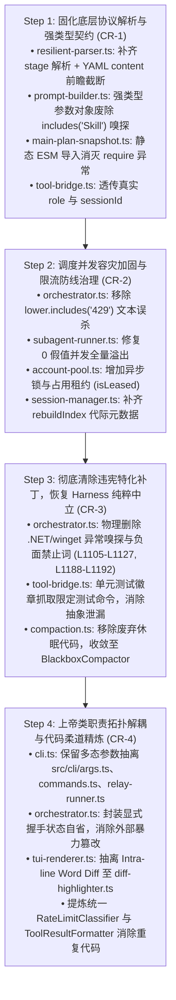

# CPH-PI 对抗审计安全整改原子实施计划 (Adversarial Remediation Plan)

- **输入契约**: `CPH-PI/.docs/audit/FINAL-AUDIT-REPORT.md` (全量对抗审计决议蓝图)
- **驱动流水线**: `safe-remediation-pipeline`
- **目标分支**: `fix/adversarial-audit-remediation-20261014`
- **基线测试**: 508 passed / 0 failed / 72 test files (100% 绿灯保障)
- **整改架构原则**:
  1. 严格遵守《AGENTS.md》核心开发与治理准则（Harness 纯粹与中立、正向引导优先、黑盒抽象、持久化与视口正交）；
  2. 严守【特征测试行为锁死 (Characterisation Tests)】门禁：先写失败测试捕获缺陷，再行修复，最后全量回归；
  3. 严格遵循拓扑次序图（底层契约 ➔ 调度容灾 ➔ 治理违宪清理 ➔ 上帝类解耦）。

---

## 依赖修复拓扑执行流 (Topological Execution Flow)

---

## 阶段任务原子切片明细

### Task 1: 固化底层协议解析与强类型契约 (CR-1)
- **核心文件**:
  - `src/protocol/resilient-parser.ts` (L309-L347, L208-L265)
  - `src/protocol/prompt-builder.ts` (L140-L164)
  - `src/session/main-plan-snapshot.ts` (L100-L110)
  - `src/protocol/tool-bridge.ts` (L485-L488)
- **7 类制品双向冲击面**:
  - `函数/接口`: `ResilientParser.parseSubagentsBlock` 增加 `stage` 字段提取；`PromptBuilder.buildTurn2TaskPrompt` 接收强类型对象；
  - `依赖`: `main-plan-snapshot.ts` 使用顶层静态 `import { ExecutionLedger }`；
  - `数据/存储`: `ExecutionLedger` 记录真实的 `role` 和 `sessionId`。
- **特征测试设计**:
  - 新建 `tests/protocol/subagent-parser-stage.test.ts`：验证 JSON 与 YAML 动作块中 `stage: 2` 被正确解析，未指定时默认值为 1；
  - 新建 `tests/protocol/prompt-builder-order.test.ts`：构造包含 `"Skill"` 和 `"技能"` 文本的工具输出，断言 `toolResult` 与 `skillsSection` 不发生对调；
  - 新建 `tests/protocol/yaml-content-lookahead.test.ts`：验证 YAML 动作块中 `content:` 位于 `path:` 之前时，`path:` 不被吞入文件正文；
  - 新建 `tests/session/snapshot-static-import.test.ts`：验证快照格式化函数在纯 ESM 下无异常生成物理账本挂载头。
- **实施改动**:
  1. `resilient-parser.ts`: JSON 解析增加 `stage: Number(s.stage) || 1`；YAML 解析增加 `stageMatch` 正则提取并赋值；
  2. `resilient-parser.ts`: YAML `contentMatch` 正则增加同级前瞻断言 `(?=\n\s*(?:path|tool|file)\s*:|\Z)`；
  3. `prompt-builder.ts`: `buildTurn2TaskPrompt` 采用重载/对象签名，若入参为对象直接取字段，若为位置参数优先按 `(task, toolResult, skillsSection, toolName)`，彻底移除基于内容 `.includes("Skill")` 的猜测；
  4. `main-plan-snapshot.ts`: 替换动态 `require` 为静态导入；
  5. `tool-bridge.ts`: `recordToLedger` 接收调用方传入的上下文 `context?: { role?: string; sessionId?: string }`。
- **验证命令**:
  - `bun test tests/protocol/subagent-parser-stage.test.ts`
  - `bun test tests/protocol/prompt-builder-order.test.ts`
  - `bun test tests/protocol/yaml-content-lookahead.test.ts`
  - `bun test tests/session/snapshot-static-import.test.ts`
  - `bun test tests/protocol/`

---

### Task 2: 调度并发容灾加固、限流误杀拦截与无锁竞态防护 (CR-2)
- **核心文件**:
  - `src/agent/orchestrator.ts` (L1397-L1411)
  - `src/agent/subagent-runner.ts` (L84-L95)
  - `src/auth/account-pool.ts` (L321-L360)
  - `src/session/session-manager.ts` (L185-L199)
- **7 类制品双向冲击面**:
  - `函数/接口`: `isRateLimitResponseText` 仅由强模式匹配；`AccountPool.acquireToken` 增加租约与释放机制；
  - `全局状态`: 增加 `leasedAccounts: Set<string>` 避免并发重入；
  - `数据/存储`: `rebuildIndex` 保全代际字段。
- **特征测试设计**:
  - 新建 `tests/agent/ratelimit-text-filter.test.ts`：验证模型分析文本包含 "排查 429 报错" 或 "Line 429" 时不会触发限流自杀；
  - 新建 `tests/agent/subagent-capacity-zero.test.ts`：模拟全部账号限流，断言 `effectiveCapacity` 不会异常跃升为总账号数；
  - 新建 `tests/auth/account-pool-concurrency-lease.test.ts`：模拟多个并发 worker 同时获取 token，断言各 worker 获取不同账号或顺序排队；
  - 新建 `tests/session/session-manager-rebuild-metadata.test.ts`：验证重建索引后 `generation` 与 `handoffCount` 不丢失。
- **实施改动**:
  1. `orchestrator.ts`: `isRateLimitResponseText` 增加严格的前缀或行边界限定，仅在文本是特定报错信令时判定，豁免长文分析；
  2. `subagent-runner.ts`: `effectiveCapacity` 计算改为显式逻辑：若 `activeAllowedAccounts` 存在且长度为 0，则设为 1（或熔断等待），杜绝 `0 || poolStatus.length` 的假值求值；
  3. `account-pool.ts`: 引入租约标记，在异步获取 token 期间锁定当前账号；
  4. `session-manager.ts`: `rebuildIndex` 补齐 `generation: session.generation ?? 1` 与 `handoffCount: session.handoffCount ?? 0`。
- **验证命令**:
  - `bun test tests/agent/ratelimit-text-filter.test.ts`
  - `bun test tests/agent/subagent-capacity-zero.test.ts`
  - `bun test tests/auth/account-pool-concurrency-lease.test.ts`
  - `bun test tests/session/session-manager-rebuild-metadata.test.ts`
  - `bun test tests/agent/`
  - `bun test tests/auth/`

---

### Task 3: 彻底清除违宪特化补丁，恢复 Harness 纯粹中立 (CR-3)
- **核心文件**:
  - `src/agent/orchestrator.ts` (L1105-L1127, L1188-L1192)
  - `src/protocol/tool-bridge.ts` (L479-L484)
  - `src/agent/compaction.ts`
- **7 类制品双向冲击面**:
  - `提示词/交接文档`: 彻底清除 winget/.NET 特化环境卡点及负面词，交接文档基于通用错误输出；
  - `工具/抽象`: 工具层仅在测试命令时解析徽章；
  - `代码清理`: 清理休眠的 `compaction.ts`。
- **特征测试设计**:
  - 新建 `tests/agent/orchestrator-governance-cleanliness.test.ts`：断言交接文档生成器在面对含 winget/dotnet 文本时不会输出特化建议，断言无“切勿盲目重复调用 winget”等负面词；
  - 新建 `tests/protocol/tool-bridge-badge-sniffing.test.ts`：验证含 "password" 或 "compass" 的普通命令输出不会被误抓取为测试徽章；
  - 更新关联单测保证绿灯。
- **实施改动**:
  1. `orchestrator.ts`: 删除针对 .NET SDK 与 winget 的特化 `if` 分支，替换为通用命令失败提取；
  2. `tool-bridge.ts`: 限制徽章抓取仅在 `command` 匹配 `/(?:bun|npm|pnpm|yarn|jest|vitest|pytest|go\s+test)\s+/i` 时触发；
  3. 清理 `compaction.ts` 或标为废弃别名统一收敛至 `BlackboxCompactor`。
- **验证命令**:
  - `bun test tests/agent/orchestrator-governance-cleanliness.test.ts`
  - `bun test tests/protocol/tool-bridge-badge-sniffing.test.ts`
  - `bun test`

---

### Task 4: 上帝类职责拓扑解耦与代码柔道精炼 (CR-4)
- **核心文件**:
  - `src/cli.ts` (2,122 行解耦)
  - `src/cli/args.ts` (新建，多态参数解析)
  - `src/cli/commands.ts` (新建，Slash 命令路由)
  - `src/cli/relay-runner.ts` (新建，接力编排)
  - `src/agent/orchestrator.ts` (封装自治状态机)
  - `src/ui/tui-renderer.ts` 与 `src/ui/diff-highlighter.ts` (新建)
- **7 类制品双向冲击面**:
  - `模块/依赖`: `cli.ts` 瘦身为纯装配层（< 400 行）；
  - `函数/接口`: 参数解析器独立为纯函数模块；
  - `表现层`: Diff 算法独立。
- **特征测试设计**:
  - 新建 `tests/cli/args-polymorphism.test.ts`：全面测试 `-t 30`（数字超时）、`-t "task"`（字符串任务）、`--debug`（布尔）与 `--debug ./path`（可选值）；
  - 新建 `tests/ui/diff-highlighter.test.ts`：测试词级高亮 Diff；
  - 保证现有 `tests/cli/*.test.ts` 100% 绿灯。
- **实施改动**:
  1. 创建 `src/cli/args.ts`，迁出手工参数解析状态机，保持多态特性；
  2. 创建 `src/cli/commands.ts`，将 355 行 Slash 指令路由解耦为命令处理器表；
  3. 创建 `src/agent/relay-runner.ts`，抽离 CLI 层的多代接力 `while (true)` 循环；
  4. `orchestrator.ts` 提供显式自省方法，消除 `cli.ts` 外部暴力修改 `isHandshakePending`；
  5. 提炼 `src/ui/diff-highlighter.ts`，从 `tui-renderer.ts` 中移出 138 行 Diff 比较算法；
  6. 瘦身后的 `src/cli.ts` 成为清晰整洁的装配入口。
- **验证命令**:
  - `bun test tests/cli/args-polymorphism.test.ts`
  - `bun test tests/ui/diff-highlighter.test.ts`
  - `bun test tests/cli/`
  - `bun test` 全量通过！

---

## 全量终审验收门禁 (Final Acceptance Gate)
- 执行 `bun test`，必须亲眼见证 508+ 个测试 100% 绿色通行；
- 更新 `.docs/CHANGELOG.md` 与 `.docs/MODULE-REGISTRY.md`；
- 向用户提交完整成果。

