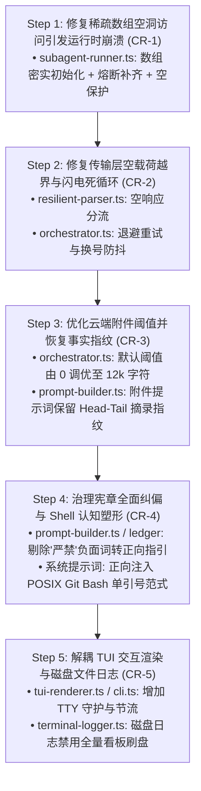

# CPH-PI 核心调度与运行时安全整改实施计划 (Safe Remediation Plan)

- **输入契约**: `CPH-PI/.docs/audit/FINAL-AUDIT-REPORT.md` (全量对抗审计决议蓝图)
- **驱动流水线**: `safe-remediation-pipeline`
- **目标工程**: `E:/copilot-web proxy/CPH-PI`
- **基线测试**: 492 passed / 0 failed / 67 test files (100% 绿灯保障)
- **整改架构原则**:
  1. 严格遵守《AGENTS.md》核心开发与治理准则（Harness 纯粹与中立、正向引导优先、黑盒抽象、持久化与视口正交）；
  2. 严守【特征测试行为锁死 (Characterisation Tests)】门禁：先写失败测试捕获缺陷，再行修复，最后全量回归；
  3. 严格遵循拓扑次序图（底层契约 ➔ 调度容灾 ➔ 提示词正向治理 ➔ 展现层解耦）。

---

## 依赖修复拓扑执行流 (Topological Execution Flow)



---

## 阶段任务原子切片明细

### Task 1: 修复并发熔断稀疏数组空洞引发的运行时崩溃 (CR-1)
- **核心文件**:
  - `src/agent/subagent-runner.ts` (L99, L144, L150-L176, L208-L255, L569-L588)
- **7 类制品双向冲击面**:
  - `函数/接口`: `executeBatch` 返回的 `SubagentTaskReport[]` 必须 100% 密集无 `undefined`；
  - `数据/存储`: 熔断任务的 `error` 明确标为 `STAGE_CIRCUIT_BREAKER`；
- **特征测试设计**:
  - 新建 `tests/agent/subagent-sparse-array.test.ts`；
  - 模拟并发多任务执行时触发 `signal.abort()` 或 `circuitBreakerTriggered = true`；
  - 断言 `executeBatch` 返回的数组无空洞，断言 `formatReportSummary` 在包含异常/取消任务时 100% 安全执行不抛出 `TypeError`。
- **实施改动**:
  1. `subagent-runner.ts:99` 将 `new Array(tasks.length)` 改为全量填充初始状态的密集数组；
  2. 在 `stageWorker` 退出分支中显式补齐未执行任务的失败状态报告；
  3. 在 `formatReportSummary` 中增加 `if (!r) continue;` 防御守卫。
- **验证命令**:
  - `bun test tests/agent/subagent-sparse-array.test.ts`
  - `bun test tests/agent/subagent-runner.test.ts`

---

### Task 2: 修复空响应越界泄漏与 30 轮闪电死循环 (CR-2)
- **核心文件**:
  - `src/protocol/resilient-parser.ts` (L115-L122)
  - `src/agent/orchestrator.ts` (L557-L560, L837-L852)
- **7 类制品双向冲击面**:
  - `函数/接口`: `ParsedTurn` 增加 `{ type: "empty_response"; thought: string }` 类型；
  - `全局状态`: `Orchestrator` 增加 `consecutiveEmptyResponses` 计数器；
- **特征测试设计**:
  - 新建 `tests/protocol/empty-response-handling.test.ts`；
  - 构造包含纯 Progress 进度词但正文为空字符串 `""` 的输入；
  - 断言 `ResilientParser.parse("")` 返回 `type: "empty_response"`（而非 `invalid_chatter`）；
  - 测试 `Orchestrator` 遇到空响应时不会无脑递增正式 `turn` 且不会发送纠偏警告。
- **实施改动**:
  1. `resilient-parser.ts`: 当 `trimmed === ""` 时返回 `empty_response` 类型；
  2. `orchestrator.ts`: 捕获 `empty_response`，进行最多 2 次指数退避重试；重试超限后触发账号切换与灾备跃迁，绝不秒级刷爆 30 轮。
- **验证命令**:
  - `bun test tests/protocol/empty-response-handling.test.ts`
  - `bun test tests/protocol/resilient-parser.test.ts`

---

### Task 3: 优化云端附件阈值并恢复事实指纹 (CR-3)
- **核心文件**:
  - `src/agent/orchestrator.ts` (L162-L163, L733-L760)
  - `src/protocol/prompt-builder.ts` (L213-L224)
- **7 类制品双向冲击面**:
  - `配置/常量`: 默认阈值改为 12,000 字符（可配）；
  - `提示词`: 上传附件时必须包含 Head-Tail 物理事实指纹；
- **特征测试设计**:
  - 新建 `tests/agent/cloud-attachment-threshold.test.ts`；
  - 验证小于 12,000 字符的工具输出直接内联送达；
  - 验证超过阈值上传附件时，Prompt 中仍包含输出行数、状态码与首尾文本截断指纹。
- **实施改动**:
  1. `orchestrator.ts`: `cloudAttachmentThresholdChars` 默认设为 12,000，`cloudAttachmentThresholdLines` 默认设为 200；
  2. `prompt-builder.ts:buildAttachedToolResultPrompt`: 接收并嵌入 `headTailExcerpt` 摘要指纹。
- **验证命令**:
  - `bun test tests/agent/cloud-attachment-threshold.test.ts`
  - `bun test tests/agent/full-file-delivery.test.ts`

---

### Task 4: 治理宪章全面归正与 Shell 认知塑形 (CR-4)
- **核心文件**:
  - `src/protocol/prompt-builder.ts` (L27-L28, L180, L247)
  - `src/session/ledger/execution-ledger.ts` (L129)
  - `cph-main-agent-prompt.txt`
  - `cph-researcher-agent-prompt.txt`
- **7 类制品双向冲击面**:
  - `常量/提示词`: 消除所有“严禁/切勿/不要”负面词，全部重构为正向建设性指引；
  - `规范契约`: 显式告知 Windows 环境为 Git Bash，PowerShell 脚本使用外层单引号字面量包裹。
- **特征测试设计**:
  - 新建 `tests/protocol/prompt-builder-governance.test.ts`；
  - 正则扫描所有内置提示词与协议提醒，断言不包含负面禁止词；
  - 断言系统提示词中包含 POSIX Git Bash 单引号语法指引。
- **实施改动**:
  1. 清洗 `PromptBuilder.PROTOCOL_REMINDER`、`execution-ledger.ts` 等处禁用词；
  2. 在 Agent 系统提示词中正向交代 Windows Shell 单引号语法。
- **验证命令**:
  - `bun test tests/protocol/prompt-builder-governance.test.ts`
  - `bun test tests/skills/tri-agent-prompts.test.ts`

---

### Task 5: 解耦 TUI 交互渲染与磁盘文件日志 (CR-5)
- **核心文件**:
  - `src/ui/terminal-logger.ts` (L128-L140)
  - `src/ui/tui-renderer.ts` (L780-L818)
  - `src/cli.ts` (L1429-L1471)
- **7 类制品双向冲击面**:
  - `展现层/日志`: 屏幕与磁盘日志物理流严格分流；
  - `可观测性`: 磁盘日志体积缩减 80% 以上，纯净可读。
- **特征测试设计**:
  - 新建 `tests/ui/tui-logger-decoupling.test.ts`；
  - 模拟非 TTY 管道输出与文件日志写入，断言 `cph-terminal-*.log` 中不出现全量看板重绘方框，仅记录结构化单行事件。
- **实施改动**:
  1. `TUIRenderer`: 仅在 `process.stdout.isTTY` 时输出动态 ANSI 看板；
  2. `TerminalLogger`: 拦截 stdout 时过滤多行 ANSI 方框或采用单行事件流格式。
- **验证命令**:
  - `bun test tests/ui/tui-logger-decoupling.test.ts`
  - `bun test tests/ui/terminal-logger-session.test.ts`

---

## 全量回归验证门禁 (Final Verification Gate)
在所有任务完成后，执行全量测试套件：
```bash
bun test
```
必须亲眼确认 492+ 个测试 100% 绿灯通行，并更新 `.docs/CHANGELOG.md`。

---

## 实施完成验收记录 (Sign-Off Record)
- **完成时间**: 2026-10-14
- **最终测试结果**: **508 passed / 0 failed across 72 test files (2,235 expects, 100% 绿灯通过)**
- **新增特征测试套件**:
  1. `tests/agent/subagent-sparse-array.test.ts` (CR-1: 稀疏数组与熔断保护)
  2. `tests/protocol/empty-response-handling.test.ts` (CR-2: 空响应分流与重试)
  3. `tests/agent/cloud-attachment-threshold.test.ts` (CR-3: 12k 阈值与物理指纹)
  4. `tests/protocol/prompt-builder-governance.test.ts` (CR-4: 零负面词与 POSIX Shell 规范)
  5. `tests/ui/tui-logger-decoupling.test.ts` (CR-5: TUI 与磁盘日志解耦)
- **文档沉淀**: 已生成并更新 `CPH-PI/.docs/CHANGELOG.md`。
- **治理核验**: 严格遵守《AGENTS.md》根目录零污染、Harness 纯粹中立、正向引导、黑盒抽象及持久化与视口正交准则。

