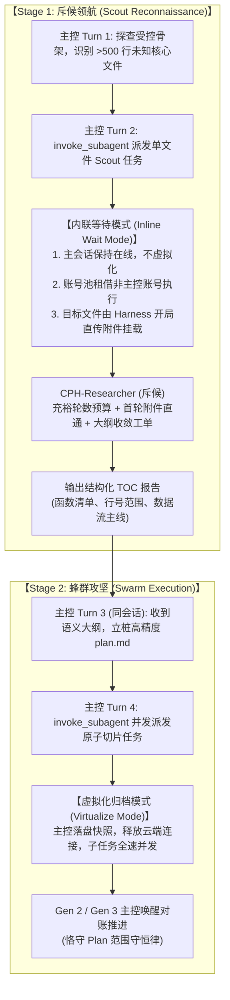

# 斥候领航与蜂群攻坚双轨调度及受控 Plan 调整架构设计规范
(Two-Stage Scout & Swarm Protocol with Controlled Plan Refinement)

- **设计日期**: 2026-10-18
- **版本**: v1.0.0
- **状态**: 已批准 (Approved)
- **目标组件**: `CPH-PI` (调度核、系统提示词、工作区专属技能)

---

## 1. 背景与核心问题定义 (Problem Statement)

在真实复杂长耗时项目（如代码质量深度审查）执行日志（`cph-terminal-2026-10-18T14-34-09.log`）的复盘中，揭示了以下深层次工程矛盾：

### 1.1 现状与痛点复盘
1. **超大单文件诱发失控 Handoff（Runaway Handoff 现象）**：
   - 子代理 Sub-3 面对 1112 行的大型复合文件（`JsygtClient.psm1`），被赋予了横跨通信层、数据模型、CSV 原生/回退等价性、全部异常契约及外部测试验证的宽泛目标；
   - 模型在缺乏附件直传心智引导下，采用了极度保守的 `powershell ... for($j=955;$j -lt 995...)` 每次读 40 行的命令切片模式，导致 30 轮推理预算全消耗在翻页空转中；
   - 连续触发 4 次 Handoff（5 个 Hop），耗时 1572 秒直至超时中断。
2. **对照组的启示**：
   - 在 Gen 2 主控唤醒后，重新派发的补缺任务 Sub-9 提示词高度聚焦：“*仅补齐失败专项...以完整静态审查报告为交付目标，不要求实施修复或穷尽动态实验。优先收敛已有证据，避免因扩展验证反复交接*”；
   - **Sub-9 在 117 秒、7 轮内一次性完成（0 次 Handoff）**，交付了高质量的静态审查报告。
3. **“未读先切”的架构悖论**：
   - 若要避免子代理过载，主控必须在派发前将任务切细（如单任务 ≤300 行）；
   - 但主控在真正深入阅读代码前，无法预知上千行未知大文件内部包含多少函数、模块与依赖，导致切片缺乏依据或流于盲猜。

---

## 2. 核心架构设计 (Architecture & System Design)

为彻底解决上述悖论与两极分化的 Handoff 现象，系统确立三大设计基石：



### 2.1 双轨调度契约 (Dual-Track Scheduling Contract)

Harness 调度核（`Orchestrator`）根据主控调派的工单形态，自适应采用两种正交的调度管道：

| 调度轨 | 触发条件 | 主控会话状态 | 账号分配 | 目标文件投递 | 核心目标 |
|---|---|---|---|---|---|
| **内联等待轨 (Inline Mode)** | `subagents.length === 1 && subagents[0].role === 'researcher'` 且为大纲探测 | 保持活跃在线，不虚拟化，不切换代次 | 从账号池租借**非主控独立账号**（保证物理隔离） | Harness 在 Turn 1 自动将目标文件打包为云端附件送达 | 2~3 分钟内极速获取文件语义大纲，零上下文切换损耗 |
| **虚拟化归档轨 (Virtualize Mode)** | `subagents.length > 1` 或包含 `coder` 实施任务 | 物理快照落盘并安全释放云端 WebSocket 连接 | 账号池全量并发滑窗调度 | 按需挂载与引用 | 长耗时大规模并发攻坚，事后唤醒 Successor 主控对账推进 |

### 2.2 斥候认知塑形与首轮附件直通 (Scout Cognition & Direct Attachment)

1. **零新增云端 Agent 维护成本**：
   - 斥候直接复用已有的 `CPH-Researcher` 角色，无需在 M365 / Copilot Studio 注册额外的 Agent ID，保持 **Main (统帅) / Researcher (侦探) / Coder (工匠)** 经典三元组的纯粹性。
2. **充足安全预算与工单精准收敛**：
   - 杜绝硬编码 6~8 轮硬上限（规避轻微命令失误导致的意外中断），保留物理层标准的 25~30 轮充裕预算；
   - 通过**首轮工单提示词（First-Turn Prompt）**进行精准认知锚定：
     ```yaml
     role: researcher
     description: <目标文件> 模块骨架与函数大纲探查
     prompt: |
       【任务性质与收敛标准】: 本任务为单文件架构透视斥候任务。你的目标仅为梳理该文件的模块骨架、导出函数/类清单（附精确行号）及核心输入输出数据流向。无需开展逐行审查细节，无需运行动态测试或测试复现。大纲整理完毕后，立即在 FINAL_ANSWER 中输出结构化大纲结题。
     ```
3. **开局直传附件挂载**：
   - Harness 在派发 Scout 任务时，自动检测任务中的核心目标文件，通过 `SubstrateUploader` 秒级上传至云端 OneDrive/SharePoint，并作为 `initialAnnotations` 挂载在第 1 轮消息中；
   - Scout 开局即拥有全量源文件，彻底消除“找不到路径、空格路径转义失败、分块探测文件”的初始摩擦。

### 2.3 后继主控 Plan 调整规范：范围守恒律 (Conservation of Scope)

为支持第二代及后继主控（Gen 2 / Gen 3）面对子代理部分成功（Partial Success）时的自愈调整能力，同时杜绝任务无限漂移（Goal Drift），确立以下契约：

1. **允许的操作（纵向细化切片）**：
   - 当某个父计划项（如“按模块拆分只读审查任务”）下有部分子任务成功、部分未达成时，主控允许将该待办项拆分为：
     - `- [x] <父任务描述>（已完成部分成果对账锁定）`
     - `- [ ] <父任务描述>：定向补缺未达成项（精确限定遗留文件与单点关注点）`
2. **明确的边界（范围守恒，严禁横向发散）**：
   - 后继主控必须严格围绕初始战役目标推进；
   - 在推进过程中，保持战役边界闭环，不追加与既定目标无关的新增议题（如临时决定开展全局性能重构、引入无关依赖探测等）；
   - `FINAL_ANSWER` 的唯一门禁依然是物理清单全部打勾 `- [x]`。

### 2.4 全量附件阅读与消灭切片空转 (Attachment-First Mindset)

在 `cph-researcher-agent-prompt.txt` 中强化正向引导：
- 明确告知系统底层已提供全量源码附件，阅读文件时优先调用 `read_file` 一次性获取全局视野；
- 采用宏观语义块（函数、类、数据流）进行定位分析，摒弃通过 Shell 命令每次 40 行分块读取的操作方式；
- 收集完整证据后立即在 `FINAL_ANSWER` 中输出结构化交付物，以单会话原生收敛为常态。

---

## 3. 具体修改组件与实施清单 (Implementation Checklist)

### 3.1 调度核与基座代码 (`CPH-PI/src/`)
- [ ] **`src/agent/orchestrator.ts`**:
  - 在 `invoke_subagent` 分支中增加判断：若任务为单个轻量调研任务（`subagents.length === 1 && subagents[0].role === 'researcher'` 且标记为 scout），走**内联等待**路径（保持主控 WebSocket 活跃，从账号池申请非当前主控账号的独立 Token 驱动子代理，执行完毕后将总结作为该 tool call 的 output 直接返回，不切代次）。
  - 若任务包含多个子代理或包含 coder 实施角色，继续走**虚拟化归档与代际交接**路径。
- [ ] **`src/agent/subagent-runner.ts`**:
  - 在 `runSingleSubagent` 启动时，若检测到工单中明确了单个目标源文件，自动提取路径并调用 `SubstrateUploader` 预上传，将其注入 `initialAnnotations`，实现开局全量附件挂载。

### 3.2 系统提示词 (`CPH-PI/*.txt`)
- [ ] **`cph-main-agent-prompt.txt`**:
  - 增加“两阶段斥候领航（Two-Stage Scout & Swarm）”工作流指导；
  - 明确“Plan 调整规范与范围守恒律（Conservation of Scope）”；
  - 升级子任务切片度量指标（建议单任务聚焦约 300 行或单一逻辑子系统）。
- [ ] **`cph-researcher-agent-prompt.txt`**:
  - 注入全量附件优先心智与语义块审阅原则，消灭 40 行命令分块空转。

### 3.3 工作区专属技能 (`CPH-PI/skills/`)
- [ ] **`skills/subagent/SKILL.md`**:
  - 增加 Scout 斥候任务工单标准提示词模板；
  - 明确内联等待与并发蜂群双轨规则；
  - 明确后继主控针对 Partial Success 时的原子切片回填范式。

---

## 4. 验证与对账方案 (Verification Plan)

1. **自动化测试套件回归**：
   - 运行 `bun test tests/`，确保 622+ 个单元与集成测试保持 100% 通过；
   - 针对内联等待调度逻辑与开局附件注入编写新增单元测试。
2. **打包与分发产物校验**：
   - 运行 `bun run build:package; bun run package`；
   - 验证 `dist/copilot-agent-bundle.zip` 正确包含最新提示词与更新后的 `skills/subagent/`。
