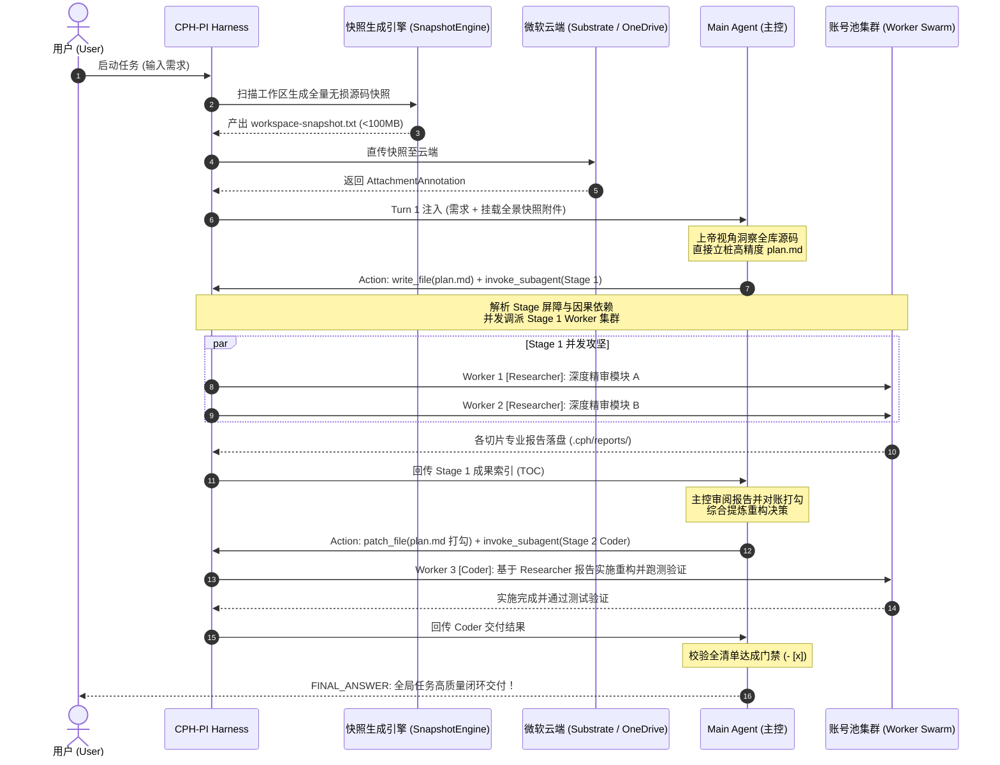

# 全工作区无损源码快照增压与因果感知调度架构设计规范 (Workspace Snapshot Supercharger & Causality-Aware Pipeline Architecture)

> **设计日期**: 2026-10-19  
> **状态**: 批准待实施 (Approved - Pending Implementation)  
> **对应规范**: `AGENTS.md` 核心开发与治理准则、`CR-Snapshot-Pipeline`

---

## 1. 背景与核心动机 (Background & Core Motivation)

### 1.1 现有自主 Agent 调度的痛点与瓶颈
在当前的 CPH-PI 架构中，主协调智能体（Main Agent）面对一个新项目或未知的复杂工作区时，受限于对工作区真实代码的摸黑状态，必须经历多轮探查：
1. 启动初期调用 `run_command` 列目录，或调派专职的“斥候子代理（Scout Researcher）”去遍历大文件；
2. 反复调用 `read_file` 查阅各个子模块代码，一旦路径推测错误便遭遇 `ENOENT`；
3. 多次交互往返消耗了大量的会话轮次预算（Turns Budget），造成严重的 token 消耗与注意力稀释，极易诱发代际接力中的注意力漂移与失忆反问。

### 1.2 微软云端 Substrate 附件直传的物理红利
根据《AGENTS.md》准则 9（全量附件投递与杜绝内联倾倒），微软 Copilot 底层接入 Substrate 云端文档引擎。通过 OneDrive 附件直传的大文件，会在云端由 Substrate 建立全文索引并按需召回，**完全不占用本地会话消息传输的行数与字符限制，也不会因文件体积打爆模型上下文**。

### 1.3 模式选择的伪优雅与统一全景快照增压方案
在探讨架构演进时，曾设想过“审查走 Pipeline 流水线、编码走自主 Agent”的双模架构，但这立即引入了难以消解的模式选择困境（用户选择增加负担，系统自动分类极易误判，且现实任务往往是审查与编码交织的）。  
因此，系统决定全面采用**“统一全景快照首轮增压方案（Turn 1 Snapshot Supercharger）”**：无论用户下达审查、重构、排错还是编码任务，Harness 在开局首轮直接向 Copilot 挂载工作区全量无损源码快照附件。模型在第 1 轮即拥有上帝视角，实现“开局即洞察全貌、首轮精准立桩、因果有序派发”。

---

## 2. 物理快照生成引擎设计 (Workspace Snapshot Generator)

### 2.1 物理生成流程与存储位置
- **生成时机**: CLI 启动或新任务开启之初，由 Harness 本地执行器在毫秒级自动构建完成；
- **存储路径**: 物理落盘于 `.cph/cache/workspace-snapshot-<sha256>.txt`，避免在代码工作区造成文件污染；
- **缓存复用机制**: 基于工作区 Git 提交状态与文件哈希，若工作区源码未发生变更，直接复用既有快照缓存，无需重复全量扫描。

### 2.2 快照文件结构规范
快照文件采用纯文本格式，包含清晰的段落分隔符，供云端文档引擎进行清晰分块与精准检索：
```text
======================================
WORKSPACE STRUCTURE (REL-PATHS)
======================================
Library/CNNJI QUERY/web/modules/YardApi.psm1
tools/jsygt-ocr/Program.cs
tools/jsygt-ocr/OcrEngine.cs
web/public/yard.js
plan.md
AGENTS.md

======================================
FILE CONTENTS
======================================

##################################################
FILE: Library/CNNJI QUERY/web/modules/YardApi.psm1 (Lines: 340)
##################################################
<文件全量 UTF-8 内容>

##################################################
FILE: tools/jsygt-ocr/Program.cs (Lines: 236)
##################################################
<文件全量 UTF-8 内容>
```

### 2.3 严苛物理过滤与安全门禁 (Pruning & Safety Gates)
为保障快照的高信噪比与云端投递稳定性，快照生成器配置强制物理门禁：
1. **强制排除目录与文件**:
   - 依赖与构建输出: `node_modules/`, `dist/`, `.git/`, `.cph/`, `.vscode/`, `bin/`, `obj/`, `coverage/`, `build/`
   - 压缩包与非文本资源: `.zip`, `.tar`, `.gz`, `.7z`, `.rar`, `.png`, `.jpg`, `.jpeg`, `.gif`, `.ico`, `.svg`, `.pdf`, `.onnx`, `.model`
   - 动态日志与临时转储: `*.log`, `*.tmp`, `*.cache`
   - 严格遵循本地 `.gitignore` 规则。
2. **强制编译原生二进制黑名单**:
   - 严禁打入以下不可读的原生二进制文件: `.exe`, `.dll`, `.so`, `.dylib`, `.bin`, `.pdb`, `.class`, `.pyc`。
3. **源码扩展名白名单（支持配置扩展）**:
   - 覆盖所有核心语言与配置文本: `.ps1`, `.psm1`, `.psd1`, `.py`, `.js`, `.mjs`, `.cjs`, `.ts`, `.tsx`, `.jsx`, `.cs`, `.json`, `.md`, `.sql`, `.bat`, `.cmd`, `.html`, `.css`, `.yaml`, `.yml`, `.xml`, `.txt`, `.toml`, `.sh`。
4. **全量投递准则与物理防爆安全线**:
   - **彻底废除单文件 2MB / 5000 行的人为截断与抽稀**：所有符合白名单的源码文件 **100% 原始完整打入快照**，确保云端 Substrate 建立完整语义索引，杜绝模型因局部盲视而发起补读空转；
   - **底层物理内存安全线**: 快照总大小上限设定为 100MB（仅作为防止宿主内存溢出的最后底线防护，常规代码库通常在 1MB~30MB 之间）。

---

## 3. 快照挂载通道与首轮认知编排 (Turn 1 Grounding & Mounting)

### 3.1 挂载管道与时机编排
- **Custom Agent 直连模式 (Direct Mode / CPH-Dev)**:
  在 **Turn 1 首轮**直接通过 OneDrive 附件通道直传挂载快照（`uploadedAttachment.annotation`），与用户需求、并发集群容量事实一并送达；
- **通用握手模式 (Handshake Mode)**:
  Turn 1 进行物理链路与宿主环境探测，在 **Turn 2 注入用户正式需求时**作为核心附件全量挂载送达。

### 3.2 首轮提示词认知引导 (Turn 1 Prompt Guidance)
在提示词中显式注入快照感知指令，正向引导模型建立全局掌控感，彻底消除盲查冲动：
```text
【全工作区无损源码快照已挂载送达】
✔ 工作区全量源码与完整相对路径拓扑已封装为附件【workspace-snapshot.txt】挂载至本会话。
✔ 该快照包含当前工作区所有业务源码与目录结构，云端文档引擎已全量解析完毕。
✔ 【高效攻坚行动指引】：
1. 你已天然拥有全工作区的完整源码视野，无需调派斥候（Scout）子代理或发起盲读类的 read_file / run_command 探查目录；
2. 请直接基于附件中的完整代码与结构拓扑，在第一轮立桩精准的 plan.md 物理清单（格式为 - [ ] 步骤描述，精准定位至目标文件与核心关注点）；
3. 计划立桩后，立即进入子任务调派或直接推进外科手术级局部修改！
```

---

## 4. Tri-Agent 系统提示词推倒重塑 (Tri-Agent Prompt Re-Architecture)

由于工作流范式发生了质的跃迁，原有的三套 Agent 系统提示词全部推倒重写，摒弃原有的摸黑探查补丁，建立高度自洽的新型分工：

### 4.1 Main Agent (cph-main-agent-prompt.txt) 重塑：从“摸黑探查者”到“上帝视角总参谋”
- **彻底废除“两阶段斥候领航协议 (Scout Protocol)”**：
  模型开局已有全景快照，不再需要任何 Scout 斥候探查轮次；
- **首轮直接立桩终局级 `plan.md`**：
  在 Turn 1 凭借全局视野，直接看清所有模块依赖与调用链，输出精确定位到文件和关键行号范围的 `- [ ]` 物理清单；
- **纯粹的统帅职责**：
  1. 首轮全景规划（出 `plan.md`）；
  2. 识别依赖时序，按批次派发精准工单；
  3. 审阅子代理回传报告并用 `patch_file` 勾选 `plan.md`（`- [x]`）；
  4. 终局收敛门禁：所有项达成后输出 `FINAL_ANSWER`。

### 4.2 Subagent（子代理）职责重塑：从“探路者”转为“高专注并发攻坚锤”
子代理的核心价值转变为：**利用账号池并发吞吐 + 干净独立的注意力窗口，执行单点深度攻坚与自动化测试验证**。
- **Researcher (cph-researcher-agent-prompt.txt)**:
  - 彻底摆脱数行号、写目录大纲的杂役；
  - 成为专注于单一切片的**深度分析锤**：针对指定模块进行热核级代码审查、安全漏洞挖掘、状态机竞争条件排查或逆向推理，产出高质量专业结题报告；
- **Coder (cph-coder-agent-prompt.txt)**:
  - 拥有极其清晰的工单输入，专注于**外科手术级代码实施与自动化验证**：实施局部精准补丁（`edit`/`patch`），并在终端运行单元测试命令（`run_command`），测试全绿后结题交付。

### 4.3 因果依赖与派发时机控制铁律 (Causality, Stage Barrier & Anti-Blind-Concurrency)
**严禁盲目全并发！主控必须深刻感知任务间的因果时序：**
1. **先研后改（Research-First Before Code）**：
   若 Coder 的编码实施依赖 Researcher 的审计结论与架构推演（例如：Worker 4 [Coder] 的实施依据正是 Worker 2 [Researcher] 的审查报告），主控必须分阶段派发：
   - 方式 A：显式利用 `stage: 1`（派发 Researcher）与 `stage: 2`（派发 Coder），由 Harness 底层保障阶段串行与因果屏障；
   - 方式 B：在第 N 轮仅派发阶段 1 的 Researcher 集群，待收到报告并经由主会话在 `【Thought】` 中完成审阅与决策综合后，在第 N+1 轮再派发 Coder 工单；
2. **同阶段正交并发（Same-Stage Orthogonal Concurrency）**：
   仅当多个子任务负责完全不重叠的文件集合且彼此无输入依赖时（如并行审查 4 个独立模块），才在同阶段进行满载并发派发。

---

## 5. 架构集成与执行数据流 (End-to-End Architecture Flow)



---

## 6. 实施路线与质量门禁 (Implementation Plan & Quality Gates)

### Phase 1: 物理快照引擎与单元测试 (Snapshot Engine)
- 新增 `src/workspace/snapshot-generator.ts`，实现目录树与源码打平拼接；
- 严格落地排除黑名单（`.exe`, `.dll`, `.git`, `node_modules` 等）与扩展名白名单；
- 编写 `tests/workspace/snapshot-generator.test.ts`，验证过滤逻辑、100% 源码完整性与体积防爆安全线。

### Phase 2: Orchestrator 挂载通道集成 (Pipeline Integration)
- 在 `Orchestrator` 启动流中集成快照生成与云端直传；
- 在 `PromptBuilder` 中升级首轮提示词，注入快照感知引导与行动指引；
- 适配后继会话接力与 Task Invariant Pinning 锚点。

### Phase 3: Tri-Agent 系统提示词推倒重写 (Prompts Overhaul)
- 全面重写 `cph-main-agent-prompt.txt`：废除 Scout 机制，确立全景首轮立桩、因果时序与依赖控制；
- 全面重写 `cph-researcher-agent-prompt.txt`：转为单点深度分析锤；
- 全面重写 `cph-coder-agent-prompt.txt`：转为接单即改、自测自闭环实施专家；
- 全量提示词遵守《AGENTS.md》正向引导铁律，严禁出现负面禁止词。

### Phase 4: 全量回归与实战对账 (Verification & Packaging)
- 运行 `bun test` 确保全部 650+ 测试套件 100% 通过；
- 执行打包脚本 `bun run package; bun run build:package` 同步分发包；
- 在真实测试环境验证首轮快照立桩与因果编排的实际表现。
