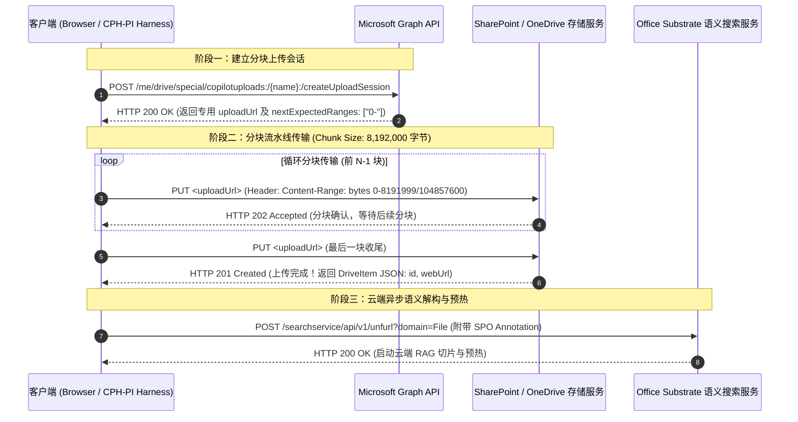

# 全工作区源码快照增压、大文件分块上传与因果调度架构设计规范 (Workspace Snapshot Supercharger, Resumable Upload & Causality-Aware Pipeline Architecture)

> **设计日期**: 2026-10-19  
> **状态**: 【已废止 / SUPERSEDED】请参阅唯一终审规范：[2026-10-19-unified-workspace-supercharger-and-pnp-mirror-architecture.md](./2026-10-19-unified-workspace-supercharger-and-pnp-mirror-architecture.md)  
> **实测证据**: 9222 端口 Edge 浏览器 100MB 实测抓包 (`upload-network-trace.json`)  
> **核心原则**: 遵循《AGENTS.md》核心开发准则、Harness 纯粹中立性与正向认知塑形、摒弃负面禁止词

---

## 1. 背景与物理链路逆向发现 (Background & CDP Trace Verification)

### 1.1 现有模式痛点与传输瓶颈
当前 CPH-PI 架构中，主协调智能体（Main Agent）在新项目中由于缺乏代码全景视野，必须经历 5~10 轮盲目列目录、推测路径、调派斥候子代理（Scout）的冗长探查，导致会话轮数消耗过快、注意力稀释甚至引发代际失忆。  
为彻底解决此问题，系统采用**开局全景源码快照直传增压**方案。  
然而，在分析底层传输链路时，发现现有实现 [`SubstrateUploader.uploadDocumentToOneDrive`](file:///E:/copilot-web%20proxy/CPH-PI/src/transport/substrate-uploader.ts#L128) 采用的是 Microsoft Graph 单次简易上传接口：
`PUT https://graph.microsoft.com/v1.0/me/drive/special/copilotuploads:/{fileName}:/content`  
**根据微软官方规范与网络物理限制，该简易接口硬性限制仅支持 ≤ 4MB 的小文件**。一旦工作区源码快照（通常在 5MB ~ 30MB）超过 4MB，简易接口会直接报错（HTTP 413 或连接强行重置），导致上传中断。

### 1.2 9222 端口实测抓包与真实大文件传输协议还原
通过连接宿主机 9222 端口的 Edge 浏览器，实测上传 **100MB 真实文本文件（104,857,600 字节）**，完整捕获并还原了微软云端的大文件分块传输状态机：



**实测关键物理参数**：
1. **分块颗粒度**: 浏览器精确采用 **`8,192,000` 字节**（刚好是 8,000 KB，严格符合微软要求的 320 KiB 整数倍）；
2. **标头契约**:
   - `PUT <uploadUrl>`
   - `Content-Range: bytes <start>-<end>/<total>`
   - `Content-Length: <chunkSize>`
3. **传输性能**: 100MB 全量文本在企业 SharePoint 通道中仅用时 24 秒即全量落盘，传输吞吐高达 ~4.2 MB/s。

---

## 2. 大文件分块上传引擎规范 (Resumable Upload Session Engine)

### 2.1 双通道自适应路由策略 (Adaptive Routing)
升级 [`SubstrateUploader.uploadDocumentToOneDrive`](file:///E:/copilot-web%20proxy/CPH-PI/src/transport/substrate-uploader.ts)：
- **通道 A: 简易直传 (< 4MB)**
  保留原有的 `PUT ...:/content` 接口，单次往返毫秒级完成，满足小文件读写与局部审查报告的轻量交付；
- **通道 B: 断点分块传输 (≥ 4MB)**
  自动切入 `createUploadSession` 流水线，以 `8,192,000` 字节为单位进行分块并发/串行上传，支持大至 100MB 的完整工作区快照。

### 2.2 核心实现流程 (Chunked Upload Loop)
1. **创建会话**:
   - `POST https://graph.microsoft.com/v1.0/me/drive/special/copilotuploads:/{fileName}:/createUploadSession`
   - 请求体: `{"item": {"@microsoft.graph.conflictBehavior": "replace", "name": fileName}}`
   - 提取响应中的 `uploadUrl`；
2. **循环分块 PUT**:
   - 从源 Buffer 中切片 `chunk = buffer.subarray(offset, offset + 8192000)`；
   - 构造标头:
     - `Content-Range: bytes ${offset}-${offset + chunk.length - 1}/${totalBytes}`
     - `Content-Length: ${chunk.length}`
   - 处理响应:
     - 中间分块期望状态码: `202 Accepted`；
     - 最后分块期望状态码: `201 Created` 或 `200 OK`，从响应中提取 `driveItemId`、`webUrl`、`parentReference`；
3. **构造 SPO 凭据**:
   - 沿用成熟的 `resolveSpoBase64` 解析 `siteId,webId,listId`；
   - 生成 `annotationId = SPO_${spoBase64}_${driveItemId}`；
   - 输出标准的 `AttachmentAnnotation`（`LocalFile` 类型）。

---

## 3. 工作区全量源码快照生成引擎 (Workspace Snapshot Generator)

### 3.1 物理生成机制与存储
- **生成时机**: 主控启动期或任务初始化阶段在宿主本地物理层构建；
- **物理路径**: `.cph/cache/workspace-snapshot-<sha256>.txt`（严禁在工作区根目录写入未受控文件）；
- **缓存策略**: 基于文件元数据与内容 SHA-256 哈希，若工作区源码无改动直接命中缓存，零二次开销。

### 3.2 快照文件结构规范
```text
======================================
WORKSPACE STRUCTURE (REL-PATHS)
======================================
Library/CNNJI QUERY/web/modules/YardApi.psm1
tools/jsygt-ocr/Program.cs
plan.md
AGENTS.md

======================================
FILE CONTENTS
======================================

##################################################
FILE: Library/CNNJI QUERY/web/modules/YardApi.psm1 (Lines: 340)
##################################################
<文件全量 UTF-8 内容>

##################################################
FILE: tools/jsygt-ocr/Program.cs (Lines: 236)
##################################################
<文件全量 UTF-8 内容>
```

### 3.3 严苛物理过滤与安全门禁 (Pruning & Safety Gates)
1. **强制排除目录与文件**:
   - 构建产物与虚拟环境: `node_modules/`, `dist/`, `.git/`, `.cph/`, `.vscode/`, `bin/`, `obj/`, `coverage/`, `build/`
   - 压缩包与非文本资源: `.zip`, `.tar`, `.gz`, `.7z`, `.rar`, `.png`, `.jpg`, `.jpeg`, `.gif`, `.ico`, `.svg`, `.pdf`, `.onnx`, `.model`
   - 严格遵循本地 `.gitignore`；
2. **强制原生二进制黑名单**:
   - 彻底阻断 `.exe`, `.dll`, `.so`, `.dylib`, `.bin`, `.pdb`, `.class`, `.pyc` 等不可读原生二进制；
3. **源码扩展名白名单（支持动态扩展）**:
   - `.ps1`, `.psm1`, `.psd1`, `.py`, `.js`, `.mjs`, `.cjs`, `.ts`, `.tsx`, `.jsx`, `.cs`, `.json`, `.md`, `.sql`, `.bat`, `.cmd`, `.html`, `.css`, `.yaml`, `.yml`, `.xml`, `.txt`, `.toml`, `.sh` 等核心代码；
4. **全量投递铁律与宿主防爆安全线**:
   - **彻底废除单文件人为截断**：所有符合白名单的源码 100% 完整录入，信任 Substrate 云端 RAG 引擎；
   - **底层物理防爆线**: 设定 100MB 物理上限，防止极端大文件导致 Node/Bun 内存溢出。

---

## 4. 首轮认知编排与挂载管道 (Turn 1 Grounding & Mounting)

### 4.1 挂载时机与会话全生命周期一致性 (Grounding Consistency)
为确保“知行合一”，Harness 在会话全生命周期的所有关键入口均保证快照附件真实送达：
- **Direct Mode (Custom Agent / CPH-Dev)**:
  在 **Turn 1 首轮**将全景快照附件与正式任务一并直传送达；
- **Handshake Mode (通用握手模式)**:
  Turn 1 进行物理基准探测握手，在 **Turn 2 注入正式任务时**作为核心附件全量挂载送达；
- **Successor Session (后继代次会话唤醒)**:
  当触发跨会话代际交接时，Harness 在后继主会话的 **Turn 1 首轮消息中同样全量挂载快照附件（`currentAnnotations` 包含快照 Annotation）**，确保接手会话实打实拥有全景视野，与提示词宣告完全一致。

### 4.2 首轮提示词认知引导 (Turn 1 Prompt Guidance)
提示词全面遵循建设性正向引导，绝不引入历史包袱词汇（杜绝“粉色大象”）：
```text
【全工作区无损源码快照已挂载送达】
✔ 工作区全量源码（共 N 个文件）与相对路径拓扑已封装为附件【workspace-snapshot.txt】挂载至本会话。
✔ 云端文档引擎已全量解析就绪，你天然具备全工作区完整代码视野。
✔ 【高效攻坚行动指引】：
1. 直接基于附件中的完整代码与结构拓扑，在第一轮立桩精准的 plan.md 物理清单（格式为 - [ ] 步骤描述，精准定位至目标文件、核心关注点与调用关系）；
2. 识别任务依赖拓扑，按需分批调派专项子代理集群协同攻坚，或直接推进外科手术级局部修改！
```

---

## 5. Tri-Agent 系统提示词推倒重塑与因果感知调度原则

由于全景快照赋予了主控上帝视角，原先建立在摸黑探查基础上的三套 Agent 系统提示词全部推倒重写：

### 5.1 Main Agent (`cph-main-agent-prompt.txt`) 重塑
- **首轮终局立桩**：在 Turn 1 依据快照直接产出涵盖所有切片与依赖的终局级 `plan.md`；
- **统帅职责纯粹化**：全局规划、依赖拓扑把控、成果对账打勾、终局收敛门禁。

### 5.2 Subagent 职责重构
- **Researcher (`cph-researcher-agent-prompt.txt`)**:
  - 定位为纯粹的“单点深度攻坚分析锤”；
  - 聚焦特定切片（≤300 行）进行热核级代码审查、安全漏洞深潜、状态机竞争条件逆向，输出专业报告；
- **Coder (`cph-coder-agent-prompt.txt`)**:
  - 外科手术级代码实施与自动化测试闭环验证专家；
  - 专注于局部补丁（`edit`/`patch`）并在终端运行测试命令（`run_command`），测试全绿后交付。

### 5.3 通用因果依赖与时序感知调度准则 (DAG Causality & Dependency Awareness)
主控在任务编排中全面建立通用有向无环图（DAG）的因果感知，根据上下游依赖形态自主决策派发时机，杜绝盲目并发：

1. **多元上下游依赖感知与阶段屏障**：
   - **契约先于实现**：接口定义、架构契约先确立，下游具体实现模块再开工；
   - **底座先于应用**：公共类库与核心服务先打桩就绪，依赖它的上层业务再开工；
   - **研判先于重构**：调研走查、根因排查报告先产出，经主控在会话中综合决策提炼后，再派发编码改造工单；
   - **实施先于集成**：各独立模块代码实施与单测通过后，再调度集成测试与端到端验证；
   - **阶段调度机制**：对存在上述因果依赖的任务，优先采用阶段划分（`stage: 1` ➔ `stage: 2` 屏障串行）或等待上游成果回传并在主会话完成综合裁决后，再派发下游工单。
2. **正交任务满额并发 (Orthogonal Concurrency)**：
   - 当多个子任务负责互不重叠的文件集合且输入输出彼此独立时（例如并行审查 4 个独立业务模块），直接在同阶段调派与集群容量匹配的 Worker 集群，实现安全高吞吐。

---

## 6. 专有专属 Skill 重构与认知对齐规范 (Dedicated Skills Overhaul)

根据《AGENTS.md》准则 4 & 5，对工作区内两个专有 Skill 进行深度演进：

### 6.1 `skills/subagent/SKILL.md`：重构为因果感知与正交调度指南
1. **全面纯粹化角色规范**：
   - `researcher`：规范单点深度攻坚分析工单写法，聚焦热核级代码审查、漏洞分析与状态机验证；
   - `coder`：规范外科手术级实施与单测验证（TDD）工单写法；
2. **通用因果时序与时机控制门禁 (Gate 5)**：
   - 强化检查任务拓扑：识别契约、底座、研判与集成等各类上下游关系，对有依赖项严格采用跨阶段屏障或主控综合决策；
   - 规范同阶段正交并发与多阶段屏障调度的标准工单格式。

### 6.2 `skills/handoff/SKILL.md`：后继防失忆与全景快照对齐微调
1. **接力智能体正向认知契约强化**：
   - 明确写入：**“接力智能体处于既定战役的攻坚推进期，天然继承工作区已有的 `plan.md` 物理清单与全景快照视野，直接依据 P0/P1 待办推进单点补缺或对账收敛，无需重新向用户确认初始工程目标”**；
2. **纯粹面向攻坚成果**：
   - 确保交接文档（P0 现场恢复 / P1 战役推进）纯粹聚焦于深度分析成果与代码补丁断点，与快照增压体系保持 100% 连贯一致。

---

## 7. 实施路线与质量门禁 (Phased Implementation Roadmap)

### Phase 0: 大文件分块上传引擎实现 (Resumable Upload Engine)
- 在 `src/transport/substrate-uploader.ts` 实现 `createUploadSession` 与 `8,192,000` 字节分块 PUT 状态机；
- 编写 `tests/transport/resumable-uploader.test.ts`，模拟微软 Graph 202/201 响应，验证分块上传正确性。

### Phase 1: 物理快照生成引擎与单元测试 (Snapshot Generator)
- 实现 `src/workspace/snapshot-generator.ts`，输出规范的快照文本结构；
- 落地黑名单（`.exe`, `.dll`, `.bin`, `.git`, `node_modules` 等）与白名单过滤；
- 编写 `tests/workspace/snapshot-generator.test.ts`，验证 100% 原始源码保留与 100MB 物理安全线。

### Phase 2: Orchestrator 挂载通道与首轮提示词升级 (Mounting Pipeline)
- 在 `Orchestrator` 启动流中集成全量快照生成与云端直传；
- 在 `PromptBuilder` 中注入快照感知指令与零盲查行动指引。

### Phase 3: Tri-Agent 系统提示词推倒重写 (Prompts Overhaul)
- 全面推倒重写 `cph-main-agent-prompt.txt`、`cph-researcher-agent-prompt.txt`、`cph-coder-agent-prompt.txt`；
- 严格遵循《AGENTS.md》正向引导铁律，无负面禁止词，确立因果时序与防盲目并发；
- 编写并更新 `tests/skills/tri-agent-prompts.test.ts`。

### Phase 4: 工作区专有 Skills 重构与对齐 (Skills Overhaul)
- 重构 `skills/subagent/SKILL.md`：废除 Scout 机制，写入因果时序与防盲目并发；
- 微调 `skills/handoff/SKILL.md`：注入接力后继主控防失忆契约与快照对齐；
- 编写 `tests/skills/subagent-skill-governance.test.ts`。

### Phase 5: 全量回归、构建打包与实战验证 (Verification & Bundle)
- 运行 `bun test` 确保 650+ 测试套件 100% 通过；
- 运行 `bun run package; bun run build:package` 重新生成分发制品。
