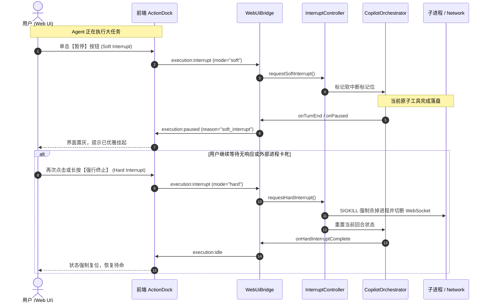

# CPH-PI Node Web GUI 技术架构与交互设计方案

> **文件标识**：`CPH-PI/.docs/specs/2026-10-20-node-web-gui-design.md`  
> **创建时间**：2026-10-20  
> **状态**：Verified & Approved  
> **核心参考**：DeepSeek Harness (`dsh web`) 架构哲学、Pi 极简纯粹基座、CPH-PI 核心开发准则

---

## 1. 背景与设计目标 (Executive Summary & Goals)

### 1.1 现状与痛点
CPH-PI 目前依托终端 TUI（`TuiRenderer` + `readline`）进行人机交互与状态流式展示。尽管终端界面轻巧敏捷，但在复杂代码工程场景下存在以下局限：
1. **多行代码差异（Diff）审查体验受限**：终端窗口宽度有限，大幅代码修改难以并排或折叠对比。
2. **多 Agent 协同缺乏拓扑透视**：`MainAgent`、`Researcher` 与 `Coder` 子代理之间的调用拓扑、世代继承与耗时只能以线性日志呈现。
3. **账户池健康状态无法直观监控**：微软 Copilot 429 限流、Token 轮换、多账号解禁倒计时缺乏直观的仪表板。
4. **底层物理预写日志（Ledger/WAL）检索繁琐**：无法一边观察对话流一边核查 `.cph/state/` 下的物理落盘证据。

### 1.2 参考标杆：DeepSeek Harness (`dsh web`)
DeepSeek Harness 创新性地采用“Everything is a plugin”与全双工 Web 控制台：
- 命令行一键拉起 `dsh web`，自动唤起浏览器控制台；
- 深度思考（Thinking / Reasoning）过程支持丝滑折叠与流式呼吸动效；
- 工具执行卡片化，支持代码 Diff 实时内联审查与人工审批介入；
- 会话生命周期与工作区文件树一体化联动。

### 1.3 核心设计目标
1. **纯粹与零臃肿依赖**：服务端依托 Node/Bun 原生 `node:http` 及现有的 `ws` 库，**不引入** Express、Nest 等重型后端框架。
2. **双模自由切换**：既支持独立纯 Web 模式（`cph-pi web`），也支持与终端 TUI 同步伴随模式（`cph-pi --web`）。
3. **全功能三栏工作台**：对齐现代 Agent IDE，左栏管理会话与账号池，中栏驱动对话与工具执行流，右栏观测工作区文件与物理 Ledger。
4. **状态与内存正交分层**：严格遵循准则 7，前端仅作为状态投影机，权威状态由磁盘预写日志（WAL）与服务端背书，传引用按需加载。

---

## 2. 整体架构与系统边界 (System Architecture & Boundaries)

### 2.1 物理目录划分
严格遵循工作区规则，所有新建代码均位于 `CPH-PI/` 二级目录内：

```
CPH-PI/
├── src/
│   ├── server/                         # Web 服务与 RPC 通讯层 (Node/Bun)
│   │   ├── web-server.ts               # 基于 node:http + ws 的轻量服务器
│   │   ├── web-ui-bridge.ts            # 核心桥接器：实现 OrchestratorEvents 与双向分发
│   │   ├── security-token.ts           # 本地回环安全令牌（防本机跨站劫持）
│   │   └── protocol-types.ts           # 前后端强类型 WebSocket 消息定义
│   └── ...                             # 现存 agent/, auth/, session/, transport/
├── web/                                # 前端工程源码 (Vite + React 19 + Tailwind CSS)
│   ├── src/
│   │   ├── components/                 # 三栏布局、Reasoning 卡片、Diff 视图、审批弹窗
│   │   │   ├── layout/                 # MainLayout, Sidebar, ContextInspector
│   │   │   ├── chat/                   # MessageStream, ReasoningBlock, ToolExecutionCard
│   │   │   ├── interaction/            # ApprovalModal, QuestionCard, ActionDock
│   │   │   ├── workspace/              # FileTreeViewer, CodePreviewModal
│   │   │   └── monitor/                # AccountPoolCard, SubagentGraph, LedgerViewer
│   │   ├── hooks/                      # useAgentSocket, useSessionState, useLedger
│   │   ├── types/                      # 前端使用的状态与协议接口
│   │   ├── App.tsx
│   │   └── main.tsx
│   ├── index.html
│   ├── package.json
│   ├── tailwind.config.js
│   └── vite.config.ts
└── dist/
    └── web/                            # 前端构建产物 (静态托管目录，由 Node 原生服务分发)
```

### 2.2 CLI 启动双模机制
在 `CPH-PI/src/cli.ts` 与 `CPH-PI/src/cli/args.ts` 中扩展命令行指令与参数：

```
cph-pi [subcommand] [options]

Subcommands:
  web                  启动独立的 Web 控制台服务并自动唤起浏览器 (类似 dsh web)

Options:
  --web                伴随模式：在启动控制台 TUI 的同时，在后台挂载 Web 监控与操作服务
  --port <number>      指定 Web 服务端口（默认: 3080）
  --no-open            仅启动 Web 服务，不自动唤起本地默认浏览器
```

1. **独立 Web 模式 (`cph-pi web`)**：
   - 实例化 `CopilotOrchestrator`、`AccountPool`、`SessionManager` 与 `ExecutionLedger`；
   - 启动 `WebServer`（默认监听 `127.0.0.1:3080`），生成带随机 token 的回环 URL（如 `http://127.0.0.1:3080/?token=8f4a...`）；
   - 在控制台打印彩色就绪徽章与访问链接，调用系统默认浏览器打开；
   - 终端转为只读日志输出或待命状态，所有交互由 Web 前端接管。

2. **伴随模式 (`cph-pi --web`)**：
   - 终端原有的 `TuiRenderer` 正常初始化并监听终端输入；
   - 后台静默启动 `WebServer` 与 `WebUiBridge`，与终端共享同一套 `Orchestrator` 实例；
   - 终端操作与 Web 操作互为镜像：终端发起指令，Web 端同步渲染；Web 端点击审批或输入，终端同步刷新 ANSI 状态。

### 2.3 安全与权限边界
- **本地回环绑定**：默认仅监听 `127.0.0.1`，拒绝未经授权的外部局域网暴露；
- **防跨站劫持令牌 (Loopback Auth Token)**：服务启动时生成高熵随机安全凭证，前端连接 WebSocket 时必须通过查询参数 `?token=...` 握手，杜绝恶意网站通过本地端口扫描劫持执行权限。

---

## 3. 全双工通讯协议规范 (Typed WebSocket Protocol)

### 3.1 消息信封结构 (Envelope)
前后端均采用统一的强类型 JSON 消息信封：

```typescript
export interface WsEnvelope<T = unknown> {
  id: string;               // UUID，用于请求与应答对账
  type: string;             // 强类型事件标识符
  payload: T;               // 结构化数据载荷
  timestamp: number;        // 毫秒时间戳
}
```

### 3.2 下行事件流 (Server ➔ Client)
| 事件类型 `type` | 载荷结构 `payload` | 说明 |
|---|---|---|
| `connection:ready` | `{ sessionId: string, version: string, mode: "standalone" \| "companion" }` | 握手通过，确认连接就绪 |
| `turn:start` | `{ turn: number, sessionId: string, agentRole: string }` | 新推理轮次启动 |
| `turn:delta` | `{ chunk: string }` | Markdown 增量 Token 流 |
| `turn:reasoning` | `{ chunk: string }` | 深度思考（Thinking）增量 Token 流 |
| `turn:end` | `{ turn: number, response: string, tokenUsage?: number }` | 推理轮次结束 |
| `tool:start` | `{ callId: string, name: string, params: Record<string, unknown> }` | 工具启动执行 |
| `tool:end` | `{ callId: string, name: string, success: boolean, output: string, diff?: string }` | 工具执行完成，含实时 Diff |
| `tool:approval-required` | `{ approvalId: string, name: string, params: unknown, riskLevel: string }` | 触发人机安全审批门禁 |
| `question:ask` | `{ questionId: string, questions: MappedQuestionArgs[] }` | 触发 `ask_question` 结构化多选/单选 |
| `account:pool-status` | `{ accounts: Array<{ email: string, status: string, throttledUntil?: number }> }` | Copilot 账户池实时健康看板 |
| `subagent:lifecycle` | `{ id: string, role: string, status: string, durationMs: number, hop: number }` | 子代理启动、流转、完成与接力状态 |
| `ledger:entry` | `{ entry: LedgerEntry }` | 物理预写日志（WAL）增量追加事实 |
| `execution:paused` | `{ reason: "soft_interrupt" \| "approval_wait" }` | 执行进入优雅挂起态 |

### 3.3 上行指令流 (Client ➔ Server)
| 指令类型 `type` | 载荷结构 `payload` | 说明 |
|---|---|---|
| `prompt:send` | `{ text: string, attachments?: string[] }` | 用户提交自然语言指令或追问 |
| `tool:approve` | `{ approvalId: string }` | 批准待审工具执行 |
| `tool:reject` | `{ approvalId: string, reason?: string }` | 拒绝执行并向 Agent 返回打回原因 |
| `question:answer`| `{ questionId: string, answers: Record<string, string \| string[]> }` | 提交选择题或问答答案 |
| `execution:interrupt` | `{ mode: "soft" \| "hard" }` | 触发优雅暂停（soft）或硬熔断（hard） |
| `session:sync-snapshot` | `{ sessionId: string, lastTurn: number }` | 页面刷新/重连后请求差量快照补齐 |
| `session:switch` | `{ sessionId: string }` | 切换当前激活的操作会话 |
| `workspace:file-read` | `{ relativePath: string }` | 按需获取工作区文件内容与只读预览 |

---

## 4. Web UI 界面与交互设计 (UI/UX Specifications)

### 4.1 整体三栏布局体系
```
+----------------------------------------------------------------------------------------------------+
| [Logo] CPH-PI  [● Connected]   Session: #a8f9 (Gen 1)   Agent: [MainAgent]   Tokens: 14.2k  [⚙]    |
+-------------------+----------------------------------------------------+---------------------------+
| [左栏 280px]       | [中栏 自适应]                                       | [右栏 360px 可折叠]        |
| 会话管理 & 账号池    | 对话流、DeepSeek 思考折叠、工具 Diff、输入坞          | 工作区文件树、WAL 日志、DAG 拓扑|
+-------------------+----------------------------------------------------+---------------------------+
```

### 4.2 核心组件功能规范
1. **思考折叠组件 (`ReasoningBlock`)**：
   - 呈现 DeepSeek 风格的紫色调流式思考卡片；
   - 流式输出中伴随微光呼吸指示灯，显示实时耗时（如 `Thinking: 8.4s`）；
   - 推理完毕后默认收起为单行摘要条，支持点击展开全量推理证据。
2. **工具执行卡片 (`ToolExecutionCard`)**：
   - 针对 `patch_file` / `write_file`：内联语法高亮 Unified Diff 对比视图，清晰展现增减行；
   - 针对 `run_command`：内置 ANSI-to-HTML 终端视窗，保留命令行的色彩与原始输出；
   - 针对 `read_file`：折叠展示读取范围与行号。
3. **人机协同审批与问答组件 (`HumanInteractionCard`)**：
   - **工具审批门禁**：高危写操作阻断时，卡片呈现黄色警示边框，列出操作目标与参数，提供【批准执行】与【打回并说明原因】；
   - **`ask_question` 卡片**：自动解析多选项，支持单选/多选 Checkbox 交互与 Write-in 自定义输入框，用户直接在卡片内点选提交。
4. **底部指令输入坞 (`ActionDock`)**：
   - 多行自适应输入框，支持 Shift+Enter 换行；
   - 输入 `/` 弹出快捷指令浮层（自动联想 `/plan`、`/goal`、`/compact`、`/clear` 等）；
   - 右侧常驻两段式中断按钮：Agent 运行中呈红光脉冲，单击执行软暂停，双击或长按执行强制硬截断。
5. **右栏观测面板 (`ContextInspector`)**：
   - **Tab 1: WorkspaceTree**：工作区文件树，动态高亮当前会话中被读取（蓝色）或修改（绿色）的文件；
   - **Tab 2: LedgerWALViewer**：实时调阅 `.cph/state/` 磁盘预写日志，以时间线展示底层每步物理执行记录；
   - **Tab 3: SubagentGraph**：可视化泳道图，清晰呈现 MainAgent、Researcher、Coder 的派生关系与执行步数。

---

## 5. 数据流、状态持久化与容错设计 (Data Flow & Resilience)

### 5.1 状态持久化与正交解耦（遵循准则 7）
- **权威状态下沉**：前端不做本地状态权威持久化，仅维持活跃视图。所有的会话记录、回合状态、工具调用证据全部在 Node 服务端的 `SessionManager` 与磁盘文件系统（`.cph/state/`）进行物理落盘。
- **传引用挂载**：初始消息仅传输文件路径与关键变更摘要，当用户在前端展开 Diff 或查阅文件时，通过 `workspace:file-read` 懒加载真实内容。

### 5.2 两段式中断时序联动 (`InterruptController`)


### 5.3 断网恢复与无感对账 (Snapshot Reconciliation)
1. 前端 WebSocket 监听 `close` / `error` 事件，以指数退避算法（1s, 2s, 4s... 最大 10s）自动重连；
2. 连接建立后立即发送 `session:sync-snapshot`，携带当前会话 ID 与已处理的最大 Turn 序号；
3. 服务端从 `SessionManager` 提取最新上下文与正在处理的未决审批事件，一次性同步给前端，前端进行状态合并，恢复现场。

---

## 6. 构建打包与工程分发 (Build & Packaging Strategy)

### 6.1 前端工程配置与静态构建
- 前端源码位于 `CPH-PI/web/`，采用 Vite 进行生产构建：
  ```ts
  // CPH-PI/web/vite.config.ts
  import { defineConfig } from "vite";
  import react from "@vitejs/plugin-react";
  import path from "path";

  export default defineConfig({
    plugins: [react()],
    base: "./",
    build: {
      outDir: path.resolve(__dirname, "../dist/web"),
      emptyOutDir: true,
      rollupOptions: {
        output: {
          manualChunks: {
            vendor: ["react", "react-dom"],
            lucide: ["lucide-react"]
          }
        }
      }
    },
    server: {
      port: 5173,
      proxy: {
        "/ws": { target: "ws://127.0.0.1:3080", ws: true }
      }
    }
  });
  ```

### 6.2 服务端静态资源托管 (`web-server.ts`)
- 服务端启动时，优先检测 `dist/web/index.html` 是否存在：
  - 生产环境：使用 Node 原生 `node:fs` 和 `node:http` 处理静态分发，内置基础 MIME 类型映射，非 API/WS 请求统一 Fallback 到 `index.html`（支持 SPA 路由）。
  - 开发环境：若未构建静态资源，控制台输出指引，引导开发者运行 `bun run web:dev`。

### 6.3 脚本集成 (`CPH-PI/package.json`)
```json
{
  "scripts": {
    "web": "bun run src/cli.ts web",
    "web:dev": "vite --config web/vite.config.ts",
    "web:build": "vite build web --outDir dist/web --emptyOutDir",
    "build:all": "bun run web:build && bun run build:package"
  }
}
```

---

## 7. 测试与质量门禁设计 (Testing & Verification Strategy)

| 测试类型 | 测试文件 | 覆盖的核心场景 |
|---|---|---|
| **单元测试** | `tests/server/security-token.test.ts` | 验证本地防劫持安全 Token 的生成、校验、过期及非法握手拦截。 |
| **单元测试** | `tests/server/protocol-envelope.test.ts` | 验证强类型消息信封的序列化、反序列化、格式校验与未知消息兼容。 |
| **单元测试** | `tests/server/web-ui-bridge.test.ts` | Mock `CopilotOrchestrator`，验证所有 `OrchestratorEvents` 被正确转换为 WebSocket 消息下发。 |
| **集成测试** | `tests/server/web-server-integration.test.ts` | 启动本地随机端口 WebServer，测试真实客户端连接握手、指令下发、审批打回、断线重连快照对账闭环。 |

---

## 8. 规范自审检查表 (Spec Self-Review Checklist)
- [x] **占位符检查**：文档无任何 "TODO"、"TBD" 或模糊不清的描述。
- [x] **内部一致性**：架构设计与双模启动、两段式中断、准则 7 状态持久化完全对齐。
- [x] **作用域边界**：聚焦于 CPH-PI 的 Node Web GUI 界面与 RPC 调度总线，不向模型提示词渗透任何底层物理实现。
- [x] **二义性消除**：明确了 WebSocket 消息信封、三栏布局结构、两段式中断流程与打包路径。
