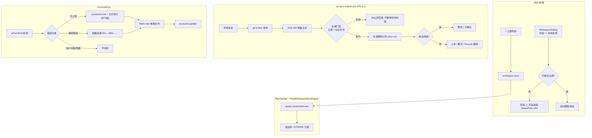

# 技术设计规范 v2.0.0：账号池冷却生命周期与 SharePoint 云端工作区（核验修订版）

> **原始文档**: [2026-10-21-account-cooldown-and-sharepoint-cloud-workspace-design.md](./2026-10-21-account-cooldown-and-sharepoint-cloud-workspace-design.md)
> **修订日期**: 2026-10-21
> **修订依据**: 对 CPH-PI 仓库逐条实测核验（`bun test tests/`、`npm run build`、PowerShell 5.1 AST 解析、全仓 grep）
> **状态**: 【核验修订稿 / Evidence-Verified Draft】—— 可作实施依据，**不可作验收依据**
> **实施基座**: Bun 1.4.2 + TypeScript + Windows PowerShell 5.1 (`powershell.exe`) + PnP.PowerShell + React 18 / Vite 6

---

## 0. 修订说明

v1 把「计划」写成了「既成事实」，并在原文档上标注了 `APPROVED / 已获用户全流程审阅`。核验发现至少 12 处可复现的事实偏差，其中 3 处导致文档给出的验证命令**根本无法执行**。本版不是文字润色，而是把每条断言重新落到「已存在 / 半成品 / 未实现 / 待验证」四个状态之一。

| v1 陈述 | 核验结果 | v2 处理 |
|---|---|---|
| 740+ 测试 100% 通过 | 实测 **732 pass / 8 fail** | §7 改为双列矩阵，并单列「修复基线」为准入条件 |
| 门禁含 `rate-limit-patterns.test.ts` 等 3 个测试 | **三个文件均不存在** | 删除伪门禁，改为行为级判定条件 |
| PS 5.1 载体「已完成实测验证」 | `sp-sync-engine.ps1` 在 PS 5.1 下**解析失败**（3 处 syntax error） | §5.0 升级为最高优先级前置闸门 |
| 使用 `SaveBinaryDirect` 流式上传 | 生产引擎用 `Add-PnPFile`；`SaveBinaryDirect` 只出现在实验脚本 | §5.5 如实区分「实验路径」与「生产路径」 |
| 云端 GUID 保持恒定 | manifest 中 `uniqueId` 为**本地伪造**，从不回读云端 | §5.5 改为「可验证不变量」并给出取证方式 |
| 孤儿删除 / 空目录级联 / 100% 镜像 | **零实现**（prune 只删本地 manifest 键） | §5.4 定义为「待实现契约」，并改为可恢复删除 |
| 依赖云端 `.cph-mirror.json` 门禁 | 全仓**零命中**，无任何代码创建该文件 | §5.3 明确「门禁不得依赖尚未存在的产物」 |
| `Ensure-PnPFolder` 递归建目录 | 本机未装该模块，**无法验证**；现代等价物为 `Resolve-PnPFolder` | §5.5 标注为待验证 API，并给出降级路径 |
| `WelcomeCard.tsx` / `WorkspaceModal.tsx` | 不存在；实际为 `WorkspaceDialog.tsx` | §6 更正 |
| 「首次进入默认无工作区」 | 架构上不可能：后端回退 `cwd`，前端硬编码路径 | §6 指明两处必改点 |
| 在 `CopilotOrchestrator` 的 `turn:end` 挂钩 | 无此类；实际为 `Orchestrator` 的 `onTurnEnd` 回调 | §4.1 更正，并指出与既有实现冲突 |
| `Ensure`/词库/门禁「已落地」 | 属设计意图 | 全文按状态分层表述 |

**v1 有一处判断是完全正确的**：`.composerCard { overflow: hidden }` 确实是 `/` 候选浮层被裁切的根因（`.suggestionsPopover` 为 `position:absolute; bottom:calc(100% + 8px)`，即浮在父容器外）。该结论予以保留。

---

## 1. 背景与目标（去修辞版）

### 1.1 真实痛点

| 痛点 | 现状证据 | 说明 |
|---|---|---|
| 冷却时长与失败原因无关 | `account-pool.ts:50` 默认 `180_000`；`markThrottled` 无原因参数 | 日上限与瞬时限流被同等对待，日上限账号会在 3 分钟后被反复取用并反复失败 |
| 后置文本检测与既有实现重复 | `orchestrator.ts:1752` 已有 `isRateLimitResponseText` | v1 提出的 `reviewTurnText` 是第二套并行机制，且判据更弱 |
| 「未选择工作区」状态不可达 | `rpc-handler.ts:144`、`store.ts:303` | 首启必然是某个具体目录，引导页没有触发条件 |
| 云端镜像能力不可用 | PS 5.1 解析失败，8 个测试全红 | 该子系统的**所有**能力都被这一个编码问题阻断 |

### 1.2 目标（可验收表述）

- **A**：冷却决策携带「原因类型」，且同一账号的冷却时长在一次失败风暴中**单调不减**。
- **B**：Web 端可完成「本地目录 → 可选云端镜像」的一次性绑定，并在后续启动时静默校验；破坏性操作前有可撤销的预演。
- **C**：`/` 技能候选浮层完整可见。

### 1.3 明确不在本版范围

- 把 `SaveBinaryDirect` 从实验脚本提升为生产上传通道（需单独的性能与 GUID 语义验证）。
- 多租户 / 多站点并行同步。
- 云端到本地的反向拉取（pull）。

---

## 2. 现状盘点

这一节是 v1 缺失的，也是后续所有排期的唯一依据。**任何标为「已存在」的项都不应再被实现一遍。**

### 2.1 已存在且可直接复用

| 能力 | 位置 | 备注 |
|---|---|---|
| 账号状态与冷却字段 | `src/auth/account-pool.ts:12` `cooldownUntil` | 字段齐备，缺「原因」与「合并」 |
| 冷却设置/解除 | `account-pool.ts:359` `markThrottled`、`:384` `unthrottle` | 无条件覆写 |
| 池耗尽等待时间计算 | `account-pool.ts:537-564` | 已能算最早到期时间 |
| 429 / 配额错误识别（含 URL 剔除） | `orchestrator.ts:1686` `isExplicitRateLimitError` | 已用 `replace(/https?:\/\/[^\s]+/g,"")` 规避 GUID 假阳性 |
| 回复文本限流识别 | `orchestrator.ts:1752` `isRateLimitResponseText` | 已有 300 字上限、`` ```action `` / `FINAL_ANSWER` 排除、行首锚定 |
| 轮末回调 | `orchestrator.ts:98` `onTurnEnd(turn, response)` | 5 处触发点，挂载点正确 |
| 失败仲裁与账号轮转 | `orchestrator.ts:714`、`:1842` | 已在限流时调用 `markThrottled` |
| 工作区配置读写 | `rpc-handler.ts:480` 读 / `saveWorkspaceConfig` 写 | 浅合并，追加 `cloudWorkspace` 键安全 |
| 账号推送事件 | `rpc-handler.ts:209` `accounts:update` | 命名可直接使用（v1 的猜测是对的） |
| 本地文件枚举（git 语义） | `sp-sync-engine.ps1:238` | `git ls-files --cached --others --exclude-standard` |
| hash 增量跳过 | `sp-sync-engine.ps1:271` `Sync-Item` | SHA-256 比对已实现 |
| 失败重试 + 脏日志 | `sp-sync-engine.ps1:141` `Push-FileToSharePoint`（3 次）、`:118` `Append-DirtyLog` | 已写入 `.cph/state/dirty-sync.jsonl` |
| 敏感内容闸门 | `src/workspace/snapshot-generator.ts:33-44` | 私钥 / JWT / `.env` / `*.pem` 规则已存在，**但只有 Snapshot 在用** |
| Composer 浮层结构 | `Composer.module.css:198` | 定位逻辑正确，仅被父级裁切 |

### 2.2 半成品

| 能力 | 完成度 | 缺口 |
|---|---|---|
| PowerShell 同步引擎 | 逻辑完整、**不可执行** | 文件为 UTF-8 无 BOM + 含中文，PS 5.1 按 ANSI 解码导致 3 处语法错误 |
| `PnpWorkspaceSyncEngine`（TS 封装） | 能拉起子进程 | 未处理子进程退出码 1 的**分类**，全部归为「同步失败」 |
| `sharepoint-sync.ts` | 14KB 已有实现 | 与 `pnp-sync-engine.ts` 职责边界未文档化，存在双实现风险 |

### 2.3 未实现（v1 已将其描述为完成）

- 云端文件枚举（无 `Get-PnPFolderItem` / `Get-PnPListItem`）
- 云端孤儿删除与空目录级联（无 `DeleteObject`、无 `Recycle`）
- 镜像合法性门禁（0 重合拦截、比例阈值）
- `.cph-mirror.json` 标记文件的**任何**创建方
- 云端 GUID 回读与校验
- 认证/授权章节（`Connect-PnPOnline` 方式、ClientId、权限范围）
- 冲突解决、单文件结果明细、断点续传
- 「无工作区」状态与欢迎页

### 2.4 v1 未意识到的一处冲突（重要）

v1 计划新增 `reviewTurnText(fullText, hasError)`，但 `orchestrator.ts:1752` 的 `isRateLimitResponseText` 已在同一位置工作，且判据**严格更优**：

| 维度 | 既有 `isRateLimitResponseText` | v1 的 `reviewTurnText` |
|---|---|---|
| 长度上限 | 300 字 | 200 字 |
| 动作块排除 | 排除 ` ```action ` / `FINAL_ANSWER` | **无** |
| `429` 判据 | 行首锚定 / `status code: 429` / `error: 429` | 裸子串 `includes("429")` |
| URL 假阳性 | 上游 `isExplicitRateLimitError` 剔除 URL | **无** |
| 中文短语 | `配额已达上限`、`请求过于频繁` | 大词表（含高误报项） |
| 失败归因 | 进入灾难恢复仲裁流程 | 一律 `hasError → burst` |

若按 v1 实施，会**替换掉一个更保守的实现**。因此 v2 的决策是：**扩展既有函数，不新建并行函数**。

---

## 3. 目标架构（修正分层）

v1 的图缺少 TypeScript 中间层，把 Web 直接连到 PS 脚本。实际调用链为：

```
React (web/src)
   ↕ WebSocket JSON-RPC
RpcHandler (src/web/rpc-handler.ts)
   ↕
PnpWorkspaceSyncEngine (src/workspace/pnp-sync-engine.ts)
   ↕ child_process.spawn("powershell.exe")
sp-sync-engine.ps1  ──imports──▶  scripts/lib/PnPSession.psm1
   ↕ CSOM / PnP cmdlets
SharePoint Online
```



---

## 4. 子系统 A：账号冷却

### 4.1 现状（v1 描述需更正的三点）

1. 挂载点是 `Orchestrator` 的 `onTurnEnd(turn, response)` 回调，不是 `CopilotOrchestrator` 的 `turn:end` 事件。
2. 限流文本识别**已经存在**（`orchestrator.ts:1752`），不是新增能力。
3. 限流失败**已经**触发 `markThrottled`（`orchestrator.ts:658/742/1842`），默认 180s。新机制必须与之**协同**而非叠加。

### 4.2 待修缺陷

**D1｜冷却时长可被反向缩短（回归风险，v1 引入）**

`account-pool.ts:369` 为无条件赋值：

```ts
status.cooldownUntil = Date.now() + cooldown;
```

若日上限已把 `cooldownUntil` 设为「次日零时」，随后一次 `burst` 回调会把它覆盖为 `now + 120s`，等价于**把「封禁一天」降级为「封禁两分钟」**，账号立刻被重新取用并再次撞墙。v1 未定义合并规则。

**D2｜所有异常被归因为账号问题**

v1 伪代码中 `hasError → burst`。但错误来源至少包括：用户主动停止、网络中断、provider 5xx、客户端超时、工具执行异常。这些与账号配额无关，冷却它们是纯粹的产能损失。

**D3｜日上限时刻缺乏下限与退避**

`getNextUtcMidnight()` 是纯算术。若限流通知在 23:59:59 UTC 到达，返回值与 `now` 相差 **1 秒**，账号立即解冻并再次失败。v1 未设最小冷却、未设连续失败升级。

**D4｜判据强度低于既有实现**

见 §2.4。裸子串 `429`、无 ` ```action ` 排除、200 字门禁均弱于现状。

### 4.3 目标设计

**A. 状态字段扩展**（`AccountStatus`）

```ts
interface AccountStatus {
  isThrottled: boolean;
  cooldownUntil: number;
  throttleReason?: 'daily' | 'burst' | 'agent_ineligible';
  consecutiveFailures: number;   // 新增：同一原因连续触发次数
  lastFailureKind?: 'daily' | 'burst' | 'transport' | 'user_abort' | 'tool_error';
}
```

**B. 单调合并语义**（修复 D1）

```ts
public markThrottled(
  email: string,
  durationMs?: number,
  reason: 'daily' | 'burst' = 'burst'
): void {
  const key = email.toLowerCase();
  this.refreshAccountList();
  const status = this.statuses.get(key);
  if (!status) return;

  const base = durationMs ?? this.defaultCooldownMs;
  const target = Date.now() + base;

  // 单调不减：daily 优先于 burst；同因连续失败按退避放大
  status.cooldownUntil = Math.max(status.cooldownUntil ?? 0, target);
  status.isThrottled = true;
  status.throttleReason =
    status.throttleReason === 'daily' ? 'daily' : reason;
  status.throttledCount = (status.throttledCount || 0) + 1;
}
```

> **不变量**：在冷却未到期期间，任意次 `markThrottled` 调用都不会让 `cooldownUntil` 变小。此项必须由单元测试固定（见 §7 G-A2）。

**C. 错误分类优先于文本匹配**（修复 D2、D3、D4）

```
onTurnEnd(turn, response) / onError(err)
  ├─ 用户中断 (AbortError / signal.aborted)        → 不冷却
  ├─ 传输层错误 (ECONNRESET / ETIMEDOUT / EPIPE)  → 不计账号冷却，走既有重连
  ├─ 工具/业务异常                                  → 不冷却
  ├─ isExplicitRateLimitError(err) 或
  │  isRateLimitResponseText(response)
  │     ├─ 命中日上限判据 → daily，冷却 = max(次日零时, now + 15min)
  │     └─ 否则           → burst，冷却 = min(60s × 2^n, 15min)
  └─ 其他 → 不计冷却
```

要点：

- **复用** `isExplicitRateLimitError` / `isRateLimitResponseText`，把 300 字上限统一为单一常量，并保留 `` ```action `` 与 `FINAL_ANSWER` 排除。
- 日上限保留 `now + 15min` 下限，消除 D3 的「零点前 1 秒」退化。
- `burst` 采用指数退避并设 15 分钟上限，避免单次抖动触发长冷却。
- 取消 v1 的「微型探活指令」：探活本身消耗配额，且在日上限状态下必然失败，反而放大问题。若确需区分抖动，用**被动**方式（下一个真实请求的结果）。

**D. 词库设计原则（替代 v1 的长词表）**

v1 列出了 20 余条中英短语，其中 `quota exceeded`、`message limit`、裸 `429` 具有显著误报面。v2 改为三层判据：

| 层 | 判据 | 归属 |
|---|---|---|
| 强信号（可直接判 daily） | 行首/独立行出现 `daily limit`、`today's message limit`、`已达到今天的消息上限` | daily |
| 弱信号（判 burst） | `too many requests`、`rate limit exceeded`、`throttled`、`请求过于频繁`、`配额已达上限` | burst |
| 排除项 | 含 ` ```action `、`FINAL_ANSWER`、代码块围栏、URL 的文本 | 不判定 |

原则：**宁可少判（漏判由下一次真实请求自然纠偏），不可误判**——误判的代价是一个账号报废整天，漏判的代价是一次额外的失败重试。

### 4.4 待验证假设 H1：日额度刷新时刻

v1 把「微软额度在次日 00:00 UTC 刷新」写入算法前提，但**无一手证据**。公开资料对此存在分歧（固定边界 vs 滚动 24 小时窗口）。二者的运维后果相反：

| 若为固定边界 | 若为滚动窗口 |
|---|---|
| 睡到 UTC 零点是正确的 | 睡到 UTC 零点会白白损失最多 ~24 小时产能 |
| `getNextUtcMidnight()` 可直接使用 | 需改为「从第一条被拒消息起 +24h」 |

**处置**：本版把 `getNextUtcMidnight()` 保留为**默认**分支，但必须由 §7 的 H1 探测实验确认；同时在配置中留出开关，使策略可切换为 `rolling24h`。在实验得出结论前，该分支标注「假设覆盖」。

---

## 5. 子系统 B：SharePoint 云端工作区

### 5.0 前置闸门：PS 5.1 可解析性（最高优先级）

**实测事实**：`scripts/sp-sync-engine.ps1` 首字节为 `3C 23 0A 2E`（无 BOM），文件内含中文字符。Windows PowerShell 5.1 以 ANSI 解码该文件，AST 解析返回 **3 处 `Unexpected token '}'`（第 23、33、222 行）**。这意味着：

- 第 25 行的 `$PSVersionTable` 运行时守卫**永远执行不到**；
- `tests/scripts/sp-sync-engine.test.ts` 与 `tests/workspace/pnp-sync-engine.test.ts` 的 8 个失败用例，全部源于此；
- v1 所称「载体已完成实测验证」不成立。

**修复契约**（择一，推荐 A）：

| 方案 | 做法 | 代价 |
|---|---|---|
| A | 保存为 **UTF-8 with BOM** | 一次性改动，其余脚本不受影响 |
| B | 脚本内仅使用 ASCII，中文文案外置为资源文件 | 改动面较大，但跨编辑器稳定 |

**验收**：`powershell.exe -NoProfile -Command "[System.Management.Automation.Language.Parser]::ParseFile(<path>,[ref]$null,[ref]$e); $e.Count"` 输出 `0`。此命令必须成为 CI 门禁的一部分，且对**所有** `.ps1` / `.psm1` 生效（当前仓库尚有其他同类风险文件）。

### 5.1 认证与授权（v1 完全缺失）

没有这一节，「全流程闭环」不成立。需明确：

- **认证方式**：交互式设备码（`Connect-PnPOnline -DeviceLogin`，适合桌面单用户）vs app-only 证书（适合无人值守）。默认推荐设备码，因为本产品是本地单用户工具。
- **ClientId**：必须使用自有 Entra 应用注册，禁止借用第三方公开 ClientId。
- **权限范围**：仅申请 `Sites.Selected`（或 `Sites.ReadWrite.All` 的最小化替代）并显式授予目标站点，避免租户级授权。
- **令牌生命周期**：设备码登录产生的令牌有效期有限，需定义过期后的重连与用户提示路径。
- **受管租户风险**：条件访问、MFA、DLP、站点级禁止外部应用等策略会导致连接被拒。必须把「连接失败的原因」透出到 UI，而非统一报「同步失败」。
- **凭据落盘**：PnP 的令牌缓存存放位置、是否加密、是否纳入 `.gitignore`。

### 5.2 配置持久化

沿用 `.cph/config.json` 的浅合并写入（`saveWorkspaceConfig`），新增 `cloudWorkspace` 键。需补充 v1 遗漏的字段：

```jsonc
{
  "workspaceRoot": "E:\\test\\Library\\CNNJI QUERY",
  "cloudWorkspace": {
    "enabled": true,
    "siteUrl": "https://<tenant>.sharepoint.com/sites/<site>",
    "driveName": "Documents",              // 用库的内部名，不用显示名
    "targetFolder": "CNNJI QUERY",         // 相对库根的路径
    "hostWebUrl": "https://<tenant>.sharepoint.com/sites/<site>",
    "authMode": "device-code",             // device-code | app-only
    "clientId": "<entra-app-id>",
    "dailyResetPolicy": "utc-midnight",    // utc-midnight | rolling24h
    "lastSync": {
      "at": "2026-10-21T15:00:00Z",
      "status": "success",                 // success | partial | aborted | failed
      "counts": { "uploaded": 3, "skipped": 34, "pruned": 1, "failed": 0 },
      "manifestVersion": 1
    }
  }
}
```

**关键修正**：v1 使用 `"Shared Documents"`。那是**库的显示名**，随租户语言变化（德语租户为 `Freigegebene Dokumente`）。必须改用库的**内部名**（通常 `Documents`），通过 `Get-PnPList` / Graph `drives` 解析后持久化。

### 5.3 镜像合法性门禁（强化）

v1 的门禁是二值的（0 重合 vs ≥1 重合），且依赖一个**尚未存在**的 `.cph-mirror.json`。这在工程上等于没有门禁。

**修正后的判据**：

| 步骤 | 规则 |
|---|---|
| 1. 基线判定 | 远端目标文件夹条目数 = 0 → 合法「全新镜像」，允许初始化 |
| 2. 比例判定 | 以**相对路径**（非文件名）计算重合度 `r = |local ∩ remote| / |local|` |
| 3. 分级动作 | `r ≥ 0.5` → 直接同步；`0 < r < 0.5` → 需用户确认；`r = 0` 且远端非空 → **中止** |
| 4. 标记文件 | `.cph-mirror.json` 若存在，则跳过 2/3 直接放行 |
| 5. 标记文件缺失 | **不得**视为失败理由，必须回落到比例判定（v1 把「标记存在」作为主要通道，而该文件无人创建） |

**为什么必须用相对路径**：`README.md`、`package.json`、`index.js`、`.gitignore` 这类文件名在任何两个代码目录间都会重合。v1 用文件名集合求交，`r = 0` 拦不住「把另一个项目目录整片删除」。

**首次破坏性操作的额外保护**：无论 `r` 多高，若本次同步的删除条目数 > 0 且此前从未成功同步过，则强制要求显式确认。

### 5.4 删除安全契约（v1 用不可恢复删除保护数据）

v1 写「直接通过 `File.DeleteObject()` 移除」。CSOM 的 `DeleteObject` **不进回收站**；进回收站的入口是 `ListItem.Recycle()` 或 `File.Recycle()`。在标题为「保护数据安全」的章节里选用不可恢复删除，是自相矛盾的。

**契约**：

1. **可恢复优先**：一律使用 `Recycle()`，并在报告中标明回收站保留期（站点设置决定，通常 93 天）。
2. **预演先行**：同步分两阶段——`Plan`（只读，产出待删清单）与 `Apply`（执行）。Web 端在 `Plan` 后展示清单；超过阈值时阻塞等待确认。
3. **阈值**：默认「单次删除 > 10 个文件或 > 20% 的远端条目」即需确认，可配置为 0（每次都确认）。
4. **单次删除上限**：硬上限（如 500），超出则中止并要求人工介入，防止误配置造成整站清空。
5. **目录清理只针对本次创建或本次腾空的目录**：不得删除非本工具创建、且仍含内容的父级目录（同事共享的子文件夹、Teams 同步目录）。
6. **可观测**：`lastSync.status` 增补 `partial` 与 `aborted`，并保留 per-file `{path, action, result}` 明细。

> 与 AGENTS.md「Harness 纯粹中立」一致：删除决策由协议与用户确认驱动，Harness 不对内容做价值判断。

### 5.5 传输通道（如实区分实验路径与生产路径）

**实测事实**：`SaveBinaryDirect` 仅出现在 `scripts/upload-live-test.ps1:22` 与 `scripts/upload-txt-variants.ps1:14`，都是**实验脚本**。生产引擎 `sp-sync-engine.ps1:173` 使用的是 `Add-PnPFile`。

因此 v1 的表述「使用已完成实测验证的 … SaveBinaryDirect 流式上传，保持 GUID 恒定」混淆了两条路径。修正为：

| 路径 | 现状 | 用途 |
|---|---|---|
| `Add-PnPFile`（生产） | 已实现，带 3 次重试 | 默认同步通道 |
| `SaveBinaryDirect`（实验） | 已有脚本验证可用 | 大文件或有 GUID 语义要求时，作为**可选**通道 |

**关于 GUID 恒定**：`sp-sync-engine.ps1:281` 的 `uniqueId` 是本地生成的占位串 `"guid-" + Guid(8位)`，从不回读云端。因此「GUID 恒定」目前是**不可验证的**。

- 若确需该不变量，须在上传后通过 `Get-PnPFile -AsListItem` 或 CSOM 回读 `UniqueId` 并写入 manifest，且在覆写路径上验证其未变。
- 若不需要，应从文档与 manifest 中移除该字段，避免制造虚假保证。

**建目录 API**：v1 使用 `Ensure-PnPFolder`。该 cmdlet 属旧版命名，现代 PnP PowerShell 的等价物是 `Resolve-PnPFolder`（前者在 3.4.0 起被移除）。本机未安装 PnP.PowerShell，**无法验证 1.12.0 上的可用性**。实施时须先执行 `Get-Command Resolve-PnPFolder, Ensure-PnPFolder -ErrorAction SilentlyContinue` 探测，并保留「逐级 `Add-PnPFolder`」的降级实现。

**SharePoint 自身的限流**：v1 为账号池精心设计了 429 语义，却对自己这条更可能撞 429 的链路只字未提。必须复用同一套语义：解析 `Retry-After`、指数退避、并把 429 与「权限拒绝」「路径不存在」在错误分类上分开——三者的处置完全不同。

### 5.6 排除策略与敏感内容（v1 黑名单与代码不符）

**实测**：`sp-sync-engine.ps1:246` 的实际过滤正则为 `[\\/](\.git|node_modules|\.cph|dist|package)[\\/]`。它**不包含** v1 所列的 `.vscode`、`*.log`、`*.tmp`，也不包含 `.env`、`profiles/`。同时仓库存在 `Get-ChildItem -Recurse` 回退路径（`:245`），该路径会绕过 git 的忽略规则——`profiles/` 是被 `.gitignore` 排除的浏览器凭据目录，在回退模式下会被上传。

**修正**：

1. 排除清单以**代码实际规则为准**描述，并补齐：`.env*`、`*.pem`、`*.key`、`*.pfx`、`profiles/`、`.worktrees/`、`web/node_modules/`、`package/`。
2. **复用** `SnapshotGenerator.SENSITIVE_FILE_PATTERNS` 与 `SENSITIVE_CONTENT_PATTERNS`（`snapshot-generator.ts:33-44`），让上传链路与快照链路共享同一敏感闸门。当前只有快照在用，这是既有能力未被复用。
3. 回退路径（无 git 时）必须**显式**应用同一敏感闸门，且需在报告中标注「本次使用回退枚举，忽略规则未生效」。
4. `.cph-mirror.json` 必须加入 `.gitignore`（实测当前**未被**忽略）。否则它落在地面根目录时，会被 `git ls-files --others` 当作业务文件上传——同一文件同时承担「云端门禁标记」与「本地待同步文件」两个角色，语义冲突。

### 5.7 冲突解决（v1 的「本地 SSOT」隐含数据丢失）

v1 定义「以本地 SSOT 为权威，同名覆写」。这意味**任一端在 SharePoint 上的修改会被无提示销毁**。这是数据丢失面，必须显式承认并给出策略：

| 场景 | 建议策略 |
|---|---|
| 远端文件较本地新（`Modified` > manifest `lastSyncedAt`） | 默认 `skip + warn`，列出清单交由用户决定；可配置为强制覆写 |
| 远端文件被他人锁定 / 签出 | 跳过并记录，不重试 |
| 远端文件被重命名（同 GUID 不同名） | 视为「删 + 增」，但需在报告中提示疑似重命名 |

### 5.8 URL 解析

粘贴 `https://<tenant>.sharepoint.com/sites/<site>/Shared Documents/<folder path>` 时：

- 按**已知的库内部名列表**切分，而非硬编码 `Shared Documents`；
- 处理 `%20` 与其他百分号编码；
- 处理 OneDrive 形式（`/personal/<upn>/Documents/...`）与 Teams 形式（`/sites/<site>/<channel>/...`）；
- 解析失败时给出明确错误与可接受格式示例，而不是静默取默认值。

### 5.9 可观测性

- 同步结果落到 `.cph/state/sync-manifest.json`（既有）+ per-file 明细。
- 失败落到 `.cph/state/dirty-sync.jsonl`（既有 `Append-DirtyLog`）。
- 前端 Toast 只展示摘要；明细以**文件挂载**方式提供（符合 AGENTS.md「传引用挂载而非传值倾倒」），不在 Prompt 或 WebSocket 消息流中倾倒长日志。

---

## 6. 子系统 C：Web UI

### 6.1 Composer 浮层（v1 唯一完全正确的部分）

- `Composer.module.css:18` 的 `overflow: hidden` 改为 `visible`。
- 副作用需处理：`overflow: hidden` 原本用于裁切内部子元素的圆角与背景。改为 `visible` 后，须由 `.attachmentsList` / textarea 容器 / `.actionBar` 各自承担圆角与背景边界，否则会出现内容溢出圆角外的视觉缺陷。
- `border-radius` 与 `box-shadow` 保留在 `.composerCard` 上即可。
- 验证：键入 `/` 时浮层完整可见，且长列表内部滚动（`max-height: 260px; overflow-y: auto`）仍生效。

### 6.2 组件命名更正

| v1 名称 | 实际 | 处理 |
|---|---|---|
| `WelcomeCard.tsx` | 不存在 | 新增（或改造 `ChatView` 空态） |
| `WorkspaceModal.tsx` | 不存在；实际为 `WorkspaceDialog.tsx` | 在既有 `WorkspaceDialog` 内扩展第二阶段，不新建并行弹窗 |

`WorkspaceDialog.tsx` 已有 `workspaceModalOpen` / `setWorkspaceRoot` / `inputPath` / 剪贴板复制等能力，第二阶段的「关联云端」应作为其内部状态机的一个 step，避免出现两套工作区弹窗。

### 6.3 「未选择工作区」状态需要两处改动

v1 假设该状态天然存在，实测不然：

- 后端：`rpc-handler.ts:144` `this.workspaceRoot = path.resolve(options.workspaceRoot || process.cwd())` —— 永远有值。
- 前端：`store.ts:303` 硬编码 `workspaceRoot: 'e:\\copilot-web proxy\\CPH-PI'`。

需要：

1. 前端移除硬编码默认值，改为 `null` 初始态；
2. 后端在未收到显式工作区时不要回退 `cwd`，或回退后把 `isExplicit: false` 一并推送；
3. 前端依据 `isExplicit` 决定是否展示欢迎引导，而不是依据 `workspaceRoot === ''`。

### 6.4 顶栏状态

- `☁️ SharePoint 已连接` 需区分：`未绑定 / 已绑定未验证 / 验证通过 / 验证失败（附原因）`。v1 只有「已连接」一种，会把授权失败显示成成功。
- `🔄 立即同步` 在同步进行中需禁用并显示进度；同步为 `partial` 时 Toast 用非成功色。

---

## 7. 验证矩阵（目标 + 当前状态）

v1 的矩阵把「目标」写成了「预期结果」，且 3 个被测文件不存在。以下每行都标注**当前实测状态**。

| ID | 验证项 | 判定命令 / 操作 | 目标 | 当前状态 |
|---|---|---|---|---|
| **G0** | PS 脚本可解析 | PS 5.1 `Parser::ParseFile` 于全部 `.ps1/.psm1` | 0 error | ❌ `sp-sync-engine.ps1` 报 3 error |
| **G1** | 测试基线 | `bun test tests/` | 0 fail | ❌ **732 pass / 8 fail** |
| **G2** | Web 构建 | `npm run build` | 0 error | ✅ 通过（1628 modules） |
| G-A1 | 限流判据不与既有实现冲突 | 断言仅有一处限流文本判定入口 | 单一实现 | ⬜ 待实现 |
| G-A2 | 冷却单调不减 | 单元测试：daily 后调 burst，断言 `cooldownUntil` 不变小 | 恒成立 | ⬜ 待实现 |
| G-A3 | 用户中断不冷却 | 单元测试：`AbortError` 不改变 `cooldownUntil` | 恒成立 | ⬜ 待实现 |
| G-A4 | 日上限有下限 | 单元测试：23:59:59 触发 → 冷却 ≥ 15min | 恒成立 | ⬜ 待实现 |
| G-A5 | `` ```action `` 豁免 | 单元测试：含动作块的短文本不判限流 | 恒成立 | ⬜ 待实现 |
| G-B1 | 镜像门禁（相对路径） | 单测：远端仅含同名 `README.md` 但路径不同 → 拦截 | 拦截 | ⬜ 待实现 |
| G-B2 | 门禁不依赖标记文件 | 单测：远端无 `.cph-mirror.json` 时仍按比例判定 | 生效 | ⬜ 待实现 |
| G-B3 | 删除走回收站 | 单测/集成：断言调用 `Recycle` 而非 `DeleteObject` | 可恢复 | ⬜ 待实现 |
| G-B4 | Plan/Apply 分离 | 集成：`Plan` 阶段不产生任何远端写操作 | 零写入 | ⬜ 待实现 |
| G-B5 | 敏感文件不上传 | 集成：`.env` / `*.pem` / `profiles/` 不出现在远端 | 零泄漏 | ⬜ 待实现 |
| G-B6 | 大字典解析 | 单测：`Documents` / 德语显示名 / `%20` 路径 | 正确解析 | ⬜ 待实现 |
| G-C1 | 浮层不被裁切 | 键入 `/` | 完整可见 | ⬜ 待修复 |
| G-C2 | 长列表内部滚动 | 候选 > 8 项 | 内部滚动 | ⬜ 待验证 |
| G-H1 | 日额度刷新假设 | **人工实验**：同一账号在 UTC 零点前后各发一次受控请求，记录可用性 | 得出结论 | ⬜ 未进行 |

> **H1 说明**：这是一次性人工探测，不能由单元测试替代。在结论产出前，代码中的 `utc-midnight` 分支标注为「假设覆盖」，`rolling24h` 分支必须可切换。

---

## 8. 实施顺序与准入条件

顺序由依赖关系决定，不可并行跳跃：

| 阶段 | 内容 | 准入条件 |
|---|---|---|
| **P0** | 修复测试基线（8 个失败用例）+ `.ps1` 编码/BOM | G1 = 0 fail，G0 = 0 error。**在此之前不合并任何新特性** |
| **P1** | 冷却合并语义（§4.3 A/B） | G-A2 通过。这是回归防护，必须先于任何新判据 |
| **P2** | 错误分类 + 判据收敛到单一实现（§4.3 C/D） | G-A1/A3/A4/A5 通过 |
| **P3** | 认证与配置（§5.1/5.2） | 设备码登录可在受管租户成功，或明确记录被拒原因 |
| **P4** | 门禁 + 删除安全（§5.3/5.4） | G-B1..B4 通过；**先 Plan，后 Apply** |
| **P5** | 敏感内容与排除策略（§5.6） | G-B5 通过 |
| **P6** | Web UI（§6） | G-C1/C2 通过 |
| **P7** | H1 实验结论回填 | 决定 `utc-midnight` 是否保留为默认 |

**P0 的强制性理由**：当前 8 个失败用例全部指向同一个编码问题。在其之上叠加任何 SharePoint 特性，都无法区分「新代码有问题」与「基线本来就红」。

---

## 附录 A：事实核验记录（可复现）

| # | 断言 | 核验命令 | 观测结果 |
|---|---|---|---|
| A1 | 默认冷却 3 分钟 | `grep defaultCooldownMs src/auth/account-pool.ts` | `?? 180_000` |
| A2 | 冷却无条件覆写 | 读 `account-pool.ts:369` | `status.cooldownUntil = Date.now() + cooldown;` |
| A3 | 既有文本限流判定 | 读 `orchestrator.ts:1752-1778` | 300 字上限 + `` ```action `` 排除 + 行首锚定 |
| A4 | 既有错误分类剔除 URL | 读 `orchestrator.ts:1689` | `.replace(/https?:\/\/[^\s]+|wss?:\/\/[^\s]+/g,"")` |
| A5 | 轮末回调名 | `grep onTurnEnd src/agent/orchestrator.ts` | `onTurnEnd?: (turn, response) => void`，5 处触发 |
| A6 | 测试实际结果 | `bun test tests/` | 740 tests / **732 pass / 8 fail** |
| A7 | 文档所列测试文件 | `Test-Path` × 3 | 全部 `False` |
| A8 | PS 5.1 解析 | PS 5.1 `Parser::ParseFile(sp-sync-engine.ps1)` | **3 处 error（23/33/222）** |
| A9 | 文件无 BOM | 读首字节 | `60,35,10,46` → 无 BOM |
| A10 | 生产上传用 `Add-PnPFile` | `sp-sync-engine.ps1:173` | `Add-PnPFile -Path ... -Folder ...` |
| A11 | `SaveBinaryDirect` 位置 | 全仓 grep | 仅 `upload-live-test.ps1:22`、`upload-txt-variants.ps1:14`（实验） |
| A12 | GUID 为本地伪造 | `sp-sync-engine.ps1:281` | `"guid-" + Guid.NewGuid().Substring(0,8)` |
| A13 | prune 不删远端 | `sp-sync-engine.ps1:316-328` | 仅 `$manifest.files.Remove($mk)` |
| A14 | 无远端枚举 | grep `Get-PnPFolderItem|Get-PnPListItem` | 零命中（仅默认参数串出现 `workspace-mirror`） |
| A15 | `.cph-mirror.json` 无创建方 | 全仓 grep | 零命中 |
| A16 | 实际排除正则 | `sp-sync-engine.ps1:246` | `(\.git|node_modules|\.cph|dist|package)` |
| A17 | `.cph-mirror.json` 未被忽略 | `git check-ignore -v` | 无输出（未忽略） |
| A18 | 前端硬编码工作区 | `store.ts:303` | `workspaceRoot: 'e:\\copilot-web proxy\\CPH-PI'` |
| A19 | 后端 cwd 回退 | `rpc-handler.ts:144` | `path.resolve(options.workspaceRoot || process.cwd())` |
| A20 | 组件实际名称 | 列 `components/**` | 有 `WorkspaceDialog.tsx`；无 `WelcomeCard`/`WorkspaceModal` |
| A21 | CSS 根因 | `Composer.module.css:18` + `:198` | `overflow:hidden` + `absolute; bottom:calc(100% + 8px)` |
| A22 | Web 构建 | `npm run build` | 成功，1628 modules |
| A23 | 敏感闸门已存在 | `snapshot-generator.ts:33-44` | 私钥/JWT/`.env`/`*.pem` 规则齐备 |
| A24 | 默认 shell 为 PS 7 | `$PSVersionTable.PSVersion` | `7.6.6`（脚本会主动 `throw`） |

## 附录 B：本次未处理的既有问题（仅记录，不在本版范围）

1. `sharepoint-sync.ts`（14KB）与 `pnp-sync-engine.ts`（10KB）职责重叠，存在双实现漂移风险，需单独做去重设计。
2. 仓库同时存在 `test/` 与 `tests/` 两个目录，`bun test tests/` 只覆盖后者。
3. `PnpWorkspaceSyncEngine` 对子进程退出码未分类，当前无法区分「脚本语法错误」与「网络失败」——这也是 8 个用例失败难以定位的原因之一。

---

**结论**：本版把 v1 的 12 处事实偏差逐一落回可核验状态，补上认证、删除安全、冲突解决、限流语义、编码闸门五个工程契约，并把验证矩阵从「结果陈述」改为「目标 + 当前状态」。v1 中关于 Composer 裁切的诊断与「后置检测不增加首包延迟」的判断予以保留——后者需注意：原 3 分钟冷却本就发生在事后，该特性真正改善的是**冷却时长的准确性**，而非首包延迟。
