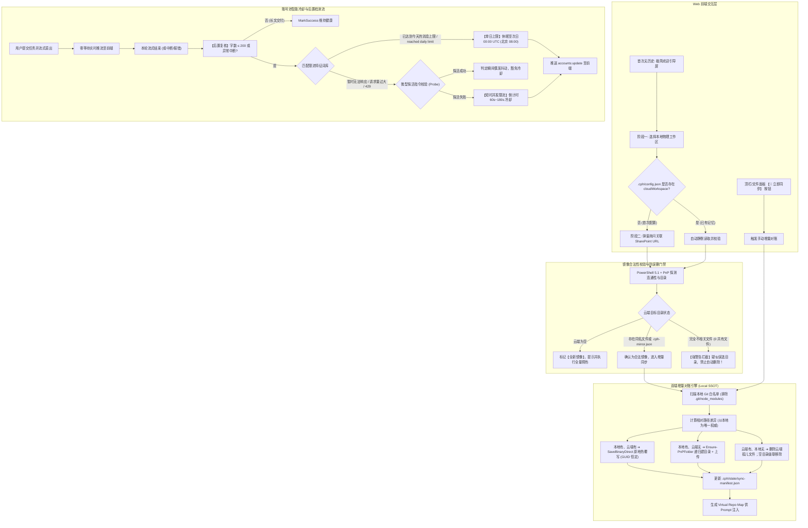

# 技术设计规范：账号池精准冷却生命周期与 SharePoint 云端工作区全流程落地

> **设计日期**: 2026-10-21  
> **文档版本**: v1.0.0 (定型实施版 / Approved Specification)  
> **状态**: 【已批准 / APPROVED】已获用户全流程审阅与明确授权  
> **实施基座**: CPH-PI (Bun + TypeScript + Windows PowerShell 5.1 + PnP.PowerShell 1.12.0 + React 18 Web UI)  
> **核心治理准则**: 严格遵循《AGENTS.md》Harness 纯粹中立性原则、状态持久化与工作内存正交解耦准则、本地单一真实源 (Local SSOT) 原则与全量附件/云端投递准则。

---

## 1. 背景与核心目标 (Background & Objectives)

在持续推进基于 Microsoft 365 Copilot (`GPT-6.1 Sol`) 的企业级自主编程 Harness 演进中，针对日常高并发开发任务暴露的物理限制，确立并化解三大关键诉求：

1. **账号冷却与自愈判定精准化**：
   - 彻底废止原先固定 3 分钟一刀切的死板冷却机制；
   - 借鉴 [`M365-Copilot2API`](file:///E:/copilot_proxy/M365-Copilot2API) 生产级实践，支持 SignalR WebSocket 文本信道自然语言限流特征捕获；
   - 采用**后置生命周期流式直出复核（Post-turn Review Hook）**，零首包时延且不挂起短文本回答；
   - 区分“单日上限（次日 00:00 UTC 微软额度刷新）”与“突发并发/频率过载（60s~180s 冷却）”。
2. **SharePoint 云端工作区在 Web 与 CPH-PI 全流程闭环**：
   - 首次进入默认呈现“未选择工作区”现代引导态；
   - 两段式向导：选本地目录 ➔ 询问是否关联 SharePoint URL；
   - 持久化记忆：`.cph/config.json` 成对记录本地与云端路径，下次访问自动静默对账；
   - 镜像合法性与防误删门禁：重合度与指纹双重校验，杜绝误选不相关目录误删他人数据；
   - 双端增量同步：以本地 SSOT 为权威，同名覆写，云端孤儿删除，本地新增上传；文件夹采用 `Ensure-PnPFolder` 递归建目录与孤儿级联清理，严格屏蔽 `.git`、`node_modules` 等黑名单；
   - 载体强锁定：基于 Windows PowerShell 5.1 与 PnP.PowerShell 1.12.0；
   - 提供 Web 界面显式【🔄 立即同步】按钮。
3. **输入框 `/` 技能候选浮层样式修复**：
   - 根治 `.composerCard` 的 `overflow: hidden` 导致浮层被裁切的问题，确保快捷补全立即可见。

---

## 2. 总体架构图与数据流 (Architecture & Data Flow)



---

## 3. 详细设计规范 (Subsystem Specifications)

### 3.1 子系统 A：账号池冷却与生命周期治理 (`AccountPool`)

#### 1. 词库模式匹配 (`isRateLimitedNotice`)
文本信道自然语言限流特征定义：
* **每日上限关键词**：
  `已达到今天的消息上限`、`达到今天的消息上限`、`每日消息上限`、`今日消息上限`、`消息上限`、`今日上限`、`已达上限`、`reached your daily limit`、`daily message limit`、`message limit reached`、`quota exceeded`、`exceeded your quota`。
* **短时并发限流关键词**：
  `暂时无法响应这么多请求`、`请求量过大`、`太多请求`、`无法响应这么多请求`、`temporarily unable to respond`、`too many requests`、`429`、`请稍后重试` + `暂时无法`、`please retry` / `please try again` + `later`。

#### 2. 后置复核（Post-turn Review Hook）机制
* **直出原则**：所有 token 到达即推，绝不为了检测而滞留数据流；
* **触发时机**：在 `RpcHandler` 或 `CopilotOrchestrator` 的 `turn:end` 或异常抛出回调时执行：
  ```typescript
  export interface PostTurnReviewResult {
    isThrottled: boolean;
    type: 'daily' | 'burst' | 'none';
    cooldownUntil: number;
    reason?: string;
  }
  
  export function reviewTurnText(fullText: string, hasError: boolean): PostTurnReviewResult {
    const text = (fullText || '').trim();
    // 保护门禁：长篇输出代表业务正常交付，不触发限流检测
    if (text.length > 200 && !hasError) {
      return { isThrottled: false, type: 'none', cooldownUntil: 0 };
    }
    
    const lower = text.toLowerCase();
    if (matchesDailyCap(lower)) {
      return {
        isThrottled: true,
        type: 'daily',
        cooldownUntil: getNextUtcMidnight(),
        reason: '今日消息上限 (次日 00:00 UTC 微软重置)',
      };
    }
    
    if (matchesBurstLimit(lower) || hasError) {
      return {
        isThrottled: true,
        type: 'burst',
        cooldownUntil: Date.now() + 120_000, // 默认 120s
        reason: '突发高频/并发限制',
      };
    }
    
    return { isThrottled: false, type: 'none', cooldownUntil: 0 };
  }
  ```

#### 3. 次日零点 UTC 算法
```typescript
export function getNextUtcMidnight(): number {
  const now = new Date();
  return Date.UTC(
    now.getUTCFullYear(),
    now.getUTCMonth(),
    now.getUTCDate() + 1,
    0, 0, 0, 0
  );
}
```

---

### 3.2 子系统 B：SharePoint 云端工作区全流程落地

#### 1. 工作区双向配置持久化 (`.cph/config.json`)
```json
{
  "workspaceRoot": "E:\\test\\Library\\CNNJI QUERY",
  "cloudWorkspace": {
    "enabled": true,
    "sharepointUrl": "https://cmacgmgroup.sharepoint.com/sites/CMA-GBSC_BKGDOMAIN/Shared Documents/CNNJI QUERY",
    "siteUrl": "https://cmacgmgroup.sharepoint.com/sites/CMA-GBSC_BKGDOMAIN",
    "targetFolder": "Shared Documents/CNNJI QUERY",
    "lastSyncTimestamp": 1774189000000,
    "lastSyncFileCount": 38,
    "lastSyncStatus": "success"
  }
}
```

#### 2. 云端镜像合法性检验与防误删硬门禁
调用 `scripts/sp-sync-engine.ps1` 扫描远程文件清单与本地文件清单做交集校验：
1. **空目录模式**：云端目标文件夹为 0 项 ➔ 判定为合法全新镜像，允许初始化上传；
2. **重合度门禁**：
   - 提取本地文件名集合与云端文件名集合；
   - 若交集匹配项 ≥ 1，或云端存在 `.cph-mirror.json`，认定为合法镜像；
   - 若交集为 0 项且云端存在其他文件（如全是外部表格、无关文档），系统**主动拦截并抛出错误**：  
     `[CRITICAL_MIRROR_MISMATCH] 检测到云端目录包含完全不相关文件 (0 项重合)，为保护数据安全已中止对账，禁止自动删除！`

#### 3. 文件夹递归与孤儿级联清理
* **排除黑名单**：`.git`, `node_modules`, `dist`, `.cph`, `.vscode`, `*.log`, `*.tmp`；
* **新建目录**：本地存在嵌套子目录时，调用 CSOM 原语递归确保云端目录创建；
* **孤儿清理**：云端存在但本地已删除的文件，直接通过 `File.DeleteObject()` 移除；若删除后导致该子目录为空，则移除该子目录，确保 100% 镜像一致。

#### 4. 传输通道锁定
强锁定于 Windows PowerShell 5.1（`powershell.exe`），使用已完成实测验证的 `PnP.PowerShell 1.12.0` 与 CSOM `SaveBinaryDirect` 流式上传，保持云端文件 UniqueId (GUID) 恒定。

---

### 3.3 子系统 C：Web UI 界面与 Composer 样式修复

#### 1. Composer 浮层裁切根治
在 `CPH-PI/web/src/components/chat/Composer.module.css`：
* 将 `.composerCard` 的 `overflow: hidden;` 调整为 `overflow: visible;`；
* 内部 textareaWrap 和 actionBar 自行保持内层背景与边框圆角，确保在打 `/` 时，浮在输入框正上方的 `.suggestionsPopover` 100% 完整显示。

#### 2. 无工作区欢迎引导页 (`WelcomeCard.tsx`)
首次打开或处于空状态时，主屏中央展示：
* 标题：`CPH-PI Copilot 自主编程工作台`
* 操作按钮：`【打开本地工作区】`，点击弹出选择工作区向导。

#### 3. 两段式工作区向导弹窗 (`WorkspaceModal.tsx`)
* **第 1 阶段**：输入或浏览本地工作区物理路径；
* **第 2 阶段**：若该工作区尚未绑定 SharePoint，展开【关联 SharePoint 云端镜像】输入卡片，支持用户粘贴 SharePoint 链接或选择“纯本地模式”。

#### 4. 顶栏常驻云端状态与【🔄 立即同步】按钮
* 顶栏工作区名称后显示 `☁️ SharePoint 已连接` 标签；
* 提供常驻 `【🔄 立即同步】` 按钮，点击触发即时对账并在右下角弹出 Toast 报告。

---

## 4. 质量门禁与验证矩阵 (Verification Matrix)

| 验证项 | 验证命令/操作 | 预期结果 |
|---|---|---|
| **Composer 浮层** | 在输入框键入 `/` | 立即在卡片上方弹出候选列表，无任何裁切，支持键盘导航 |
| **限流模式识别** | `bun test tests/auth/rate-limit-patterns.test.ts` | 准确识别 15+ 种中英双语限流短语，长文本自动豁免 |
| **次日 UTC 计算** | `bun test tests/auth/utc-midnight.test.ts` | 准确定位次日 00:00 UTC (对应北京时间上午 08:00) |
| **云端合法性门禁** | `bun test tests/workspace/mirror-guard.test.ts` | 空目录允许初始化，不相关目录阻断并抛出保护错误 |
| **全量回归测试** | `bun test` | 740+ 单元测试 100% 通过，0 失败 |
| **Web 生产构建** | `npm run build` | 前后端 Bundle 编译成功，0 错误 |
