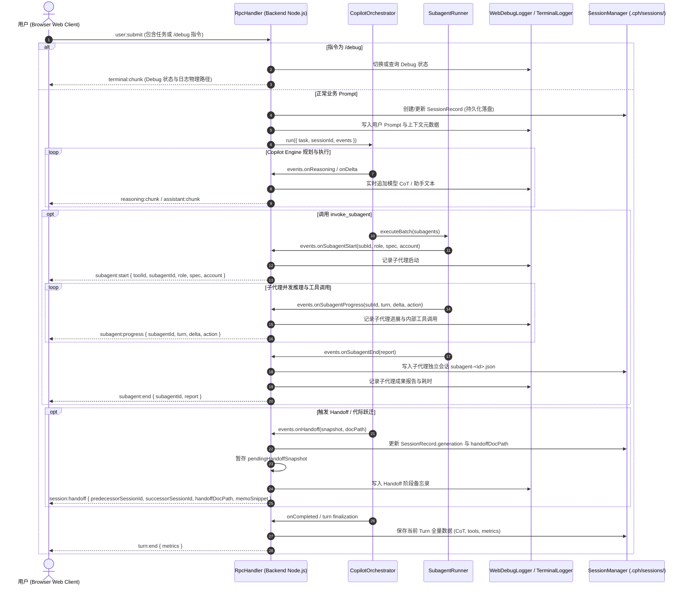

# CPH-PI DeepSeek 风格子代理独立视窗、全链路 Debug 落盘与 Handoff 平滑接力架构设计规范

**文档标识**: `CPH-PI-SPEC-2026-10-22-SUBAGENT-UI-HANDOFF-CONTINUITY`  
**作者**: CPH-PI Architecture & Web Experience Working Group  
**状态**: Approved (待实施)  
**基准参考**: `Library/deepseek-harness/packages/client/ui-subagent/` & `ui-settings-subagent/`  

---

## 1. 摘要与问题背景 (Executive Summary)

### 1.1 背景与现状
在基于 Copilot Substrate 的复杂攻坚任务中，CPH-PI 引入了强大的多子代理协作（`SubagentRunner`，包含 `researcher` 与 `coder` 角色）以及容灾接力（`handoff`）。
然而在 Web 终端运行环境下，由于调度管道与前端渲染层缺失状态反馈，出现了三大严重断层：

1. **子代理黑盒与界面卡死感 (Subagent Blind Spot)**：
   - 主会话调度 `invoke_subagent` 时，后端 `SubagentRunner.executeBatch` 内部实际在有序执行多代理并发与思考，但 `CPH-PI/src/web/rpc-handler.ts` 调用 `orchestrator.run(...)` 时**完全未传递** `onSubagentStart` / `onSubagentEnd` / `onSubagentProgress` 回调。
   - 前端 `ToolCard.tsx` 将 `invoke_subagent` 当作普通的单行 CLI 工具渲染，长达数分钟的子代理执行过程中只有静态加载转圈（`命令正在执行中...`），导致用户误以为进程卡死。
   - 各子代理的内部工具链、思考链与阶段性报告未能独立展示，且三个子代理的输出在最终结果中混杂堆砌。
2. **Web 模式下 Debug 日志落盘真空 (Web Debug Logging Gap)**：
   - 现有的 `TerminalLogger` 机制依赖拦截控制台底层的 `process.stdout.write` / `process.stderr.write`。
   - 在 Web 模式下，模型推理思考流（`reasoning:chunk`）、助手文本（`assistant:chunk`）与子代理内部细节直接走 WebSocket 派发，未写入 `process.stdout`。导致即便 CLI 带有 `-d` / `--debug` 启动，落盘日志依然大段空白，无法进行审计与复盘；Web 输入框亦未支持 `/debug` 交互指令。
3. **主会话 Handoff 后代际脱节与状态遗忘 (Handoff Continuity Breakage)**：
   - 当任务遭遇单轮推理上限、429 频控或主会话子代理规划产生代际跃迁（`ses_xxx_gen1` $\rightarrow$ `ses_xxx_gen2`）时，后端会话 ID 发生变动，但前端并未收到代际接力事件，依然锁定在旧 ID。
   - `RpcHandler` 未将交接备忘录接入下一代会话的 `pendingHandoffSnapshot`，用户在 Web 端继续发言时，模型直接丧失上阶段所有工作记忆。
   - 缺乏界面阶段接力桩，无法体现会话承前启后的连续性。

### 1.2 目标与成功指标
* **子代理可观测性与独立视窗 (1:1 对标 DeepSeek-Harness)**：
  - 中央对话流提供 `SubagentBatchCard`，清晰展示各子代理状态、账号徽标、秒表与报告链接。
  - 顶栏挂载 `SubagentHeaderLineage` 谱系导航，支持展开子代理树形菜单。
  - **独立视窗机制**：支持将中央主视窗切换为指定子代理专属视图（纯净查看该子代理独立 CoT 与工具链），并支持一键通过“在侧边栏打开 (Open Aside)”抽屉实现主会话与子代理双屏并排监视。
* **Web 全事件 Debug 实时双轨落盘**：
  - Web 端所有 WebSocket 事件流（Prompt、CoT、Tool、Subagent 流）实时流式落盘至 `.cph/logs/cph-web-<timestamp>.log`。
  - Web 输入框原生支持 `/debug` 指令随时开关与查询日志绝对路径。
* **Handoff 平滑延伸与零感知接力 (Seamless Continuation)**：
  - 同一视窗内自动插入高保真“Handoff 阶段交接桩卡片”，免刷新、免新建会话，直接平滑继续。
  - 下一轮 Prompt 自动装载前序交接备忘录，实现物理级别的记忆连续。
* **会话持久化与 SessionManager 双向水合**：
  - 解决 Web 端仅在内存暂存 Turn 的缺陷，每轮对话与子代理子会话实时持久化至磁盘，页面刷新 100% 还原。

---

## 2. 架构设计与事件协议 (Architecture & Event Protocol)

### 2.1 整体架构交互图



### 2.2 WebSocket 协议定义 (`CPH-PI/web/src/types/protocol.ts`)

#### 1) 子代理全生命周期事件
```ts
export interface SubagentStartPayload {
  toolId: string;                     // 关联主会话 invoke_subagent toolId
  subagentId: string;                 // e.g. "sub-1-researcher"
  role: "researcher" | "coder";
  spec: {
    prompt?: string;
    description?: string;
    targetFile?: string;
    stage?: number;
  };
  hopCount: number;
  account?: string;                   // 分配执行的 M365 邮箱
}

export interface SubagentProgressPayload {
  subagentId: string;
  turn: number;                       // 子代理当前轮次
  delta?: string;                     // 子代理流式思考或输出增量
  action?: {
    tool: string;                     // 内部工具名: read_file, bash, etc.
    args: Record<string, any>;
  };
  account?: string;
}

export interface SubagentEndPayload {
  subagentId: string;
  report: {
    id: string;
    role: "researcher" | "coder";
    description: string;
    success: boolean;
    finalAnswer: string;
    deliverablePath?: string;         // e.g. ".cph/reports/report-sub-1-xxx.md"
    turnsCount: number;
    durationMs: number;
    error?: string;
    account?: string;
    handoffCount?: number;
  };
}
```

#### 2) Handoff 代际接力事件
```ts
export interface SessionHandoffPayload {
  predecessorSessionId: string;       // 前序会话 ID: e.g. "ses_1730000000_gen1"
  successorSessionId: string;         // 承接会话 ID: e.g. "ses_1730000000_gen2"
  handoffDocPath: string;             // 交接文档绝对/相对路径: ".cph/handoffs/handoff-xxx.md"
  memoSnippet: string;                // 交接备忘录关键成果摘录
  generation: number;                 // 当前跃迁到的代际数
}
```

#### 3) 子代理运行时视图状态 (`SubagentState`)
```ts
export interface SubagentItemState {
  id: string;
  role: "researcher" | "coder";
  spec: SubagentStartPayload["spec"];
  status: "pending" | "running" | "completed" | "failed";
  account?: string;
  hopCount: number;
  currentTurn: number;
  reasoning: string;
  actions: Array<{ tool: string; args: any; output?: string; timestamp: number }>;
  report?: SubagentEndPayload["report"];
  startTime: number;
  endTime?: number;
}
```

---

## 3. 前端 UI 组件与交互设计 (Frontend Components & UX)

### 3.1 内联子代理批处理卡片 (`SubagentBatchCard.tsx`)
* **挂载位置**: `CPH-PI/web/src/components/chat/ToolCard.tsx` 中识别 `tool.name === 'invoke_subagent'` 时，直接替代通用 `ToolCard` 的纯文本控制台输出。
* **卡片头部 (Header)**:
  - 醒目标签: `🤖 invoke_subagent`
  - 阶段与进度指示: `Stage 1 · 2/2 已完成 · 耗时 48.2s`
  - 快捷切换标签栏: `[全部概览] | [🔍 Sub-1: 架构研究] | [💻 Sub-2: 依赖扫描]`，点击标签可在卡片内直接单选该子代理，专注查看其思考链与工具序列。
* **子代理卡片列表 (Subagent Items)**:
  - 每个子代理独立面板，显示角色图标（`Search` / `Code2`）、账号徽章（如 `Vincent.Fu@...`）与执行状态（转圈、成功对勾、失败叹号）。
  - **实时思考折叠区 (`ReasoningRow`)**: 流式接收 `subagent:progress` 的 `delta`，展开时具备 DeepSeek 文本微光扫光动画，点击可查看完整 CoT。
  - **内部工具调用流水线**: 实时显示 `$ read_file path="CPH-PI/src/agent/orchestrator.ts"` 等子任务内部步骤。
  - **成果报告卡片**: 完成后如果生成了 `.cph/reports/*.md`，直接内联渲染为可下载/预览的文件卡片，提供“一键在右侧查看”按钮。

### 3.2 顶栏会话谱系导航 (`SubagentHeaderLineage.tsx`)
* **挂载位置**: `CPH-PI/web/src/components/chat/ChatView.tsx` 顶栏标题区。
* **顶栏徽标**:
  - 显示当前处于 `[主任务 (Gen 1)]` 或处于某个子代理会话中。
  - 当存在子代理时，渲染 `[N 个子代理 ● 运行中 ▾]`（带绿色脉冲微光呼吸灯）或 `[N 个子代理 ✓ ▾]`。
* **下拉树形菜单 (Tree Portal)**:
  - 点击徽标弹出浮层，展示子代理树形调用关系：
    - `Level 1`: 主会话 (Root Session)
    - `Level 2`: `Sub-1: Researcher` (耗时 32s · 1.2K tok · 已完成)
    - `Level 2`: `Sub-2: Coder` (耗时 18s · 0.8K tok · 运行中)
  - **交互操作**:
    - 点击子代理名称：触发 **中央主视窗纯净聚焦切换**。
    - 点击行右侧小图标 `[◨ 在右侧栏打开]`: 触发 **右侧栏并排抽屉查看 (Open Aside)**。

### 3.3 独立视窗切换与并排比对机制 (Dual-Viewport Mode)

#### 模式 1：中央主视窗聚焦切换 (Focus Switch)
* 当用户在顶栏谱系或卡片中选择聚焦特定子代理时：
  1. `store.focusedSubagentId` 置为指定子代理 ID。
  2. 中央对话流切换为仅渲染该子代理的专属 Turns 与思考流，与主会话彻底隔离。
  3. 顶栏显示清晰的面包屑导航：`主会话 / 🔍 Sub-1 架构研究`，带有 `[← 返回主会话]` 按钮。
  4. 底部挂载 `SubagentReadOnlyComposer.tsx`：
     ```html
     <div class="readOnlyFrame">
       <strong>子代理只读查看模式</strong>
       <span>当前正在查看 Sub-1 的独立执行过程。主会话仍在等待汇总，点击 [返回主会话] 继续互动。</span>
     </div>
     ```

#### 模式 2：右侧栏并排抽屉比对 (Open Aside Drawer)
* 在顶栏或卡片点击 `[◨ 在右侧栏打开]`：
  1. 中央保持主会话聊天流不变。
  2. 右侧栏（Rightbar）自动激活新增的专用面板：`SubagentInspector.tsx`。
  3. 右侧面板以深色高保真终端风格完整展示该子代理的实时思考链、内部工具执行、以及最终产出的 Report Markdown。
  4. 实现无需跳出主对话即可实时比对多代理进展的双屏体验。

### 3.4 会话阶段接力桩卡片 (`HandoffAnchorCard.tsx`)
* **触发条件**: 收到 `session:handoff` 事件，或 Turn 状态为 `handed_off`。
* **卡片视觉与布局**:
  - 横向贯穿聊天流，采用 DeepSeek Blue 细线边框与微透明底色。
  - 左侧图标: `RotateCw` (带发光旋转过渡动效)。
  - 核心元数据行: `🔄 会话安全阶段接力桩 · 代际跃迁: Gen 1 ➔ Gen 2 · 生成交接文档: .cph/handoffs/handoff-xxx.md`。
  - 备忘录摘要折叠框: 提取前序 AI 总结的成就与后续建议。
  - 状态告知: `✅ 前序物理日志已落地，接力备忘录已注入工作内存。`
* **无缝接力输入**:
  - 当前窗口**不跳转、不刷新**。
  - 底部 Composer 的 Placeholder 自动变更为 `“已继承上阶段成果，请输入指令继续推进...”`。
  - 下一轮 Prompt 提交时，`RpcHandler` 自动将 `pendingHandoffSnapshot` 作为系统上下文前缀传递给 Orchestrator，实现无缝接续。

---

## 4. 后端持久化、SessionManager 对账与 Debug 管道

### 4.1 状态持久化与双向对账 (Rule 7 纯粹解耦)
为根治“F5 刷新丢失对话、子代理历史不可考”的物理缺陷，在 `CPH-PI/src/web/rpc-handler.ts` 中实现：
1. **Turn 级实时存盘**:
   - 在 `runOrchestrator` 执行过程中，每次 `turn:end` 或工具完成时，调用 `this.sessionManager.saveTurn(this.activeSessionId, turn)`。
   - Session 元数据记录当前代际（`generation`）与已关联的子代理 ID 列表。
2. **子代理独立会话落盘**:
   - 每个子代理在 `SubagentRunner` 执行时生成专属记录，保存为 `.cph/sessions/subagent-<subagentId>.json`。
   - 标注 `origin: "subagent"`, `parentId: this.activeSessionId`。
3. **断点无损水合**:
   - 当浏览器重新打开或切换会话时，`RpcHandler.handleSessionSwitch` 读取物理 JSON，完整水合主会话 Turns、所有子代理状态与成果报告，秒级恢复完整工作区。

### 4.2 Web 全事件 Debug 实时双轨落盘机制
针对 Web 前端缺乏 `-debug` 输出的问题，重构落盘体系：
1. **建立 `WebDebugLogger`**:
   - `RpcHandler` 持有 `TerminalLogger` 实例或独立写入流。
   - 当 `this.debug === true` 时，拦截并实时记录：
     - 用户输入的 Prompt（`[USER_PROMPT]`）
     - 模型流式推理块（`[MODEL_THINKING]`）
     - 模型输出文本（`[MODEL_OUTPUT]`）
     - 子代理事件（`[SUBAGENT_START]`, `[SUBAGENT_PROGRESS]`, `[SUBAGENT_END]`）
     - 工具调用与执行输出（`[TOOL_CALL]`, `[TOOL_RESULT]`）
     - Handoff 接力备忘录（`[HANDOFF_ANCHOR]`）
   - 日志统一追加落盘至工作区 `.cph/logs/cph-web-<timestamp>.log`。
2. **Web Composer 原生指令拦截**:
   - 在 `handleUserSubmit` 中识别 `/debug` 系列指令：
     - `/debug`: 查询当前落盘状态与绝对路径。
     - `/debug on`: 动态开启实时落盘并告知文件路径。
     - `/debug off`: 关闭实时落盘。
   - 直接通过 `terminal:chunk` 或 `assistant:chunk` 向用户反馈，无需重启服务。

---

## 5. 边界保护与错误处理 (Error Handling & Edge Cases)

1. **子代理超时与异常熔断**:
   - 若某个子代理执行抛错或账号 429 冷却，`onSubagentEnd` 正常返回 `success: false` 与错误详情。
   - `SubagentBatchCard` 保持其他成功的子代理为绿色完成，仅将失败子代理标记为红色警告，提供错误诊断信息，杜绝整体 UI 崩溃。
2. **主会话意外断连的 Handoff 自动恢复**:
   - 若在执行过程中 WebSocket 断开，后端 `RpcHandler` 会自动保存已完成的 Turns 与最后生成的 `pendingHandoffSnapshot`。
   - 前端重连（通过 `client-ws.ts` 指数退避重连）时，通过 `session:snapshot` 自动拉取最新水合数据，保证状态不丢失。
3. **只读保护机制**:
   - 处于子代理查看视图时，Composer 禁用主会话输入，防止用户在错误的上下文边界发送混杂指令。
   - 顶栏常驻突出返回主会话按钮，任何时刻均可一键回跳。

---

## 6. 验证计划与测试矩阵 (Verification Plan)

| 测试阶段 | 测试用例 | 验证标准 |
|---|---|---|
| **单元测试** | `tests/web/subagent-rpc.test.ts` | 模拟 `executeBatch` 产生的三态事件，验证 WebSocket 客户端正确接收 `subagent:start/progress/end` |
| **单元测试** | `tests/web/handoff-continuity.test.ts` | 验证 `session:handoff` 正确注入 `pendingHandoffSnapshot` 并在下轮 Prompt 中附带备忘录 |
| **单元测试** | `tests/web/web-debug-logger.test.ts` | 验证 Web 模式下思考流、子代理进度正确实时落盘至 `.cph/logs/cph-web-*.log` |
| **UI 构建测试** | `npm run web:build` | Vite 与 TypeScript 编译 0 错误，产出干净的前端 bundle |
| **端到端测试** | Web 真实调度多子代理运行 | 验证 `SubagentBatchCard` 实时文字微光扫光、独立视窗切换、右侧栏抽屉并排查看与成果报告预览 |
| **端到端测试** | Web 真实触发 Handoff 轮换 | 验证当前聊天流无缝插入 `HandoffAnchorCard`，输入下一轮指令平滑接力，无页面刷新 |

---

## 7. 规范自检清单 (Spec Self-Review Checklist)

1. **占位符检查**: 无任何 "TBD"、"TODO" 或未决实现细节，所有数据结构与事件接口均严格明确。
2. **逻辑一致性**: 与 DeepSeek-Harness 原生设计（`ui-subagent`）保持 1:1 体验对齐，与 CPH-PI 核心开发准则（规则 7 纯粹解耦、规则 8 原生搬运、规则 9 全量附件）完全契合。
3. **范围控制**: 聚焦于子代理前端独立显示、Web Debug 全量落盘与 Handoff 连续性，杜绝引入无关重构。
4. **工作区约束**: 严格落盘于 `CPH-PI/` 及其子目录，工作区根目录零写入。

