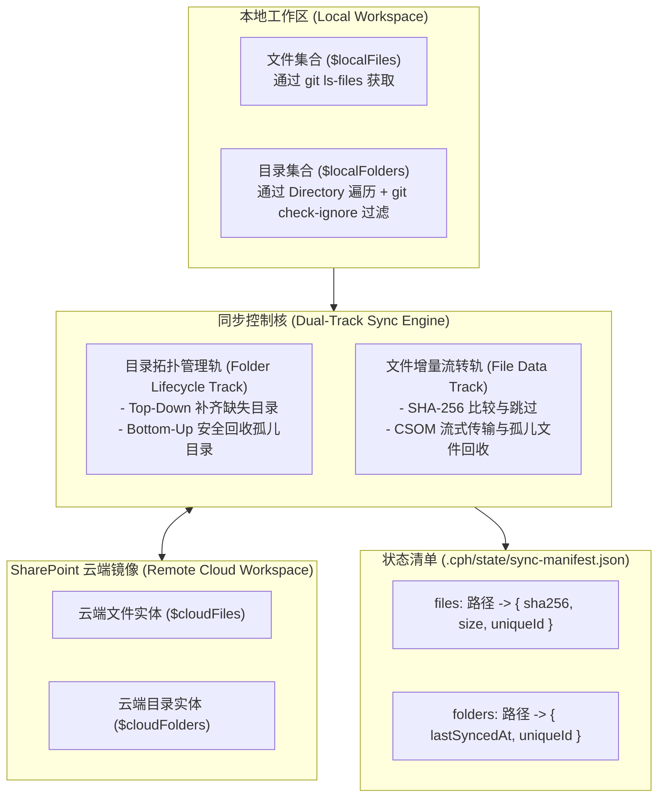
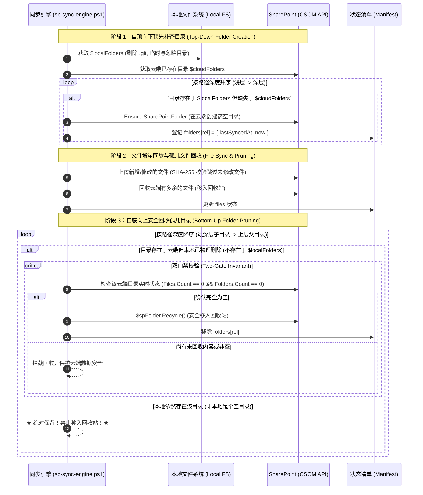

# 云端工作区目录双轨对齐与拓扑生命周期设计规范 (Cloud Workspace Folder Dual-Track Sync Design)

- **日期**: 2026-10-24
- **状态**: 提案 (Proposed)
- **范围**: `CPH-PI/scripts/sp-sync-engine.ps1`, `CPH-PI/src/workspace/pnp-sync-engine.ts`, `CPH-PI/tests/`
- **关联缺陷**: 本地空文件夹在云端被无差别删除；本地新建空目录无法同步上云；无法达成 1:1 严格镜像

---

## 一、背景与问题根因 (Background & Root Causes)

在现有的 SharePoint / PnP 云端工作区镜像机制中，同步引擎的设计初衷是让“云端与本地文件系统保持 1:1 严格一致”。但在真实工程使用中暴露出严重的空文件夹治理缺陷：

1. **单轨文件导向盲区 (File-Centric Blind Spot)**：
   - 本地扫描仅依赖 `git ls-files` 或 `Get-ChildItem -File`，云端扫描仅收集 `$currentFolder.Files`。
   - “目录（Folders）”未作为一等公民纳管，系统缺乏对空目录的感知与追踪能力。
2. **孤儿目录粗暴无差别回收 (Indiscriminate Folder Recycling Bug)**：
   - 在 `sp-sync-engine.ps1` 原第 463~482 行中，只要发生过任意文件清理（`$prunedCount > 0`），引擎便会遍历云端根目录下的子文件夹；只要发现某个子文件夹当前 `Files.Count == 0 && Folders.Count == 0`，就直接调用 `$sub.Recycle()` 扔入回收站。
   - **致命缺陷**：该逻辑完全没有检查“这个文件夹在本地是否其实是一个正当保留的空目录”。一旦本地存在空目录，只要别处删了一个文件触发了 pruning，云端的该空目录就会被强制销毁。
3. **空目录无法主动上云 (Missing Active Creation)**：
   - 云端目录此前仅在上传具体文件时由 `Push-FileToSharePoint` 顺带 `Ensure-SharePointFolder` 创建。若本地新建了一个纯空目录（例如暂无文件的模块骨架或输出目录），该目录永远不会被推送到云端。
4. **缺乏拓扑感知与单层假设**：
   - 旧版目录清理仅扫描直接一级子目录，无法处理多层嵌套目录（如 `src/empty/sub/`）的自底向上依赖回收。

---

## 二、架构设计：文件与目录双轨模型 (Dual-Track Architecture)

为了彻底根治上述问题，我们将工作区镜像系统从“单轨文件同步”升级为“**文件与目录独立双轨对齐模型 (Dual-Track Alignment Model)**”：



### 2.1 核心原则
1. **1:1 严格镜像契约**：本地有什么目录，云端就必须有什么目录；本地是空目录，云端也必须完整保留空目录。
2. **两重硬门禁回收原则 (Two-Gate Invariant)**：
   - **门禁 1（本地存续校验）**：若本地目录树仍存在该目录，**绝对禁止**移入回收站。
   - **门禁 2（云端空闲校验）**：仅当本地已删除该目录，且云端该目录在完成孤儿文件清理后确认无未回收文件与子目录时，方可回收。
3. **拓扑序不变性**：创建必须自顶向下（浅层在前），删除必须自底向上（深层在前），杜绝 CSOM 依赖冲突。

---

## 三、三阶段拓扑同步流水线 (3-Phase Pipeline)

在每次执行 `Prewarm` 或 `SyncWorkspace` 时，执行以下三阶段：



### 3.1 阶段 1：自顶向下预创建目录 (Top-Down Pre-Creation)
- 扫描本地业务目录，按路径深度升序排序（以 `/` 计数，例如 `src` 在 `src/empty` 之前）。
- 遍历 `$localFolders`：若云端 `$cloudFolders` 中不存在该路径，立即通过 `Ensure-SharePointFolder` 递归创建。
- 保证即便本地目录下没有任何文件，云端也能先于文件上传阶段就建好完整的目录结构骨架。

### 3.2 阶段 2：文件增量对齐与孤儿回收 (File Sync & File Pruning)
- 保持现有的文件级 SHA-256 哈希对比、断点跳过与流式上传。
- 扫描云端文件，与本地 `$localFiles` 对照，清理本地不存在的孤儿文件（移入回收站），并从 `$manifest.files` 中移除。

### 3.3 阶段 3：自底向上孤儿目录精准回收 (Bottom-Up Safe Pruning)
- 扫描云端全部目录 `$cloudFolders`，按路径深度降序排序（例如 `src/a/b` 先于 `src/a`，先于 `src`）。
- 遍历每个云端目录：
  1. **检查本地是否存在**：若 `$localFolders.ContainsKey($folderRel)` 为真，直接跳过并保留。
  2. **检查是否为孤儿且为空**：若本地已无此目录，加载该云端目录的实时 `Files` 与 `Folders`：
     ```powershell
     if ($f.Files.Count -eq 0 -and $f.Folders.Count -eq 0) {
         $f.Recycle() | Out-Null
         $manifest.folders.Remove($folderRel)
     }
     ```
- 自底向上的拓扑顺序保证子目录优先被清空回收，父目录变为全空后再行安全回收，完全避免 CSOM 报“目录非空无法删除”错误。

---

## 四、数据模型与清单定义 (Data Model & Manifest)

在 [`.cph/state/sync-manifest.json`](file:///e:/copilot-web%20proxy/CPH-PI/.cph/state/sync-manifest.json) 中升级清单格式为版本 2：

```typescript
export interface FolderManifestEntry {
  lastSyncedAt: string;     // ISO 8601 同步时间戳
  uniqueId?: string;        // SharePoint CSOM 分配的 GUID（如获取到）
}

export interface SyncManifest {
  version: 2;               // 升级版本号为 2
  lastPrewarmAt?: string;
  siteUrl?: string;
  targetFolder?: string;
  files: Record<string, { sha256: string; size: number; uniqueId?: string; lastSyncedAt?: string }>;
  folders: Record<string, FolderManifestEntry>; // 新增：纳管的云端目录相对路径映射表
}
```

> [!NOTE] 向后兼容保障
> 当读取到 `version: 1` 或无 `folders` 字段的陈旧 Manifest 时，引擎自动无损初始化 `manifest.folders = {}`，无需破坏既有数据。

---

## 五、接口契约与组件修改 (Interface Contracts)

### 5.1 PowerShell 引擎层 (`sp-sync-engine.ps1`)
1. **本地目录采集函数 `Get-LocalFolders`**：
   - 过滤排除：`(\.git|\.cph|node_modules|dist|package|Library)`。
   - 动态 Git 忽略：调用 `git check-ignore` 过滤掉构建生成或临时目录。
2. **云端实体采集函数 `Get-SharePointCloudEntities`**：
   - 递归采集同时返回 `$cloudFiles` 与 `$cloudFolders`。
   - 排除 SharePoint 系统保留目录（`_` 开头目录与 `Forms` 目录）。
3. **新增独立 Action `EnsureFolder`**：
   - 允许通过 `-Action EnsureFolder -SourceFolder <relPath>` 单独在云端创建与确保目录存在。
4. **`VerifyCloudMirror` 修复**：
   - 加载检查 `$folder.Files` 与 `$folder.Folders`，修复仅看文件计数导致的误判。

### 5.2 TypeScript 引擎层 (`pnp-sync-engine.ts`)
1. **暴露 `syncFolder()` 接口**：
   ```typescript
   public async syncFolder(
     workspaceRoot: string,
     relativeFolderPath: string,
     targetFolder?: string,
     options?: { siteUrl?: string; mockTransport?: boolean; signal?: AbortSignal }
   ): Promise<SyncFolderResult>;
   ```
2. **扩展 `PrewarmReport` 统计指标**：
   - `totalLocalFolders`: 本地纳管目录数
   - `syncedFoldersCount`: 新建或更新的目录数
   - `prunedFoldersCount`: 安全回收的孤儿目录数
   - `folderResults`: 目录操作明细列表
3. **增强 `generateVirtualRepoMap()`**：
   - 在生成的 Markdown 地图中追加 `[DIRECTORIES / EMPTY FOLDERS]` 节点，确保模型完全感知空目录的存在。

---

## 六、异常防护与边界约束 (Safety & Constraints)

1. **系统目录免死金牌**：云端所有以 `_` 开头的目录（`_cts`, `_vti_pvt` 等）及 `Forms` 目录自动获得豁免保护，由同步引擎直接跳过，保持云端系统原生状态。
2. **软失败容错 (Soft Failure Fallback)**：单个目录回收失败（如网络重试耗尽）记录 Warning 日志并继续后续操作，不导致整个 Prewarm 崩溃中断。
3. **MockTransport 仿真**：完全在脱机 Mock 模式下模拟目录的新增与回收，确保 CI 和离线测试 100% 可测。
4. **遵守 AGENTS.md 准则**：
   - 准则 1：所有改动严格限制在 `CPH-PI/` 二级目录内，根目录零文件创建。
   - 准则 3：全面采用建设性正向引导，杜绝负面禁止词。

---

## 七、自动化测试矩阵 (Verification Matrix)

| 测试文件 | 用例描述 | 验证目标 |
|---|---|---|
| `tests/scripts/sp-sync-engine.test.ts` | 本地空目录主动同步 | 本地存在空目录时，同步后 `manifest.folders` 登记成功，Mock 输出 `[FOLDER-SYNCED]` |
| `tests/scripts/sp-sync-engine.test.ts` | **防误删核心守护** | 本地保留空目录，删除另一文件触发 `prunedCount > 0`，断言空目录**不被回收** |
| `tests/scripts/sp-sync-engine.test.ts` | 真实孤儿目录自底向上回收 | 本地删除多层目录 `a/b/c`，断言云端回收顺序严格为 `a/b/c` ➔ `a/b` ➔ `a` |
| `tests/scripts/sp-sync-engine.test.ts` | 独立 `EnsureFolder` Action | 独立调用单目录创建成功 |
| `tests/workspace/pnp-sync-engine.test.ts` | `syncFolder` TypeScript 契约 | 返回 `synced` 状态并正确更新 Manifest |
| `tests/workspace/pnp-sync-engine.test.ts` | `prewarm` 目录指标对账 | 校验 `syncedFoldersCount` 与 `prunedFoldersCount` 正确汇总 |
| `tests/workspace/pnp-sync-engine.test.ts` | `virtual-repo-map` 空目录感知 | Markdown 包含空目录列表 |
| `tests/workspace/mirror-guard.test.ts` | 镜像守卫目录识别 | 仅有目录时正确校验通过 |
| 全仓全量测试 | `bun test` (106+ files) | **100% 绿灯，0 失败** |
