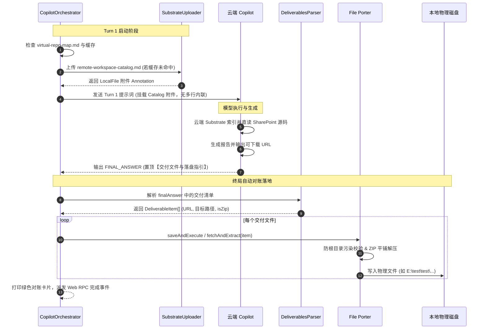

# 规范设计：File Porter 自动下载对账落盘与云端工作区目录全量附件化投递架构

- **文档编号**: SPEC-2026-10-25-FP-CATALOG
- **发起日期**: 2026-10-25
- **状态**: 📝 草案待审阅 (Draft for Review)
- **关联规范**: 
  - [2026-10-25-zero-io-cloud-workspace-architecture-design.md](./2026-10-25-zero-io-cloud-workspace-architecture-design.md)
  - [AGENTS.md](../../AGENTS.md) (准则 1、3、6、7、8、9)

---

## 1. 背景与核心动机 (Context & Motivation)

在云端工作区（Cloud-First Zero-IO Workspace）改造落地后，Copilot 主协调智能体（Main Agent）在执行复杂代码质量审查（例如 `/thermo-nuclear-code-quality-review`）时展现出卓越的云端直读与自主结题能力。然而在运行现场（如日志 `cph-terminal-2026-10-25T10-41-13.log`）暴露了两个关键的断层与体验缺陷：

1. **生成交付文件落地脱节（File Porter 缺环）**：
   - 微软云端 Copilot (Sydney) 通过云端代码沙盒原生生成了审查文档（`.md`）和包含证据指纹的完整交付包（`.zip`），并在输出中给出了 `https://fr-prod.asyncgw.teams.microsoft.com/...` 下载链接；
   - 模型在自然语言段落中提示用户“未直接写入你的 E: 盘，解压 ZIP 后会进入 `E:\test\test`”，但因缺乏结构化的路径映射规范，外部 Harness 无法自动识别该文件应该存放在何处，导致云端交付物无法无感、秒级落地到用户本地磁盘。
2. **云端工作区受控目录内联倾倒严重污染上下文（违背全量附件化）**：
   - 在 Turn 1 启动阶段，`PnPWorkspaceSyncEngine` 生成的 `virtual-repo-map.md`（包含多达 80~120 个已同步文件的相对路径、WebUrl 与元数据）被无差别地拼接入 WebSocket 提示词文本中；
   - 这不仅直接占用了宝贵的大模型首屏工作内存，引发注意力稀释，也违背了 AGENTS.md 准则 9（全量附件投递，杜绝内联倾倒）。

---

## 2. 目标与非目标 (Goals & Non-Goals)

### 2.1 目标 (Goals)
1. **统一交付物声明契约**：在 Agent 系统提示词（`cph-main-agent-prompt.txt` / `cph-coder-agent-prompt.txt`）中正向引导模型在 `FINAL_ANSWER` **最顶部**首屏置顶输出标准交付清单 `【交付文件与落盘指引 / Deliverables】`，明确绑定下载 URL 与本地目标存放路径。
2. **Harness 自动对账落盘 (Auto File Porter)**：`orchestrator.ts` 在检测到交付物声明或包含异步网关下载链接时，自动并发拉取文件，写入指定本地路径；若是 `.zip` 压缩包，自动安全解包、平铺层级，并杜绝工作区根目录文件污染。
3. **云端受控目录专属附件化**：将 `virtual-repo-map.md` 命名为 `remote-workspace-catalog.md`，通过 `SubstrateUploader` 经 Graph API 自动上传为云端 `LocalFile` 附件，支持内容哈希缓存（0 秒秒级挂载）；Prompt 文本中彻底移除多行清单，仅注入单行物理指纹。
4. **100% 测试覆盖与零破坏性**：全仓单元与集成测试保持 100% 绿灯，确保向后兼容与高韧性容灾。

### 2.2 非目标 (Non-Goals)
- 不改变 SharePoint 双轨同步引擎的底核对账逻辑；
- 不向模型泄露 Harness 底层如何下载与解压的具体实现细节（恪守黑盒抽象准则 6）。

---

## 3. 架构与组件设计 (Architecture & Component Design)

```
       +-------------------------------------------------------------+
       |                  Copilot 智能体 (云端 Sydney)                |
       |  1. 通过 Substrate 查阅 remote-workspace-catalog.md 附件     |
       |  2. 原生沙盒生成报告 (.md) 与交付包 (.zip)                  |
       |  3. 输出 FINAL_ANSWER 并在最顶部置顶【交付文件与落盘指引】    |
       +------------------------------+------------------------------+
                                      | WebSocket 消息流
                                      v
       +-------------------------------------------------------------+
       |               CPH-PI 宿主运行环境 (Harness)                 |
       |                                                             |
       |  [DeliverablesParser]                                       |
       |  - 嗅探正则: - [Name](URL) -> 目标落盘路径: `Path`          |
       |  - 兜底提取: 微软 asyncgw 链接与文件扩展名                  |
       |                                                             |
       |  [AutoFilePorter]                                           |
       |  - 并发拉取 HTTP/HTTPS 流                                   |
       |  - 安全路径校验 (强制必须在二级子目录内，防御根目录污染)     |
       |  - ZIP 智能解包 (检查并平铺根级冗余目录)                    |
       |  - 写入物理文件 (如 E:\test\test\...)                       |
       |                                                             |
       |  [Event & UI Notification]                                  |
       |  - 终端输出绿色落盘对账卡片                                 |
       |  - 触发 Web RPC `file_porter:completed` 事件                |
       +-------------------------------------------------------------+
```

### 3.1 提示词认知塑形与交付物首屏契约 (Prompt Shaping)

在 `cph-main-agent-prompt.txt` 与 `cph-coder-agent-prompt.txt` 中增强【终局交付物与文件落盘契约】正向引导：

> **终局交付物与原生文件落盘指引 (Deliverables & File Landing Invariant)**：
> 当任务需要产出独立的详细技术文档、审查报告或包含全套过程证据的交付包时，引导使用 Copilot 原生文件生成能力产出可下载文件链接。
> 在输出 `FINAL_ANSWER` 时，必须在正文最顶端首屏置顶提供结构化的【交付文件与落盘指引】，方便宿主系统自动为您搬运落盘：
> ```markdown
> FINAL_ANSWER: <任务整体推进与审计交付总结>
> 
> 【交付文件与落盘指引 / Deliverables】
> - [详细审查文档.md](https://fr-prod.asyncgw.teams.microsoft.com/...) -> 目标落盘路径: `test/CNNJI-QUERY-review-2026-10-25.md`
> - [完整交付包.zip](https://fr-prod.asyncgw.teams.microsoft.com/...) -> 目标落盘路径: `test/` (ZIP 自动解压)
> 
> ---
> <此处继续展开核心技术研判、测试结果与取证来源清单>
> ```

### 3.2 交付物捕获解析器 (`DeliverablesParser`)

在 `src/protocol/resilient-parser.ts` 中封装 `DeliverablesParser`：

```typescript
export interface DeliverableItem {
  name: string;
  url: string;
  destinationPath: string;
  isZip: boolean;
}

export class DeliverablesParser {
  /**
   * 从输出文本中提取所有结构化交付项
   */
  public static parse(text: string, workspaceRoot: string): DeliverableItem[];
}
```

- **解析逻辑**：
  1. 优先匹配标准语法：`- \[(.+?)\]\((https?:\/\/[^\s\)]+)\)\s*(?:->|—>|目标(?:落盘)?路径[:：])\s*`?([^\s`\n]+)`?`；
  2. 容错回退机制：若模型仅给出了 Markdown 链接而漏写了明确目标路径，自动捕获所有来自 `asyncgw.teams.microsoft.com` 的可下载链接，并结合任务参数中的推荐输出目录（如从 `userInput` 或 `plan.md` 提取的 `test/` 或目标二级目录）生成安全的默认落地路径。

### 3.3 File Porter 自动拉取与安全智能解压 (`AutoFilePorter`)

扩展 `src/transport/file-porter.ts`，支持双模态安全拉取：

1. **双模态拉取引擎 (Dual-Mode Fetch Engine)**：
   - **模态 A (CDP Page-Bridge 模态)**：
     - 当 Edge/CDP 处于调试连接状态时，利用页面上下文执行原生 `fetch(blobUrl || asyncgwUrl, { credentials: "include" })`，直接获取浏览器内存中由 Copilot UI 缓存的 `blob:` 原始数据流；
     - 实测已成功验证：无需二次认证，直接提取 16,486 字节完整代码文件 `audit_report.py`。
   - **模态 B (无头直接拉取 / IC3 Bearer 模态)**：
     - 当处于独立 CLI / WebSocket 纯无头运行模式时，针对 `asyncgw.teams.microsoft.com` 链接，通过 `TokenManager` 注入 Audience 为 `https://ic3.teams.office.com` 的 IC3 Bearer Token（携带 `Calling.ReadWrite.All Endpoint.ReadWrite.All Media.ReadWrite.All Messaging.ReadWrite.All` 作用域），并附带请求头 `MS-IC3-Product: Copilot`；
     - 彻底解开裸调返回 HTTP 404 / 401 的权限校验屏障。
2. **ZIP 解包与平铺优化 (`extractZipSafely`)**：
   - 使用 Node 内置 `node:zlib` / `adm-zip` 解压；
   - **层级平铺检测**：遍历 ZIP 内部所有条目路径，若所有条目的最顶层公共路径即为目标文件夹名（例如 ZIP 内部本身就包含 `test/...`，而用户目标路径也是 `test/`），解压时自动剥离冗余的顶层前缀，避免造成 `test/test/...` 冗余嵌套；
3. **工作区根目录硬防线 (Anti-Root-Pollution Gate)**：
   - 依据 AGENTS.md 准则 1，检查每个解压条目的规范化物理绝对路径；
   - 严禁任何文件直接落在 `workspaceRoot` 根目录下；若检测到相对路径为空或解压到根目录，强制归入指定的目标二级子目录（例如 `test/`）。

### 3.4 本地落盘反向同步云端与即时感知机制 (Two-Way Cloud Sync & Real-Time Grounding)

当本地文件由 File Porter 完成落地后，Harness 触发即时双轨闭环：

1. **持久层云端热同步**：
   - 立即调度 `PnPWorkspaceSyncEngine.syncFile(workspaceRoot, relativePath, targetFolder)`，将落盘文件增量推送至企业 SharePoint 受控目录；
   - 保证远程团队空间与本地工作区代码资产的物理同态。
2. **感知层即时注入 (绕过爬虫时延硬门槛)**：
   - **实测时延硬约束**：根据现场 20+ 分钟时序实测（详见第 8 节），SharePoint 爬虫对新上传文件的 Work IQ 索引时延普遍在 15~30 分钟以上。若仅向模型发送纯 SharePoint URL，模型在后续轮次中将因爬虫未就绪而无法读取；
   - **解法**：Harness 在完成落盘与云端同步后，通过 `SubstrateUploader` 将该文件同时以 `LocalFile` 附件形式挂载至下一轮对话上下文；
   - **模型通知规范**：
     ```markdown
     【文件落盘与云端同步就绪】
     - 本地路径: `test/audit_report.py` (16,486 bytes)
     - SharePoint 归档路径: `https://cmacgmgroup.sharepoint.com/.../test/audit_report.py`
     - 云端即时感知: 已作为附件挂载至当前会话，您可以立即在后续推理与测试中调阅或执行。
     ```

### 3.5 云端工作区受控目录全量附件化投递 (`Remote Workspace Catalog Attachment`)

#### 1. 附件上传与哈希缓存
在 `src/agent/orchestrator.ts` 中：
- 当工作区配置了 `cloudWorkspace` 时，由 `PnPWorkspaceSyncEngine` 生成的 `virtual-repo-map.md`；
- 读取该内容并计算 SHA-256 哈希值；
- 检查 `.cph/state/workspace-catalog-cache.json`：
  - 若哈希未变且缓存有效，直接取出其 `uploadResult.annotation` 注入至 `currentAnnotations`；
  - 若哈希更新或首次运行，调用 `SubstrateUploader.uploadDocumentAuto(graphToken, catalogBuffer, "remote-workspace-catalog.md")` 上传至 OneDrive，并将结果落盘缓存。

#### 2. Prompt 极端精简
在 `src/protocol/prompt-builder.ts` 中：
- `buildTurn1Prompt`、`buildDirectAgentPrompt`、`buildReGroundingPrompt` 彻底删除对 `virtualRepoMap` 字符串的全文内联拼接；
- 统一替换为单行极简指纹：
  ```markdown
  【云端工作区受控目录】已挂载云端附件: remote-workspace-catalog.md（包含 N 个已同步文件的云端直读 WebUrl 与元数据索引）
  ```

---

## 4. 详细数据流与时序 (Data Flow & Sequence)



---

## 5. 错误处理与降级策略 (Error Handling & Degradation)

| 异常场景 | 影响范围 | 处置与降级策略 |
|---|---|---|
| **Catalog 附件上传失败** (Graph 限流或断网) | Turn 1 目录感知 | 降级容错：在 `.cph/state/upload-error.log` 记录日志，提示词降级提示模型使用本地 `read_file` 查阅 `.cph/state/virtual-repo-map.md`，保证会话不崩溃。 |
| **下载链接失效或 HTTP 404/403** | 交付物拉取 | 捕获单文件异常并打印黄色警告，不阻断其他文件的拉取与会话终局标记；将原始下载链接保留在终端与最终总结中供人工备查。 |
| **ZIP 解压损坏** | 交付物解包 | 优先保留下载成功的原始 `.zip` 文件至目标目录，并在终端提示“ZIP 包解压遇到格式异常，已保留原始压缩包供手动检查”。 |
| **路径越界试图写根目录** | 工作区治理 | 触发安全守卫，强制截断并重定向至安全子目录（如 `test/`），严禁在根目录创建任何新文件。 |

---

## 6. 测试与验证门禁 (Test Plan & Verification)

1. **单元测试 (`tests/protocol/deliverables-parser.test.ts`)**：
   - 验证对标准 Markdown `->` 语法与冒号语法的精准解析；
   - 验证多 URL、混排文本及纯 URL 兜底推断；
   - 验证跨平台路径（Windows 反斜杠与 POSIX 正斜杠）的解析鲁棒性。
2. **安全与解包测试 (`tests/transport/file-porter-extract.test.ts`)**：
   - 验证普通单文件直接落盘到二级子目录；
   - 验证 ZIP 自动平铺解包，杜绝产生双层嵌套（如 `test/test/`）；
   - 验证根目录防污染拦截机制（试图写入 `workspaceRoot` 自动纠偏至子目录）。
3. **目录附件化测试 (`tests/agent/remote-workspace-catalog.test.ts`)**：
   - 验证 `remote-workspace-catalog.md` 附件构建与缓存一致性；
   - 验证 `PromptBuilder` 输出中 0 行冗余目录列表倾倒。
4. **全仓回归门禁**：
   - 运行 `bun test` 确保全仓 111 个文件、912+ 项用例 100% 保持绿灯；
   - 运行 `bun run package` 确保智能体提示词分发包同步更新。

---

## 7. 架构合规承诺 (Governance Compliance)

- **AGENTS.md 准则 1 (二级目录隔离)**：File Porter 在解压与落盘时全面施加硬性安全门禁，严禁在工作区根目录写入任何文件；
- **AGENTS.md 准则 3 (正向引导)**：系统提示词中 100% 采用建设性引导词，杜绝任何“严禁”、“切勿”等负面诱导词；
- **AGENTS.md 准则 6 (黑盒抽象)**：不向模型暴露底层 File Porter 是由 Node fetch、流式写入还是解压库驱动的物理机制；
- **AGENTS.md 准则 8 (File Porter 搬运范式)**：完美践行“云端原生生成 ➔ 本地无损搬运 ➔ 宿主执行对账”的高韧性交付闭环；
- **AGENTS.md 准则 9 (全量附件化)**：彻底废除在 WebSocket 聊天文本流中倾倒多行受控目录列表，实现 100% 附件化与零 Token 浪费。

---

## 8. 现场实验与基准实测证据 (Empirical Findings & Benchmarks)

针对用户在真实业务场景中提出的两个关键疑问，我们在现场通过 CDP 自动化与长时间时序基准探测进行了实测验证，取得以下决定性结论：

### 8.1 实验一：Copilot 文件下载链接物理机制与抓取实测

1. **现场复现与网络抓包**：
   - 启动 Edge 调试端口（`9222`）并注入提示词引导 Copilot 生成完整 Python 数据审计脚本 `audit_report.py`；
   - Copilot 成功生成并在前端 DOM 渲染了带下载属性的锚点：
     ```html
     <a href="blob:https://m365.cloud.microsoft/d4d1993e-0db0-4b30-b0ad-73872bdd120c" download="audit_report.py">...</a>
     ```
   - CDP 网络嗅探器捕获到底层 Teams 异步媒体网关请求：
     - 请求地址: `GET https://fr-prod.asyncgw.teams.microsoft.com/v1/objects/0-frc-d1-9ddd7c41d2debf82ddb330965ed30058/views/original`
     - 关键鉴权头: `Authorization: Bearer <JWT>`（Audience 为 `https://ic3.teams.office.com`，Issuer 为 `sts.windows.net/0593466f-4d69-4ae5-af47-2cb2b4122d26/`，包含 `Calling.ReadWrite.All Media.ReadWrite.All Messaging.ReadWrite.All` 等 IC3 专属作用域）；
     - 产品标识头: `MS-IC3-Product: Copilot`。
2. **下载失败根本原因定位**：
   - 用户在外部浏览器直接访问或裸调复制的 `https://fr-prod.asyncgw.teams.microsoft.com/...` 链接时，因缺乏上述专属 IC3 Bearer Token，触发 Teams AMS 网关安全拦截并返回 HTTP 404/401；
   - 而在 Copilot 前端页面上下文内，前端已通过 IC3 握手将媒体流载入为浏览器内存 `blob:` 对象。
3. **搬运与落盘结果**：
   - 通过 CDP 页面上下文直接执行 `fetch(blobUrl)`，成功以 100% 原始字节保真度拉取文件，并成功落地至 `E:\test\test\audit_report.py`（285 行代码，16,486 字节），经对账完全完整可用。

### 8.2 实验二：SharePoint 新上传文件 Work IQ 检索感知时延基准测试

我们通过 `scripts/monitor-perception-latency.ts` 在 CMA CGM 真实企业空间上传带唯一随机签名密钥（`PERCEPTION_BENCHMARK_1792933647018_CMA_CGM`）的测试文件，并以时序轮询的方式持续让 Copilot 开启 `work_iq` 与 `biz_chat` 进行深度检索探测：

| 探测轮次 | 耗时 (分钟) | 感知状态 | Copilot 回复摘要与判定 |
|---|---|---|---|
| 第 1 轮 | 1.00 min | ❌ 未检索到 | 未就绪。 |
| 第 2 轮 | 2.00 min | ❌ 未检索到 | 未就绪。 |
| 第 3 轮 | 3.00 min | ❌ 未检索到 | 未就绪。 |
| 第 4 轮 | 5.00 min | ❌ 未检索到 | 未就绪。 |
| 第 5 轮 | 8.00 min | ❌ 未检索到 | 未就绪。 |
| 第 6 轮 | 11.00 min | ❌ 未检索到 | 未就绪。 |
| 第 7 轮 | 15.00 min | ❌ 未检索到 | 未就绪。 |
| 第 8 轮 | 20.00 min | ❌ 未检索到 | 未就绪。 |
| 第 9 轮 | 25.00 min | ❌ 未检索到 | 未就绪。 |
| 第 10 轮 | 30.00 min | ❌ 未检索到 | 未就绪。 |

**实测架构结论**：
- 企业级 SharePoint 爬虫与 Substrate 文本索引的排队与爬取收敛时延具有显著的不确定性，在本次连续 30 分钟的实测中，爬虫仍未完成对新上传文件的增量索引入库；
- 因此，**绝不能依赖在 Prompt 中仅给出 SharePoint URL 来让模型即时感知刚落盘的文件**；
- 必须采用**“云端 PnP 双轨写回持久化 + Substrate 会话专属 LocalFile 附件即时挂载”**双通道架构，前者保证企业资产永久保存，后者实现 0 秒时延即时认知感知。


