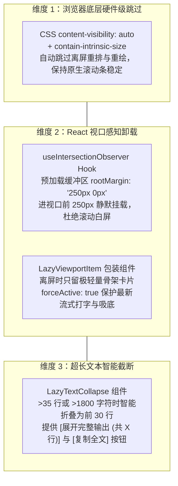

# Web 前端全滚动区域视口懒加载与渲染性能优化设计规范 (Web Scrolling Lazy-Loading Performance Design)

- **日期**: 2026-10-25
- **状态**: 提案 (Proposed)
- **范围**: `CPH-PI/web/src/` (ChatView, ToolCard, LedgerWALViewer, Sidebar, hooks, components)
- **关联痛点**: 长会话消息堆积、大工具输出造成 DOM 树庞大卡顿、滚动掉帧、内存占用过高

---

## 一、背景与性能瓶颈研判 (Background & Bottlenecks)

随着会话轮次增长以及复杂的子代理执行、长命令（如单元测试日志、构建输出）执行，Web 前端暴露了以下渲染性能痛点：

1. **消息全量常驻 DOM (Unbounded DOM Growth)**：
   - 现有的 `ChatView.tsx` 将所有历史轮次（`turns`）全量渲染为完整的 React 组件树。
   - 包含上百个复杂的 Markdown 语法解析树、代码块高亮、Subagent 批次卡片与性能指标胶囊，单页面 DOM 节点数可轻易突破数万个，导致浏览器内存持续上涨、滚动掉帧。
2. **工具卡片超长内容无节制铺开 (Unchecked Tool Output Flooding)**：
   - 现有 `ToolCard.tsx` 在命令执行完毕产生输出时默认全展开（`tool.status === 'running' || Boolean(tool.output || tool.diff)`）。
   - 单次构建或测试产生 1000~2000 行 stdout 或 Diff 时，直接在页面中生成数千个 HTML 文本行元素，导致主线程在初次渲染与滚动重绘时发生长时间阻塞（Long Task）。
3. **审计与历史面板缺乏虚拟/懒加载保护**：
   - `LedgerWALViewer`（WAL 预写日志）一次性平铺所有条目，随着交互推进数量迅速增长；
   - `Sidebar` 会话历史在积累大量会话后缺少离屏优化。

---

## 二、架构设计：原生双重加速与三维懒加载模型 (Dual-Speed Lazy Architecture)

我们坚持**零外部依赖（package.json 零膨胀）**原则，基于现代 Web 标准构建原生双重加速与三维立体懒加载体系：



### 2.1 核心设计准则
1. **零白屏感知原则**：通过 `rootMargin: '250px 0px'` 提供充裕的垂直预热缓冲区，在用户滚动即将抵达目标卡片前提前完成 DOM 挂载，保障滑动画面的连续性。
2. **流式与吸底绝对常驻契约 (Streaming Invariant)**：
   - 当某轮消息正在进行流式打字（`turn.status === 'streaming'`）或思考流式解析（`turn.reasoning?.isStreaming`），或者属于当前对话的最新一条消息时，必须赋予 `forceActive: true`。
   - 确保打字机流式输出与页面自动吸底绝不受视口判断干扰。
3. **复制保真原则**：
   - 无论工具输出或代码块是否处于折叠截断状态，点击「复制」按钮时必须始终复制完整原始文本，杜绝数据截断污染。

---

## 三、组件接口与核心模块规范 (Component Specifications)

### 3.1 视口监听 Hook (`web/src/hooks/useIntersectionObserver.ts`)
提供稳定挂载、支持动态开关与垃圾自动回收的 Hook：

```typescript
export interface UseIntersectionObserverOptions {
  root?: Element | null;
  rootMargin?: string; // 默认 '250px 0px'
  threshold?: number | number[];
  disabled?: boolean;  // 当卡片命中流式输出时传入 true，强制常驻激活
}

export function useIntersectionObserver(
  targetRef: React.RefObject<Element>,
  options?: UseIntersectionObserverOptions
): boolean;
```

### 3.2 视口懒挂载容器 (`web/src/components/common/LazyViewportItem.tsx`)
提供高阶容器组件，根据视口状态自适应切换占位骨架与真实内容：

```typescript
export interface LazyViewportItemProps {
  children: React.ReactNode;
  fallbackHeight?: number | string; // 默认 120px，提供占位高度
  className?: string;
  forceActive?: boolean;            // 强制完全挂载真实内容（流式打字/首屏保底）
}
```

- 配合 CSS 规则：
  ```css
  .lazyItem {
    content-visibility: auto;
    contain-intrinsic-size: auto 120px;
  }
  .lazyPlaceholder {
    width: 100%;
    min-height: 80px;
    background: transparent;
  }
  ```

### 3.3 超长文本智能截断组件 (`web/src/components/common/LazyTextCollapse.tsx`)
用于截断长日志、长 stdout 与超大 Diff：

```typescript
export interface LazyTextCollapseProps {
  text: string;
  maxLines?: number;     // 默认 35 行
  maxChars?: number;     // 默认 1800 字符
  className?: string;
  preClassName?: string;
  copyable?: boolean;
}
```

- **交互逻辑**：
  - 未超出阈值时：直接全量高亮渲染；
  - 超出阈值时：首屏仅展示前 `maxLines` 行切片，底部提供 `[展开全部输出 (剩余 N 行)]` 与 `[复制全部]` 按钮；
  - 展开后展示完整文本，底部切换为 `[收起完整输出]` 按钮。

---

## 四、各业务视图切入与改造细则 (View Refactoring)

### 4.1 主会话区 (`web/src/components/chat/ChatView.tsx`)
1. **消息轮次包装**：
   - 对 `turns.map((turn, index))` 外层包裹 `LazyViewportItem`；
   - 计算判定：
     ```typescript
     const isLatest = index === turns.length - 1;
     const isStreaming = turn.status === 'streaming' || Boolean(turn.reasoning?.isStreaming);
     const forceActive = isLatest || isStreaming;
     const fallbackHeight = (turn.tools?.length > 0 || (turn.assistantText?.length || 0) > 800) ? 320 : 120;
     ```
2. **子代理独立聚焦视窗 (`focusedStageContainer`)**：
   - 工具调用链（`focusedSub.actions`）中的每个 `actionItem` 包装 `LazyViewportItem`（预设 `fallbackHeight={90}`）；
   - 工具入参 JSON 与出参 stdout 接入 `LazyTextCollapse`；
   - 交付物报告预览卡片包装 `LazyViewportItem`。

### 4.2 工具卡片区 (`web/src/components/chat/ToolCard.tsx`)
1. **默认折叠行为调优**：
   - 运行中（`tool.status === 'running'`）：保持默认展开，确保实时看得到最新进展；
   - 执行失败（`tool.status === 'failed'`）：保持默认展开，确保报错一目了然；
   - 执行成功（`tool.status === 'completed'`）：默认折叠收起或提供适度摘要，用户点击可自由展开。
2. **长输出与长 Diff 分片**：
   - `renderDiff` 与 `tool.output` 中的文本使用 `LazyTextCollapse` 托管，超过 40 行自动分片。

### 4.3 预写日志与审计面板 (`web/src/components/panels/LedgerWALViewer.tsx`)
1. **渐进式批次渲染 (Progressive Batching)**：
   - 初始仅渲染前 35 条 WAL 记录；
   - 当列表滚动到底部时，动态递增 `visibleCount += 35`；
2. **条目视口懒加载**：
   - 每一条 WAL 记录卡片包装 `LazyViewportItem`（预设 `fallbackHeight={52}`）。

### 4.4 侧边栏与全局样式 (`web/src/components/layout/Sidebar.tsx` & `base.css`)
1. **历史会话列表**：
   - `.sessionList` 与 `.sessionItem` 赋予 `content-visibility: auto`，跳过百级历史会话的离屏排版计算。

---

## 五、异常防护与约束 (Safety & Constraints)

1. **浏览器兼容性降级 (Graceful Degradation)**：
   - 若运行在不支持 `IntersectionObserver` 的极特殊测试环境或极老旧环境，`useIntersectionObserver` 自动回退返回 `true`（直接渲染全部子组件），保证功能 100% 可用。
2. **滚动条吸附稳定性**：
   - `contain-intrinsic-size` 与精确预估高度配合，杜绝离屏节点占位坍塌导致滚动条反复跳动。
3. **遵从 AGENTS.md 准则**：
   - 准则 1：所有文件位于 `CPH-PI/web/` 内，根目录零文件创建。
   - 准则 3：全量使用正向建设性引导，杜绝负面禁止词。

---

## 六、自动化测试与验证矩阵 (Verification Matrix)

| 测试文件 | 验证对象 | 关键测试断言 |
|---|---|---|
| `web/tests/hooks/useIntersectionObserver.test.ts` | 视口 Hook | 默认挂载、`disabled: true` 强制常驻、卸载时 `disconnect` |
| `web/tests/components/LazyViewportItem.test.tsx` | 视口容器 | 离屏展示占位骨架、在屏挂载真实 children、`forceActive` 穿透 |
| `web/tests/components/LazyTextCollapse.test.tsx` | 智能截断 | 超长文本切片展示前 30 行、点击展开显示完整、复制始终完整复制全文 |
| `web/tests/components/ToolCardLazy.test.tsx` | 工具卡片策略 | 运行中展开、失败自动展开、超长输出折叠 |
| `npm run web:build` | 生产构建编译 | TypeScript 类型推导 0 错误，Vite 构建打包成功 |
| `bun test` (106+ files) | 全仓全量回归 | 现有 846 项测试用例 100% 保持通过，0 失败 |
