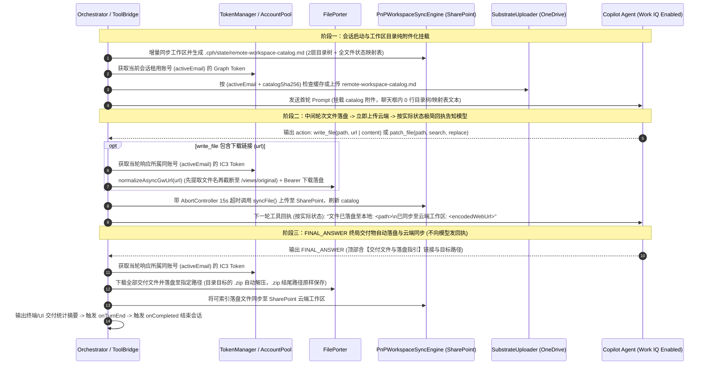

# 云端文件无头搬运（IC3 File Porter）、落盘即同步回执与工作区目录纯附件化架构设计规范

- **文档编号**: SPEC-2026-10-26-CLOUD-PORTER-CATALOG
- **制定日期**: 2026-10-26
- **状态**: Approved (v2 — 已融合独立代码审计 8 项工程修正)
- **适用工程**: `CPH-PI` 及工作区根级治理规范 `AGENTS.md`
- **干净代码基线**: Commit `30d22da` (`perf(sync): cache CSOM folder lookups, persist targetFolder, and filter Library build dirs`)

---

## 1. 背景与动机 (Context & Motivation)

在 `E:\test` 工作区的真实审查运行（日志 `cph-terminal-2026-10-25T10-41-13.log`）中，Copilot 主控智能体在 2 轮内高效产出了审查报告与证据包。但在交付与上下文挂载环节暴露出以下核心问题：

1. **模型输出的下载链接缺少落盘路径映射与无头下载支撑**：
   - 模型在输出中直接给出了两个 `https://fr-prod.asyncgw.teams.microsoft.com/...` 下载链接（`.md` 审查报告与 `.zip` 证据包），但未结构化声明这些文件应存放在本地工作区的哪个路径下；
   - 用户在 Web 前端直接复制该链接无法在浏览器中直接下载，Harness 侧需要具备不依赖浏览器前端、直接下载这些链接并落盘到指定路径的能力。
2. **工作区目录内容被直接拼入聊天框（违背全量附件化准则）**：
   - 启动会话与跨会话接力时，目录结构树（`dirTree` / `dirSkeleton`）与云端文件 URL 映射表（`virtual-repo-map.md`）被直接内联拼接到聊天框文本中，占用首屏上下文且违背 `AGENTS.md` 准则 9（全量附件投递，杜绝内联倾倒）。
3. **本地落盘文件需即时同步云端并建立清晰的模型告知闭环**：
   - 无论是中间轮次落盘的文件还是终局交付落盘的文件，在写入本地磁盘后都应立即触发 SharePoint 云端工作区同步；
   - 在中间轮次落盘并同步后，需按实际同步状态简洁明确地告知模型该文件的本地路径与云端 URL（`FINAL_ANSWER` 终局落盘则直接完成同步并结束会话，无需再向模型发回执，但对用户侧可见交付摘要）；
   - 同时需在 `AGENTS.md` 中固化 **Work IQ 企业数据访问调用规范** 与 **Harness 功能与系统提示词双向协同登记规范**。

---

## 2. 现场实测结论与工程边界 (Empirical Findings & Engineering Boundaries)

在设计本方案前，我们通过两组真实线上实验探明了底层行为边界：

### 2.1 实验一：Copilot `asyncgw` 下载链接无头拉取机制实测

针对 `cph-terminal-2026-10-25T10-41-13.log` 产出的两个真实链接（`CNNJI-QUERY-review-2026-10-25.md` 与 `CNNJI-QUERY-review-package-2026-10-25.zip`）对池内 6 个账号进行完整遍历实测（无 early return），得出以下结论：

1. **前端直接复制链接无法下载的双重原因**：
   - **URL 尾部文件名导致 404**：模型输出的链接形如 `https://fr-prod.asyncgw.teams.microsoft.com/v1/objects/<objectId>/views/original/<filename>`。Teams 异步媒体网关（AMS）的真实对象视图端点止于 `/views/original`；若保留尾部的 `/<filename>`，即使携带合法 Token 也会返回 `HTTP 404`。
   - **同账号 IC3 专属鉴权校验**：AMS 网关要求请求头携带 `Authorization: Bearer <IC3_Access_Token>`（OAuth2 Scope 为 `openid profile offline_access https://ic3.teams.office.com/.default`），且校验对象归属权——生成该文件的同一个 M365 账号（`GSC.VFU2@cma-cgm.com`）请求 `/views/original` 返回 `200 OK`；池内其余 5 个账号请求同一对象均返回 `403 Forbidden`，无头裸请求返回 `401/404`。
2. **Harness 无头直连下载实测结果**：
   - 使用当前会话账号的 `refreshToken` 换取 `https://ic3.teams.office.com/.default` Token，并将 URL 规范化截取至 `/views/original`（截断前先提取尾部 `<filename>` 并保留 query 参数）后，纯 Node/Bun `fetch` 在 ~900ms 内完成原始字节流下载：
     - `CNNJI-QUERY-review-2026-10-25.md`：`200 OK`，`24,006 bytes`；
     - `CNNJI-QUERY-review-package-2026-10-25.zip`：`200 OK`，`405,336 bytes`（内含 `test/` 下完整报告及 19 份取证文件）。

### 2.2 实验二：SharePoint 新上传文件直接给路径 URL 的感知时延实测

在启用完整 Work IQ 配置（`customAgentId` 企业智能体模式、`cwc_flux_v3` 等检索选项集、`conversationId/sessionId/requestId` 完整 UUID 三元组 + `isStartOfSession: true`、`%20` URL 编码路径）后，上传全新探针文件 `test/direct-url-latency-exact-1792946218578.md` 并进行秒级时序探测：

| 距上传完成时间 (`T+`) | 单轮查询耗时 | 感知状态 | 实测输出摘要 |
|---|---|---|---|
| `T + 0.0s ~ T + 180.0s` | `12.5s ~ 18.5s` | ❌ 未检索到 | `NOT_READY` |
| **`T + 240.0s` (4.0 min)** | `14.6s` | **✅ 成功感知** | `EXACT_LATENCY_SECRET_1792946218578_VERIFIED`（带 `turn1search1` 引用） |

- **观测结论与工程推论**：
  - 新上传至 SharePoint 的文件在 `(180s, 240s]` 区间内建立检索索引；
  - 回执无需向模型解释底层索引时延细节，只需如实告知模型文件的本地落盘路径与实际云端同步状态/URL；
  - 在系统提示词中确立简洁正向的**“以云端文件优先、本地文件（`read_file`）为辅”**读取方式（删除旧提示词中“云端检索到的文件保证为最新的权威版本”这一绝对化表述）：优先通过云端 SharePoint URL 检索阅读；当云端暂未检索到刚创建的文件、需要核对刚修改的代码或需要精确行号上下文时，调用 `read_file` 读取本地文件。

---

## 3. Git 干净基线还原方案 (Clean Baseline Restoration)

在上一轮撤回的尝试中，Git 分支 `feat/unified-supercharger-execution` 上仍残留了 `9363948..b62a037` 共 10 个提交，同时工作区存在未提交的有效改动（`src/skills/skill-registry.ts`、`src/web/rpc-handler.ts`、`src/session/session-manager.ts`、`web/src/*`）。

**可执行还原步骤（作为实施计划 Task 1 第一步执行）**：
1. **建立安全备份标签/分支**：在当前状态创建轻量备份分支 `git branch backup/pre-v2-clean-restore`，确保任何工作树状态可随时回溯；
2. **分类还原 `9363948..b62a037` 残留文件**：
   - 針對该区间被修改的 porter/catalog 相关源码与提示词文件（`src/agent/orchestrator.ts`、`src/transport/file-porter.ts`、`src/protocol/prompt-builder.ts`、`src/protocol/resilient-parser.ts`、`src/workspace/pnp-sync-engine.ts`、`cph-main-agent-prompt.txt`、`cph-coder-agent-prompt.txt`、`tests/protocol/prompt-builder.test.ts`、`tests/skills/tri-agent-prompts.test.ts`），使用 `git checkout 30d22da -- <file>` 恢复至 `30d22da` 基线；
   - 删除该区间残留的新增文件（`src/protocol/deliverables-parser.ts`、`tests/agent/orchestrator-file-porter-sync.test.ts`、`tests/agent/remote-workspace-catalog.test.ts`、`tests/protocol/deliverables-parser.test.ts`、`tests/transport/file-porter-extract.test.ts`）；
   - **明确保留项**：保留 `package.json`（含 `web`/`web:dev`/`web:build` 脚本与 `adm-zip`/`@types/adm-zip` 依赖）、保留 `.gitmodules` 当前状态、完整保留 `src/skills/skill-registry.ts`、`src/web/rpc-handler.ts`、`src/session/session-manager.ts`、`src/agent/subagent-runner.ts`、`web/src/*` 等未提交有效改动。
3. **验证基线测试**：运行 `bun test` 确认回到干净基线状态。

---

## 4. 根级 `AGENTS.md` 治理准则增补设计 (Governance Rules 10 & 11)

在工作区根目录 `e:\copilot-web proxy\AGENTS.md` 的「核心开发与治理准则」末尾新增第 10、11 条准则：

### 准则 10：启用 Work IQ 与企业内部数据访问硬性规范 (Mandatory Work IQ & Enterprise Data Grounding)
- **10a. ChatHub 企业接地不变量**：调用 Copilot 访问企业内部数据（SharePoint / OneDrive / 企业知识库）时，`ChatHubClient` 必须满足：
  1. **挂载企业智能体标识 (`customAgentId`)**：传入目标自定义智能体 ID（如 `DEFAULT_MAIN_AGENT_ID` 或 `DEFAULT_CODER_AGENT_ID`），使连接 URL 启用 `agent=Agent&agentHost=Bizchat.FullScreen&gptId=<id>@MOS3` 并在载荷中注入 `threadLevelGptId` 与 `gpts` 描述；
  2. **保持企业检索选项集 (`optionsSets`)**：载荷 `optionsSets` 必须包含 `"cwc_flux_v3"`、`"flux_v3_references"`、`"flux_v3_references_entities"`、`"flux_v3_references_ci"`、`"cwc_fileupload_odb"`、`"add_filestore_filetype"`（调用方不得覆盖丢弃默认数组）；
  3. **完整 UUID 三元组与首轮标记**：显式传入合法的 `conversationId`、`sessionId`、`requestId`（UUID v4），并在会话第 1 轮设置 `isStartOfSession: true`。
- **10b. IC3 异步媒体网关下载不变量**：下载 Copilot 生成的 `asyncgw.teams.microsoft.com` 产物时，必须使用生成该响应的同一 M365 账号换取 `https://ic3.teams.office.com/.default` Bearer Token，并校验目标域名白名单。
- **10c. SharePoint URL 路径分段编码**：向模型提供 SharePoint 路径或 WebUrl 时，所有包含空格或特殊字符的路径段必须统一通过 `encodeUrlPathSegments` 进行 `%20` URL 编码，并消除 `/sites/<name>` 重复前缀。
- **演进基线**：后续所有功能开发、提示词调优与实测脚本均必须在启用上述 Work IQ 配置的基础上进行。

### 准则 11：Harness 功能与系统提示词双向协同与登记准则 (Harness-Prompt Co-Design & Registration Invariant)
- **能力与认知同步闭环**：凡是在 Harness 侧新增或调整需要模型配合或感知的功能（包括工具参数扩展、云端目录附件挂载、文件下载链接自动落盘、本地文件写后自动同步云端及回执提示格式），**必须在系统提示词（`cph-main-agent-prompt.txt` 与 `cph-coder-agent-prompt.txt`）中同步完成正向引导、格式登记与用法介绍**，并通过打包脚本更新智能体分发包與自动化契约测试。
- **杜绝脱节演进**：确保 Harness 的每一项模型可见能力在系统提示词中都有清晰对应的正向行动指南，且系统提示词中引导的每一种输出格式在 Harness 中都有精确的解析与执行保障。

---

## 5. 核心架构与模块详细设计 (Architecture & Component Design)



### 5.1 组件一：同账号 IC3 鉴权与 `asyncgw` 安全无头下载器 (`TokenManager` / `AccountPool` / `FilePorter`)

1. **`TokenManager` & `AccountPool` 新增 IC3 Token 与同账号 Graph Token 接口**：
   - 在 `src/auth/token-manager.ts` 中新增常量与方法：
     ```typescript
     export const IC3_SCOPE =
       "openid profile offline_access https://ic3.teams.office.com/.default";
     ```
     - `public async getIc3AccessToken(email: string, forceRefresh = false): Promise<string>`：
       使用公共客户端 `refresh_token` 换取 IC3 Token，按 `email.toLowerCase()` 缓存（提前 5 分钟刷新）。
   - 在 `src/auth/account-pool.ts` 中新增 `getIc3AccessToken(email?: string): Promise<string>`，并确保 `getGraphAccessToken(email?: string)` 在传入 `email` 时严格使用该账号（不传时才遍历池内账号）。

2. **`FilePorter` URL 规范化、域名白名单、无头下载与路径/ZIP 语义处理 (`src/transport/file-porter.ts`)**：
   - **`normalizeAsyncGwUrl(rawUrl: string): { fetchUrl: string; fileNameFromUrl: string | null }`**：
     - 精确校验主机名后缀（`*.asyncgw.teams.microsoft.com`）；
     - 匹配路径 `^/v1/objects/([^/]+)/views/original(?:/(.+))?$`；
     - **先提取尾部文件名**：若存在 `m[2]`，解码提取 `fileNameFromUrl = decodeURIComponent(m[2].split("/").pop()!)`；
     - **再规范化路径并保留 query**：将 `u.pathname` 设为 `/v1/objects/${m[1]}/views/original`（保留 `u.search`），返回 `{ fetchUrl: u.toString(), fileNameFromUrl }`。
   - **`fetchFileBuffer(url: string, options?: { ic3Token?: string; cdpClient?: any; maxBytes?: number })`**：
     - **安全边界（防 SSRF 与超大流）**：仅允许 `https:`（或测试注入的本地 mock 地址）及受信任主机（`*.asyncgw.teams.microsoft.com`、`*.sharepoint.com`、`*.microsoft.com`），拒绝内网元数据地址（`169.254.169.254`）；限制最大下载体积默认 `100MB`；
     - 若为 `asyncgw.teams.microsoft.com` 链接：调用 `normalizeAsyncGwUrl(url)`，携带请求头 `{ Authorization: "Bearer <ic3Token>", "MS-IC3-Product": "Copilot" }` 拉取；若截断 URL 返回 404，自动用原始 URL fallback 重试一次。
   - **目标路径解析与 `.zip` 语义落盘 (`deliverToWorkspace`)**：
     - **二级目录防污染（`AGENTS.md` 准则 1）**：拒绝 `..` 路径穿越；若目标路径直接位于 `workspaceRoot` 根目录（如裸文件名 `report.md`），自动归入合规二级子目录（若工作区存在 `test/` 目录则归入 `test/`，否则归入 `deliverables/`）。
     - **目录目标的文件名选择**：当目标路径为目录（以 `/` 结尾）时，文件名优先取 `fileNameFromUrl`，其次取净化后的 `item.name`。
     - **按路径语义处理 `.zip`（修复 P1-13）**：
       - **情况 A（目标路径以 `.zip` 结尾，如 `test/package.zip`）**：**原样保存该 `.zip` 文件**，不解压，返回 `landedPaths: ["test/package.zip"]`；
       - **情况 B（文件是 `.zip` 且目标路径为目录，如 `test/`）**：使用 `adm-zip` 安全解压至目标目录（校验条目数 `≤ 2000`、解压总字节数 `≤ 200MB`、拒绝 `..` 路径穿越）；若 ZIP 内部所有条目均带有与目标目录同名的唯一顶层目录前缀（如目标为 `test/` 且所有条目以 `test/` 开头），自动剥离该层前缀避免产生 `test/test/`，返回所有解压出的文件相对路径 `landedPaths`。
     - **永不自动执行**：所有通过 `deliverToWorkspace` 或 `write_file(url)` 落盘的文件仅做磁盘写入，**绝不自动执行脚本**；同时将 `saveAndExecute` 的默认 `autoExecute` 改为 `false`。

### 5.2 组件二：解析器优先级修正、双时机触发、云端同步与如实回执 (`ResilientParser` / `DeliverablesParser` / `Orchestrator`)

1. **修正 `ResilientParser.parse()` 优先级与 2c 误劫持（修复 P0-1）**：
   - 在 `src/protocol/resilient-parser.ts` 中：
     - 若代码块显式标记为 ```` ```markdown:FINAL_ANSWER ```` 或 ```` ```FINAL_ANSWER ````，或者文本包含 `FINAL_ANSWER:` / `ALL_TASKS_COMPLETED` / `【已完成交付】` 且不包含合法的 `tool` 动作块时，优先进入 `final_answer` 分支，防止被通用 ```` ``` ```` 代码块分支当作 action 解析；
     - 在 2c 分支中，仅对显式带 `download=` 属性的 HTML `<a>` 标签或 `blob:` 链接生效，且默认 `autoExecute: false`；**不再将普通 `https://` Markdown 链接劫持为 `file_porter` action**。

2. **`DeliverablesParser` 严格语法解析（修复 P1-14 / P1-15）**：
   - 解析 `FINAL_ANSWER`（或响应文本）中的结构化交付行：
     `- [<显示名>](<url>) -> 目标落盘路径: \`<destinationPath>\``（分隔符仅接受箭头 `->`/`—>`/`–>`/`-->`/`=>`/`→`/`➔` 或显式关键字 `目标落盘路径:` / `落盘路径:` / `Target:`，拒绝普通说明文字中的裸冒号 `:`）；
   - `isZip` 仅根据 URL pathname/query 中的 `.zip` 后缀或 `destinationPath` 的 `.zip` 后缀判定，不根据中文描述词误判。

3. **中间轮次 `write_file(path, url)` 拦截与落盘同步回执**：
   - 在 `Orchestrator` 执行 `action` 时：
     - 若 `parsed.action.tool === "write_file"` 且带有非空的 `url`（或 `downloadUrl`）：在调用 `ToolBridge` 之前直接由 `Orchestrator` 拦截，获取当前会话 `currentEmail = (client as any)?.token?.email`，调用 `acquireIc3Token(currentEmail)` 与 `FilePorter.deliverToWorkspace()` 完成下载落盘，得到 `landedPaths`；
     - 若为常规 `write_file(path, content)` 或 `patch_file` / `edit`：由 `ToolBridge.executeAction()` 完成本地写入，得到修改的相对路径 `landedPaths = [cleanRel]`。
   - **带 `AbortController` 超时的云端同步与如实回执（修复 P0-4 / P0-6 / P1-1）**：
     - 通过 `PnPWorkspaceSyncEngine.resolveCloudTarget(this.workspaceRoot)` 解析当前工作区的 `{ siteUrl, targetFolder }`（仅读取工作区 `.cph/config.json` 或 `.cph/state/sync-manifest.json`，**绝不静默回退到个人 `DEFAULT_TARGET_FOLDER`**）；
     - 对 `landedPaths` 中的每个文件：
       - 若为不可索引二进制文件（如原样保存的 `.zip`），不调用 SharePoint 索引同步，回执如实输出：`文件已落盘至本地: <relPath>`；
       - 若为可同步文件，使用 `AbortController`（15s 超时触发 `syncAbort.abort()` 真正 kill PowerShell 子进程）调用 `engine.syncFile()`；
       - 根据 `syncRes.status` 生成回执：
         - 当 `status === "synced" || status === "skipped"` 时，使用 `PnPWorkspaceSyncEngine.buildSharePointWebUrl(siteUrl, targetFolder, relPath)`（消除双 `/sites/` 并分段 `%20` 编码）构造 URL，输出：
           ```text
           文件已落盘至本地: <relPath>
           已同步至云端工作区: <cloudWebUrl>
           ```
         - 当同步超时或失败时，如实输出：
           ```text
           文件已落盘至本地: <relPath> (云端同步未完成，如需读取请使用 read_file)
           ```
     - 每轮动作结束后最多调用一次 `PnPWorkspaceSyncEngine.generateCatalogMarkdown()` 刷新本地目录文件（避免多文件解压时重复生成 $O(N^2)$）。

4. **终局 `FINAL_ANSWER` 严格执行顺序与用户可见交付状态（修复 P1-3 / P1-4）**：
   - 在 `parsed.type === "final_answer"` 分支中，严格按以下顺序执行：
     1. 调用 `DeliverablesParser.parse(finalAnswer, this.workspaceRoot)` 提取交付项；
     2. 若存在交付项，获取当前会话 `currentEmail` 的 `ic3Token`，逐项调用 `FilePorter.deliverToWorkspace()` 落盘；
     3. 对落盘的可索引文本/代码文件调用 `syncFile()` 同步至 SharePoint，最后刷新一次 `remote-workspace-catalog.md`；
     4. 将交付结果统计写入 `.cph/state/delivery-report.json` 并在终端输出清晰的落盘/同步统计卡片（同时在 `OrchestratorRunResult` 中附加可选字段 `deliveryStatus?: "ok" | "partial" | "failed"` 与 `landedDeliverables?: string[]`）；
     5. **不向模型发送任何回执**，按序触发 `events?.onTurnEnd?.(turn, turnResponseText)` ➔ `events?.onCompleted?.(finalAnswer)` 并返回结果。

### 5.3 组件三：工作区目录 100% 附件化挂载与跨账号隔离 (`PnPWorkspaceSyncEngine` / `PromptBuilder` / `Orchestrator` / `SubagentRunner` / `main-plan-snapshot.ts`)

1. **`generateCatalogMarkdown` 包含真正的 2 层目录树 + 全工作区文件状态（修复 P0-5 / P0-6）**：
   - 生成 `.cph/state/remote-workspace-catalog.md`，包含：
     - **第 1 节：工作区 2 层目录结构树 (`## 1. 工作区目录结构 (Directory Skeleton)`)**：扫描工作区物理目录（排除 `.git`、`.cph`、`node_modules`、`dist`）生成清晰的 2 层目录树；
     - **第 2 节：文件本地路径与云端 SharePoint URL 映射表 (`## 2. 文件映射清单 (File Mapping Index)`)**：合并工作区本地文件（含 `Library/`）与 `sync-manifest.json`：
       - 已同步可索引文件：展示 `本地相对路径 | 云端 SharePoint WebUrl (%20 编码且无重复 /sites/) | 体积 | [CLOUD-READY]`（若距首次上传不足 300s 标注 `[LOCAL-NEW]`）；
       - 本地未同步或二进制文件（如 `.zip`）：展示 `本地相对路径 | — | 体积 | [LOCAL-ONLY]`，确保删掉内联 `dirTree` 后模型依然能完整看到工作区内的所有文件。

2. **全生命周期同账号附件挂载与缓存隔离（修复 P0-3 / P1-5 / P1-6）**：
   - `Orchestrator.acquireGraphToken(email?: string)` 支持传入当前会话租用的 `email`（默认取 `(client as any)?.token?.email`），调用 `this.pool.getGraphAccessToken(email)` 获取**同一个 M365 账号**的 Graph Token；
   - `.cph/state/workspace-catalog-cache.json` 与 `workspace-snapshot-cache.json` 统一按 `entries[email.toLowerCase()] = { hash, uploadResult, updatedAt }` 分账号存储（旧版无 `entries` 结构的缓存自动视为未命中并覆盖升级）；
   - **覆盖三个关键节点**：
     1. **主控会话 Turn 1**：按主会话当前账号 `email` 上传/复用 `remote-workspace-catalog.md` 附件并加入 `currentAnnotations`；
     2. **429 限流换号 / 空响应换号**：当切换至新账号 `nextToken.email` 时，若处于首轮或携带了旧账号的 `currentAnnotations`，立即用 `nextToken.email` 重新挂载目录附件替换旧账号 annotation；
     3. **后继主会话接力（`generation++`，`turn = 0`）与子代理会话（`SubagentRunner`）**：
        - 后继主会话切换至 `nextToken.email` 后，在进入新会话 Turn 1 前调用 `mountWorkspaceCatalogAttachment(nextToken.email)` 注入 `currentAnnotations`；
        - `SubagentRunner` 调用 `this.pool.getGraphAccessToken(subagentAccount)`（传入子代理实际租用的 `subagentAccount`），且 `Orchestrator` 将 `remote-workspace-catalog.md` 附件与 `options.initialAnnotations`（子代理微切片附件）**合并追加去重**，绝不相互覆盖。

3. **彻底清除聊天框内联目录树与映射表文本**：
   - `PromptBuilder`（`buildDirectAgentPrompt`、`buildTurn1Prompt`、`buildHandshakePrompt`、`buildReGroundingPrompt`）与 `main-plan-snapshot.ts`（`formatSuccessorTurn1Prompt`）全部移除 `dirSkeleton` / `dirTree` / `virtualRepoMap` 的多行目录拼接；
   - 当目录附件成功挂载时，聊天框内仅保留一行极简提示：
     `【云端工作区目录】已通过文件附件挂载: remote-workspace-catalog.md（含工作区目录结构树与全量文件本地路径/云端 SharePoint WebUrl 映射表）`
   - 若因网络异常导致目录附件上传失败，降级保留 2 层精简目录树并提示使用 `read_file`，不谎报“已挂载”。

### 5.4 组件四：系统提示词双向协同升级 (`cph-main-agent-prompt.txt` & `cph-coder-agent-prompt.txt`)

严格遵循 `AGENTS.md` 准则 3（正向引导）、准则 6（黑盒抽象）、准则 11（双向协同登记）：

1. **读取规则（云端优先、本地为辅）**：
   - 说明首轮已挂载 `remote-workspace-catalog.md` 附件（含工作区 2 层目录结构树与全量文件的本地相对路径、云端 SharePoint WebUrl）；
   - 引导模型阅读文件时**以云端文件优先、本地文件（`read_file`）为辅**：优先通过云端 SharePoint WebUrl 检索阅读；当文件在云端暂未检索到（如刚新建或仅本地文件）、需要核对本会话刚修改的最新内容、或需要精确行号上下文时，调用 `read_file` 读取对应的本地路径（移除旧版“云端检索到的文件保证为最新的权威版本”表述）。
2. **文件生成、落盘路径指定与云端同步回执登记**：
   - **中间轮次**：在 `action` 工具块协议中正式登记 `write_file` 支持 `url` 参数：
     `{ "tool": "write_file", "path": "相对路径", "url": "云端生成文件的下载链接 (与 content 二选一)" }`；
     说明每次 `write_file` 或 `patch_file` 落盘后，系统会自动同步可索引文件至云端工作区，并在工具回执中告知本地落盘路径与云端 URL。
   - **终局 `FINAL_ANSWER`**：引导模型在产出独立报告、文档或代码文件下载链接时，优先直接生成具体单文件链接，并在 `FINAL_ANSWER` 最顶部通过 `【交付文件与落盘指引 / Deliverables】`（格式：`- [文件名](下载链接) -> 目标落盘路径: \`<相对路径>\``）指明存放路径，由系统自动下载落盘并同步至云端。

---

## 6. 测试与验证计划 (Testing & Verification Plan)

1. **单元与集成测试套件**：
   - `tests/auth/ic3-token.test.ts`：验证 `TokenManager.getIc3AccessToken` 与 `AccountPool.getIc3AccessToken(email)` / `getGraphAccessToken(email)` 的同账号绑定、缓存命中与刷新逻辑；
   - `tests/protocol/deliverables-parser.test.ts`：验证 `FINAL_ANSWER` 交付清单解析、箭头与关键字分隔符（拒绝裸冒号说明文字）、相对路径规范化、二级目录防污染重定向、按 `.zip` 扩展名准确判定 `isZip`；
   - `tests/protocol/resilient-parser-precedence.test.ts`：验证 `FINAL_ANSWER`（含 ```` ```markdown:FINAL_ANSWER ````）优先于通用代码块与 2c 分支，普通 `https://` Markdown 链接不被误劫持为 `file_porter` 且不自动执行脚本；
   - `tests/transport/file-porter.test.ts`：使用本地 HTTP 测试服务验证 `normalizeAsyncGwUrl`（先提取文件名、保留 query、再截断至 `/views/original`）、域名白名单与 SSRF 拦截、携带 IC3 Bearer Header 下载、`.zip` 结尾路径原样保存 vs 目录路径自动去重解压；
   - `tests/agent/catalog-attachment-and-porter.test.ts`：验证① `generateCatalogMarkdown` 包含 2 层目录树与 `[CLOUD-READY]` / `[LOCAL-ONLY]` 全文件列表，且 `buildSharePointWebUrl` 无重复 `/sites/`；② 主会话、429 换号、后继接力会话、子代理会话均按同账号挂载 `remote-workspace-catalog.md` 且聊天框内 0 行目录树/映射表文本；③ 中间轮次 `write_file(path, url)` 与 `patch_file` 落盘后按实际同步状态返回极简回执；④ `FINAL_ANSWER` 按序完成落盘同步、生成 `delivery-report.json` 且不向模型发回执。
2. **全仓回归与打包验证**：
   - 运行 `bun test` 验证新增测试全部通过且相对基线无新增失败；
   - 运行 `bun run package` 同步更新 `package/agent-bundle/` 下的提示词与分发包。
