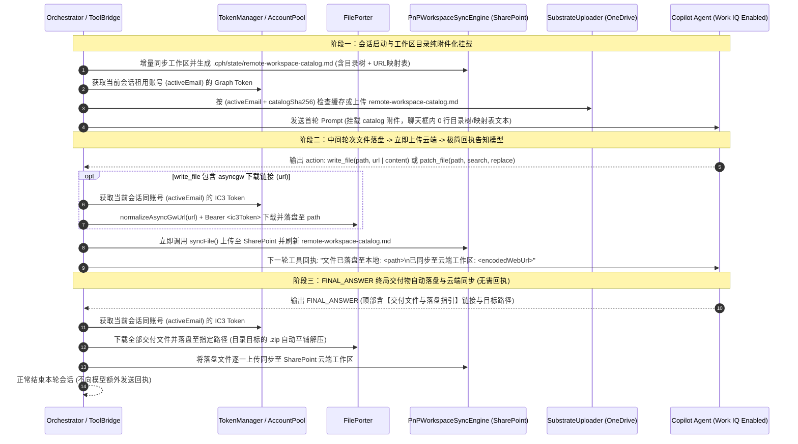

# 云端文件无头搬运（IC3 File Porter）、落盘即同步回执与工作区目录纯附件化架构设计规范

- **文档编号**: SPEC-2026-10-26-CLOUD-PORTER-CATALOG
- **制定日期**: 2026-10-26
- **状态**: Draft for User Review
- **适用工程**: `CPH-PI` 及工作区根级治理规范 `AGENTS.md`
- **干净代码基线**: Commit `30d22da` (`perf(sync): cache CSOM folder lookups, persist targetFolder, and filter Library build dirs`)

---

## 1. 背景与动机 (Context & Motivation)

在 `E:\test` 工作区的真实审查运行（日志 `cph-terminal-2026-10-25T10-41-13.log`）中，基于 SharePoint 云端工作区的改造展现出极高的推理效率：Copilot 主控智能体在 2 轮内直接精读完云端项目源码并生成了高质量审查报告与证据包。但在交付与上下文挂载环节暴露出以下核心问题：

1. **模型输出的下载链接缺少落盘路径映射与无头下载支撑**：
   - 模型在输出中直接给出了两个 `https://fr-prod.asyncgw.teams.microsoft.com/...` 下载链接（`.md` 审查报告与 `.zip` 证据包），但未结构化声明这些文件应存放在本地工作区的哪个路径下；
   - 用户在 Web 前端直接复制该链接无法在浏览器中直接下载，Harness 侧也需要具备不依赖浏览器前端、直接下载这些链接并落盘到指定路径的能力。
2. **工作区目录内容被直接拼入聊天框（违背全量附件化准则）**：
   - 启动会话与跨会话接力时，目录结构树（`dirTree` / `dirSkeleton`）与云端文件 URL 映射表（`virtual-repo-map.md`）被直接内联拼接到聊天框文本中，占用首屏上下文且违背 `AGENTS.md` 准则 9（全量附件投递，杜绝内联倾倒）。
3. **本地落盘文件需即时同步云端并建立清晰的模型告知闭环**：
   - 无论是中间轮次落盘的文件还是终局交付落盘的文件，在写入本地磁盘后都必须立即上传同步至 SharePoint 云端工作区；
   - 在中间轮次落盘并同步后，需简洁明确地告知模型该文件的本地路径与云端 URL（`FINAL_ANSWER` 终局落盘则直接完成同步并结束会话，无需再发回执）；
   - 同时需在 `AGENTS.md` 中固化 **Work IQ 企业数据访问调用规范** 与 **Harness 功能与系统提示词双向协同登记规范**。

---

## 2. 现场实测结论与物理定律基线 (Empirical Findings & Physical Laws)

在设计本方案前，我们通过两组真实线上实验探明了底层物理边界：

### 2.1 实验一：Copilot `asyncgw` 下载链接无头拉取机制实测

针对 `cph-terminal-2026-10-25T10-41-13.log` 产出的两个真实链接（`CNNJI-QUERY-review-2026-10-25.md` 与 `CNNJI-QUERY-review-package-2026-10-25.zip`）进行多账号、多鉴权头实测，得出以下结论：

1. **前端直接复制链接无法下载的双重原因**：
   - **URL 尾部文件名导致 404**：模型输出的链接形如 `https://fr-prod.asyncgw.teams.microsoft.com/v1/objects/<objectId>/views/original/<filename>`。Teams 异步媒体网关（AMS）的真实对象视图端点止于 `/views/original`；若保留尾部的 `/<filename>`，即使携带合法 Token 也会返回 `HTTP 404`。
   - **同账号 IC3 专属鉴权校验**：AMS 网关要求请求头携带 `Authorization: Bearer <IC3_Access_Token>`（OAuth2 Scope 为 `openid profile offline_access https://ic3.teams.office.com/.default`），且**严苛校验对象归属权**——唯有生成该文件的同一个 M365 账号（如 `GSC.VFU2@cma-cgm.com`）请求时返回 `200 OK`；池内其他账号请求同一链接均返回 `403 Forbidden`，无头裸请求返回 `401/404`。
2. **Harness 无头直连下载实测结果**：
   - 使用会话所属账号的 `refreshToken` 换取 `https://ic3.teams.office.com/.default` Token，并将 URL 规范化截取至 `/views/original` 后，纯 Node/Bun `fetch` 在 ~900ms 内完成 100% 原始字节流下载：
     - `CNNJI-QUERY-review-2026-10-25.md`：`200 OK`，`24,006 bytes`；
     - `CNNJI-QUERY-review-package-2026-10-25.zip`：`200 OK`，`405,336 bytes`（内含 `test/` 下完整报告及 19 份取证文件）。

### 2.2 实验二：SharePoint 新上传文件直接给路径 URL 的最短感知时延实测

在补齐 Work IQ 四要素（`customAgentId` 企业智能体模式、`cwc_flux_v3` 等检索选项集、`conversationId/sessionId/requestId` 完整 UUID 三元组 + `isStartOfSession: true`、`%20` URL 编码路径）后，上传全新探针文件 `test/direct-url-latency-exact-1792946218578.md` 并进行秒级时序探测：

| 距上传完成时间 (`T+`) | 单轮查询耗时 | 感知状态 | 实测输出摘要 |
|---|---|---|---|
| `T + 0.0s` | `15.6s` | ❌ 未检索到 | `NOT_READY` |
| `T + 17.9s` | `18.5s` | ❌ 未检索到 | `NOT_READY` |
| `T + 36.4s` | `12.5s` | ❌ 未检索到 | `NOT_READY` |
| `T + 60.0s` | `12.9s` | ❌ 未检索到 | `NOT_READY` |
| `T + 90.0s` | `13.0s` | ❌ 未检索到 | `NOT_READY` |
| `T + 120.0s` | `14.1s` | ❌ 未检索到 | `NOT_READY` |
| `T + 180.0s` | `15.2s` | ❌ 未检索到 | `NOT_READY` |
| **`T + 240.0s` (4.0 min)** | `14.6s` | **✅ 成功感知** | `EXACT_LATENCY_SECRET_1792946218578_VERIFIED`（带 `turn1search1` 引用） |

- **新建文件（Cold Create）**：上传至 SharePoint 后直接提供路径 URL，Copilot 最短在 **`T + 240s`（约 3~4 分钟）** 即可通过企业搜索直接感知并读取全文。
- **存量文件覆写（Hot Overwrite）**：已在 SharePoint 建立索引的文件通过 `SaveBinaryDirect` 原地覆盖后，感知时延为 **`T + 0.0s`（0 秒瞬时读取最新内容）**。
- **工程设计推论**：回执无需向模型解释底层索引时延细节，只需告知模型“文件已落盘至本地路径并已同步至云端 URL”，并在系统提示词中确立**“以云端文件优先、本地文件（`read_file`）为辅”**的读取方式，模型在云端暂未读到新文件时自然会回退使用 `read_file` 读取本地文件。

---

## 3. Git 干净基线还原方案 (Clean Baseline Restoration)

在上一轮不满意的尝试中，虽然删除了工作区的 spec/plan 文档，但 Git 分支 `feat/unified-supercharger-execution` 上仍残留了 `9363948..b62a037` 共 10 个提交（涉及 `orchestrator.ts`、`file-porter.ts`、`deliverables-parser.ts`、`prompt-builder.ts`、`pnp-sync-engine.ts` 等）。与此同时，工作区存在未提交的有效改动（`src/skills/skill-registry.ts` 内置技能免附件唤醒、`src/web/rpc-handler.ts`、`src/session/session-manager.ts`、`web/src/*`）。

**还原步骤（作为实施计划 Task 1 第一步执行）**：
1. 暂存/保护当前工作区中属于 `30d22da` 之后未提交的有效改动（`skill-registry.ts`、`rpc-handler.ts`、`session-manager.ts`、`subagent-runner.ts`、`web/src/*` 等）；
2. 将 `9363948..b62a037` 期间修改或新增的文件精准恢复至 `30d22da` 基线状态，删除该区间残留的新增源码与测试文件（如旧版 `src/protocol/deliverables-parser.ts`、`tests/agent/orchestrator-file-porter-sync.test.ts`、`tests/agent/remote-workspace-catalog.test.ts`、`tests/protocol/deliverables-parser.test.ts`、`tests/transport/file-porter-extract.test.ts`）；
3. 验证仓库回到干净的 `30d22da` + 有效工作区改动基线后，再开始本次全新实现。

---

## 4. 根级 `AGENTS.md` 治理准则增补设计 (Governance Rules 10 & 11)

在工作区根目录 `e:\copilot-web proxy\AGENTS.md` 的「核心开发与治理准则」末尾新增第 10、11 条准则：

### 准则 10：启用 Work IQ 与企业内部数据访问硬性规范 (Mandatory Work IQ & Enterprise Data Grounding)
- **Work IQ 四要素硬性契约**：任何需要让 Copilot 模型访问企业内部数据（SharePoint / OneDrive / 企业知识库）的功能实现、脚本调用与自动化测试，必须在 `ChatHubClient` 通信中同时满足以下四项条件：
  1. **挂载企业智能体标识 (`customAgentId`)**：传入目标自定义智能体 ID（如 `DEFAULT_MAIN_AGENT_ID` 或 `DEFAULT_CODER_AGENT_ID`），使连接 URL 启用 `agent=Agent&agentHost=Bizchat.FullScreen&gptId=<id>@MOS3` 并在载荷中注入 `threadLevelGptId` 与 `gpts` 描述（缺省时退化为 `agent=web` 纯公网模式，无法访问任何企业内部数据）；
  2. **开启企业检索选项集 (`optionsSets`)**：载荷 `optionsSets` 必须包含 `"cwc_flux_v3"`、`"flux_v3_references"`、`"flux_v3_references_entities"`、`"flux_v3_references_ci"`、`"cwc_fileupload_odb"`、`"add_filestore_filetype"`；
  3. **完整 UUID 三元组与会话首轮标记**：必须显式传入合法的 `conversationId`、`sessionId`、`requestId`（UUID v4），并在会话第 1 轮显式设置 `isStartOfSession: true`；
  4. **SharePoint URL 路径分段编码**：向模型提供 SharePoint 路径或 WebUrl 时，所有包含空格或特殊字符的路径段必须执行 `%20` URL 编码（`encodeUrlPathSegments`），防止空格截断链接。
- **演进与验证基线**：后续所有功能开发、提示词调优与实测脚本均必须在启用上述 Work IQ 配置的基础上进行。

### 准则 11：Harness 功能与系统提示词双向协同与登记准则 (Harness-Prompt Co-Design & Registration Invariant)
- **能力与认知同步闭环**：凡是在 Harness 侧新增或调整需要模型配合或感知的功能（包括但不限于：工具参数扩展、云端目录附件挂载、文件下载链接自动落盘、本地文件写后自动同步云端及回执提示格式），**必须在系统提示词（`cph-main-agent-prompt.txt` 与 `cph-coder-agent-prompt.txt`）中同步做好正向引导、格式登记与用法介绍**，并通过打包脚本更新智能体分发包。
- **杜绝脱节演进**：确保 Harness 的每一项能力在系统提示词中都有清晰对应的正向行动指南，且系统提示词中引导的每一种输出格式在 Harness 中都有精确的解析与执行保障。

---

## 5. 核心架构与模块详细设计 (Architecture & Component Design)



### 5.1 组件一：同账号 IC3 鉴权与 `asyncgw` 无头下载器 (`TokenManager` / `AccountPool` / `FilePorter`)

1. **`TokenManager` & `AccountPool` 新增 IC3 Token 获取接口**：
   - 在 `src/auth/token-manager.ts` 中新增常量与方法：
     ```typescript
     export const IC3_SCOPE =
       "openid profile offline_access https://ic3.teams.office.com/.default";
     ```
     - `public async getIc3AccessToken(email: string, forceRefresh = false): Promise<string>`：
       使用与 `getGraphAccessToken` 相同的 Azure AD v2.0 `refresh_token` 换取流程（不带 `Origin` 头，避免触发 SPA 跨域限制 `AADSTS9002326`），按 `email.toLowerCase()` 缓存 Token（提前 5 分钟刷新）。
   - 在 `src/auth/account-pool.ts` 中暴露 `getIc3AccessToken(email?: string): Promise<string>`，优先使用传入的当前会话 `email`。

2. **`FilePorter` URL 规范化、无头下载与路径/ZIP 处理 (`src/transport/file-porter.ts`)**：
   - **`normalizeAsyncGwUrl(rawUrl: string): string`**：
     - 匹配 `^https?:\/\/[^/]*asyncgw\.teams\.microsoft\.com\/v1\/objects\/[^/]+\/views\/original`；
     - 若 URL 在 `/views/original` 后附带了 `/<filename>`（如 `/views/original/CNNJI-QUERY-review-2026-10-25.md`），自动截取到 `/views/original`，消除 404 错误。
   - **`fetchFileBuffer(url: string, options?: { ic3Token?: string; cdpClient?: any }): Promise<Buffer>`**：
     - 若为 `asyncgw.teams.microsoft.com` 链接：首先 normalize URL，附带请求头 `{ Authorization: "Bearer <ic3Token>", "MS-IC3-Product": "Copilot" }` 直接通过 `fetch` 拉取二进制 `Buffer`；
     - 若为 `blob:` 链接且提供了 `cdpClient`：通过页面上下文拉取；
     - 其他标准 `http/https` 链接直接 `fetch` 拉取。
   - **目标路径解析与 `.zip` 语义落盘 (`downloadToWorkspace`)**：
     - 遵循 `AGENTS.md` 准则 1（二级目录防线）：规范化相对路径，拒绝 `..` 路径穿越；若目标路径直接落入 `workspaceRoot` 根目录（如裸文件名 `report.md`），自动归入安全的二级子目录（优先使用任务上下文子目录或 `test/<filename>`）。
     - **按路径语义处理 `.zip`**：
       - 若文件为 `.zip` 且目标路径以 `.zip` 结尾（如 `test/package.zip`）：原样保存该 `.zip` 文件，返回 `landedPaths: ["test/package.zip"]`；
       - 若文件为 `.zip` 且目标路径为目录（如 `test/` 或不带 `.zip` 后缀的目录路径）：使用 `adm-zip` 安全解压至目标目录；若 ZIP 内部所有条目均带有与目标目录同名的顶层前缀（如目标目录为 `test/`，ZIP 内条目均为 `test/xxx`），自动剥离一层冗余前缀防止产生 `test/test/xxx`，返回所有解压落盘文件的相对路径列表 `landedPaths`。
       - 非 `.zip` 普通文件：若目标路径为目录（以 `/` 结尾），拼接链接文件名保存；若目标路径为完整文件路径，直接保存至该文件路径，返回 `landedPaths: [relPath]`。

### 5.2 组件二：双时机触发（中间轮次 `write_file` + 终局 `FINAL_ANSWER`）、云端热同步与极简回执 (`ToolBridge` / `DeliverablesParser` / `Orchestrator`)

1. **中间轮次 `write_file` 原生支持 `url` 下载落盘**：
   - 在 `CopilotAction` 类型（`src/protocol/tool-bridge.ts`）中为 `write_file` 增加可选字段 `url?: string`（兼容别名 `downloadUrl?: string`）。
   - 在 `Orchestrator` 执行 `action` 分支时：
     - 若 `parsed.action.tool === "write_file"` 且存在非空的 `url` / `downloadUrl`：
       1. 获取当前会话正在使用的账号邮箱 `currentEmail = (client as any)?.token?.email`；
       2. 通过 `acquireIc3Token(currentEmail)` 获取同账号 `ic3Token`；
       3. 调用 `FilePorter.downloadToWorkspace({ url, destinationPath: parsed.action.path, workspaceRoot: this.workspaceRoot, ic3Token, cdpClient })` 将远程文件下载并落盘；
       4. 将 `landedPaths` 纳入写后云端同步队列。
     - 若为常规 `write_file(path, content)` 或 `patch_file` / `edit`：由 `ToolBridge.executeAction()` 完成本地写入，将修改的文件相对路径纳入写后云端同步队列。

2. **落盘后立即上传至 SharePoint 并生成极简回执（仅限中间轮次）**：
   - 针对上述中间轮次落盘的每一个相对路径 `relPath`（排除 `.cph/`、`.git/`）：
     - 若工作区已配置 SharePoint 同步清单（`.cph/state/sync-manifest.json` 存在且含 `targetFolder`），立即调用 `PnPWorkspaceSyncEngine.syncFile(this.workspaceRoot, relPath, targetFolder, { siteUrl, signal })`（带 15s 超时保护），并刷新 `.cph/state/remote-workspace-catalog.md`；
     - 构造该文件经 `%20` URL 编码后的完整云端地址：
       `const cloudWebUrl = "${siteUrl}/${encodeUrlPathSegments(targetFolder)}/${encodeUrlPathSegments(relPath)}"`；
     - 在返回给模型的 `toolResult.output` 中附加**极简回执**（不解释底层爬虫或时延细节）：
       ```text
       文件已落盘至本地: <relPath>
       已同步至云端工作区: <cloudWebUrl>
       ```

3. **终局 `FINAL_ANSWER` 自动下载落盘与云端同步（无回执）**：
   - 在 `src/protocol/deliverables-parser.ts` 中实现 `DeliverablesParser.parse(text, workspaceRoot)`：
     - 解析 `FINAL_ANSWER` 顶部的结构化声明行：
       `- [<文件名>](<url>) -> 目标落盘路径: `<destinationPath>``（兼容 `->`、`→`、`➔`、`:` 等常见分隔符）；
     - 兜底兼容：若模型在 `FINAL_ANSWER` 中给出了 `asyncgw.teams.microsoft.com` 链接但未写箭头路径，尝试从同一行或相邻上下文提取目标子目录，默认安全落入 `test/<filename>`。
   - 在 `Orchestrator` 的 `parsed.type === "final_answer"` 分支中：
     - 提取全部交付项，使用当前会话同账号 `ic3Token` 调用 `FilePorter.downloadToWorkspace()` 完成本地落盘；
     - 对所有 `landedPaths` 中可索引的文本/代码文件逐一调用 `PnPWorkspaceSyncEngine.syncFile()` 同步至 SharePoint 并刷新 `remote-workspace-catalog.md`；
     - **不生成、不发送任何回执给模型**，直接触发 `onCompleted` 并返回 `OrchestratorRunResult`。

### 5.3 组件三：工作区目录 100% 附件化挂载与聊天框零目录倾倒 (`PnPWorkspaceSyncEngine` / `PromptBuilder` / `Orchestrator` / `main-plan-snapshot.ts`)

1. **生成包含“目录结构树 + 云端 URL 映射表”的统一目录文件 (`remote-workspace-catalog.md`)**：
   - 在 `PnPWorkspaceSyncEngine.generateCatalogMarkdown(workspaceRoot, options)` 中生成 `.cph/state/remote-workspace-catalog.md`，包含：
     - **第 1 节：工作区受控目录结构树 (Directory Skeleton)**：2 层精简目录结构；
     - **第 2 节：文件本地路径与云端 SharePoint URL 映射表 (File Mapping Index)**：列出每个文件的 `本地相对路径 | 云端 SharePoint WebUrl (%20 编码) | 体积`。

2. **同账号绑定上传与缓存 (`mountWorkspaceCatalogAttachment`)**：
   - 在 `Orchestrator` 中封装私有方法 `mountWorkspaceCatalogAttachment(activeEmail?: string, signal?: AbortSignal): Promise<AttachmentAnnotation | undefined>`：
     - 读取 `.cph/state/remote-workspace-catalog.md` 并计算 `catalogSha256`；
     - 检查缓存文件 `.cph/state/workspace-catalog-cache.json`（按 `entries[emailKey]` 存储 `{ catalogHash, uploadResult, updatedAt }`），**必须同时匹配当前会话账号 `emailKey` 与 `catalogSha256`** 才复用缓存的 `annotation`（避免跨账号切换时 B 账号无法读取 A 账号个人 OneDrive 附件）；
     - 若未命中缓存，调用 `acquireGraphToken(activeEmail)` 获取当前会话同账号的 Graph Token，通过 `SubstrateUploader.uploadDocumentAuto(graphToken, catalogBuffer, "remote-workspace-catalog.md", signal)` 上传并写入缓存。
   - **全生命周期覆盖**：
     - 主控会话 Turn 1 启动前调用并注入 `currentAnnotations`；
     - `SubagentRunner` 创建子代理 `Orchestrator` 时自动在 Turn 1 挂载；
     - 主控会话派发子代理后唤醒后继主会话（`generation++`，重置 `turn = 0`）时，同样为后继主会话的 Turn 1 重新调用 `mountWorkspaceCatalogAttachment(nextAccountEmail)` 注入 `currentAnnotations`。

3. **彻底清除聊天框内联目录文本**：
   - **`src/protocol/prompt-builder.ts`**：
     - `buildDirectAgentPrompt`、`buildTurn1Prompt`、`buildHandshakePrompt`、`buildReGroundingPrompt` 全部移除 `dirSkeleton` / `dirTree` / `virtualRepoMap` 的多行目录拼接；
     - 当存在目录附件时，仅在 Prompt 中输出单行提示：
       `【云端工作区目录】已通过文件附件挂载: remote-workspace-catalog.md（包含工作区目录结构树与全量文件本地相对路径/云端 SharePoint WebUrl 映射表）`
   - **`src/session/main-plan-snapshot.ts`**：
     - `formatSuccessorTurn1Prompt` 移除 `【工作区受控目录骨架 (2-Level Skeleton)】` 与 `virtualRepoMap` 全文拼接，替换为上述单行挂载提示。

### 5.4 组件四：系统提示词双向协同升级 (`cph-main-agent-prompt.txt` & `cph-coder-agent-prompt.txt`)

严格遵循 `AGENTS.md` 准则 3（正向引导，无负面禁用词）、准则 6（黑盒抽象）、准则 11（Harness 功能与提示词双向登记）：

1. **工作区目录附件与“云端优先、本地为辅”读取引导**：
   - 说明首轮已挂载 `remote-workspace-catalog.md` 附件（含工作区目录结构树与每个文件的本地相对路径、云端 SharePoint WebUrl）；
   - 引导模型阅读文件时**以云端文件优先、本地文件为辅**：优先通过云端 SharePoint WebUrl 直接检索阅读；当某个文件在云端暂未检索到或需要核对局部精确行上下文时，使用 `read_file` 读取对应的本地路径。
2. **文件生成、落盘路径指定与云端同步告知登记**：
   - **中间轮次**：登记 `write_file` 工具支持 `{ "tool": "write_file", "path": "<目标相对路径>", "url": "<云端生成文件的下载链接>" }`（以及常规 `content` 写入）；说明每次 `write_file` 或 `patch_file` 落盘后，系统会自动将其同步至云端工作区并在工具回执中返回本地路径与最新云端 URL；
   - **终局 `FINAL_ANSWER`**：引导模型在产出独立报告或代码文件链接时，优先直接生成具体单文件链接，并在 `FINAL_ANSWER` 最顶部通过 `【交付文件与落盘指引 / Deliverables】`（格式：`- [文件名](下载链接) -> 目标落盘路径: \`<相对路径>\``）指明存放路径，由系统自动下载落盘并同步至云端。
3. **打包同步**：
   - 运行 `bun run scripts/package-agent-bundle.ts` 同步更新 `package/agent-bundle/` 下的提示词与 `copilot-agent-bundle.zip`。

---

## 6. 错误处理与边界防护 (Error Handling & Edge Cases)

1. **二级目录防污染门禁（`AGENTS.md` 准则 1）**：
   - 无论模型给出的目标路径是裸文件名（如 `review.md`）还是指向工作区根目录，解析器与 `FilePorter` 均自动将其归入合规二级子目录（如用户任务指定的子目录或 `test/review.md`），确保工作区根目录零文件污染。
2. **下载或云端同步异常容错**：
   - 若中间轮次 `write_file(path, url)` 下载失败，工具回执明确返回错误状态码与原因，引导模型重试或改用直接写入；
   - 若本地落盘成功但 SharePoint 实时同步超时（>15s），本地文件完整保留，回执仅告知 `文件已落盘至本地: <relPath>` 并记录待同步队列，不阻断主流程。
3. **多账号切换下的附件隔离**：
   - `workspace-catalog-cache.json` 按账号邮箱分桶缓存 OneDrive `LocalFile` Annotation；一旦发生 429 换号或跨代接力换号，自动使用新账号的 Graph Token 上传并挂载目录附件。

---

## 7. 测试与验证计划 (Testing & Verification Plan)

1. **单元测试**：
   - `tests/auth/ic3-token.test.ts`：验证 `TokenManager.getIc3AccessToken` 的 Scope 请求参数、缓存命中与强制刷新逻辑；
   - `tests/protocol/deliverables-parser.test.ts`：验证 `FINAL_ANSWER` 顶部交付清单解析、相对/绝对路径规范化、根目录防污染重定向与 `.zip` 识别；
   - `tests/transport/file-porter.test.ts`：验证 `normalizeAsyncGwUrl` 剥离 `/views/original/<filename>` 后缀、携带 IC3 Bearer Header 下载、按路径语义区分保存 `.zip` 与平铺解压 `.zip`；
   - `tests/agent/catalog-attachment-and-porter.test.ts`：验证①首轮与后继接力会话均按当前账号挂载 `remote-workspace-catalog.md` 附件且 Prompt 内 0 行目录树/映射表内联文本；②中间轮次 `write_file(path, url)` 与 `patch_file` 落盘后自动触发 SharePoint 同步并返回极简回执；③ `FINAL_ANSWER` 自动落盘同步且不产生额外回执。
2. **真实链接落盘验收**：
   - 使用本次实验一中的两个真实 `asyncgw` 链接驱动 `DeliverablesParser` + `FilePorter`，验证自动下载落盘与解压结果 100% 完整。
3. **全仓回归与打包验证**：
   - 运行 `bun test` 确保全仓测试 100% 绿灯；
   - 运行 `bun run package` 更新智能体提示词分发包。
